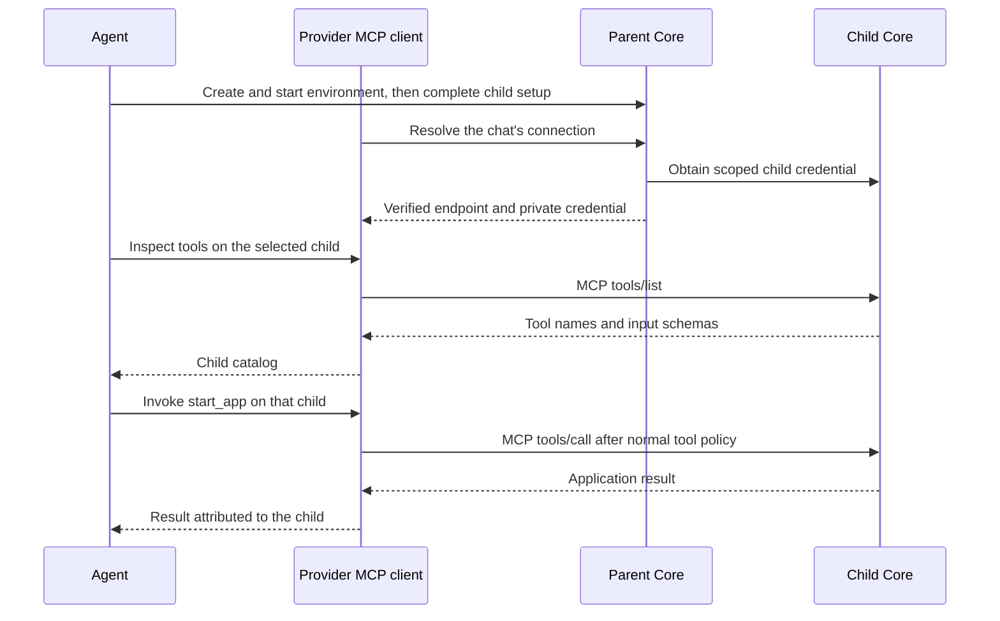

# Connect agents to a child Core MCP server

## Goal

An agent working on Media Server starts a test Core, finishes normal child account setup
and sees the child as a separate MCP connection in the same chat. It can read the child's
tool catalog and invoke an ordinary tool such as `start_app` there during the current turn.
The parent can have its own installation of Media Server. Starting the test copy changes
only the child. The connection can invoke tools that the child exposes and authorizes
and that the provider's tool policy permits. For initial installation from an existing
manifest, use the child's ordinary installation and browser review.

## Current behavior

Each Core serves its own `/api/mcp`. The [agent directory](feature.md) and
[provider interface](../agent-provider-interface/feature.md) select the admitting Core or
an installed application's declared MCP endpoint. The current selection cannot name another
Core instance. The provider already mediates native MCP calls and per-tool decisions.
The child has a separate account database. The parent-side
[environment tools](../external-development-workspaces/feature.md#canonical-environment-publication-and-work-lifecycle)
provide normal child setup or login through `environment_setup` and scoped JSON API calls
through `environment_api`. Native agents still need a way to discover and invoke the
child's MCP tools directly.

A Claude Code run can reconfigure its MCP servers. Ollama discovers tools between model
iterations. The current Codex adapter can replace its MCP server configuration only when
its native thread is idle. A design that requires replacing that configuration as soon as
the agent creates the child would strand an active Codex turn.

## Connection and call path

1. At admission, allow a run that can manage development environments to use a provider-local
   MCP client for children created by its originating chat. Register its small, stable tool
   surface at run start. Initially its connection list can be empty.
2. When the agent creates a child, the manager records the originating chat from the validated
   run admission. After the child is running and the chat has completed ordinary setup/login,
   return an opaque connection reference and label. Replaying the same creation recovers the
   same reference. A later authorized run of that chat can rediscover it.
3. At connection setup, trusted components obtain the child's address and a short-lived
   credential issued for its own test account. Renew it in the background while that connection
   has an authorized consumer. Use the existing child login and scoped Core
   credential machinery with an explicit expiry. Restrict the credential to the selected test
   operations. Environment lifecycle and JSON API authority alone cannot grant child MCP
   access. Deliver the credential privately to the provider's MCP transport. Keep passwords,
   cookies, bearer tokens and control secrets out of transcripts, tool results, logs and model inputs.
4. The provider connects directly to the child's ordinary `/api/mcp` for MCP initialization,
   tool discovery and invocation. The parent manages the environment and helps establish or
   renew the connection. It does not relay tool lists, arguments or results. The normal
   parent connection and each child have distinct identities even when their tool names match.

### Using a new connection during the same turn

Use one provider-local interface to list connections, inspect a selected connection's tools
and schemas on demand, and invoke a named tool with its original arguments. These are generic
client operations, independent of how many child tools exist. They let Codex reach a child
created halfway through its active turn with no native process replacement or repeated user
input. Claude Code and Ollama can use the same interface in the first implementation.
Present the verified child label, tool name and result in chat. Apply
[the existing MCP policy](../assistant-session-autonomy/feature.md) to the actual selected
tool and schema. Disabled blocks it, an explicit Ask asks once before the upstream call,
and an allowed tool runs immediately in Autonomous. A generic invoke operation cannot grant
access to an upstream tool. Use bounded catalog reads and the provider's existing call limits.

### Which chat gets the connection

For the first implementation, bind the connection to the environment ID plus the consumer app
installation, parent user and originating chat. Core already obtains that chat identity from the
authenticated run admission when linking a [workspace](../workspace-sessions/feature.md).
Use that evidence when creating the environment and when resolving a connection. A client-supplied
session label, directory or workspace membership alone cannot establish the origin. The workspace
helps show where work happened. Two chats of the same user can share a workspace and still have
different connections. A subagent can reuse the connection when its verified admission carries
the same originating chat. Automatically list a child only when its creation has a verified
origin. Older or manually created children remain accessible through the usual operator controls.

### Disconnects and routing

Keep the connection reference stable across a normal child restart. While stopped, report
it unavailable. On restart, resolve the running instance again, check its process/instance
identity, obtain fresh authority and open a new MCP transport. Finish invalidates the reference
and releases the transport. A reused port or display name must never redirect a call. If contact
is lost after a mutation, surface the uncertain result and use that tool's own receipt or status
before retrying. A local provider dials the verified host endpoint. For a containerized provider,
resolve an address reachable from its network namespace and verify the same child identity at
that endpoint. Application browser URLs may address a different service.

## Deliverables

- [ ] D1. Extend the SDK and admission contract to represent chat-owned child Core connections. Store verified creation provenance, support idempotent attachment and handle records without provenance.
- [ ] D2. Resolve the ready child endpoint and obtain renewable, time-bounded child authority for the authorized provider. Invalidate live access on Stop, Finish, loss of authority or replacement.
- [ ] D3. Add discovery and invocation to the provider-local MCP client. Preserve child-qualified tool names, schemas, per-tool policy and visible attribution across all three adapters.
- [ ] D4. Verify a child created after a native turn starts, two simultaneous children, user and chat isolation, and reconnect/cleanup in managed environments.

## Verification

- During one active Codex turn, create and set up a child, discover its real catalog and call
  `list_apps` and `start_app` against it. Verify that the original thread and run continue and the
  parent's corresponding application stays stopped. Repeat through Claude Code and Ollama.
- Use two users, two chats for one user, a shared workspace and a subagent of the initiating
  chat. Check discovery and invocation separately. A copied connection reference grants no access.
  Prove independent targeting with two children that have identically named installations.
- Compare allowed, explicit Ask and Disabled calls. Check that one Ask yields one decision,
  the child enforces its own scopes and calls go to the chosen child's server. Check an older
  child that omits a tool and a legacy environment whose origin is unknown.
- Exercise native and containerized callers, child credential expiry, provider restart and
  reuse of a released port by a different instance. During an active call, verify that Stop,
  Restart and Finish honor the existing registered-consumer guard. After verified consumer
  release, check Stop/Restart recovery and confirm that a successful Finish invalidates the
  connection and removes the resources. Check attribution and absence of secrets in persisted
  observations.
