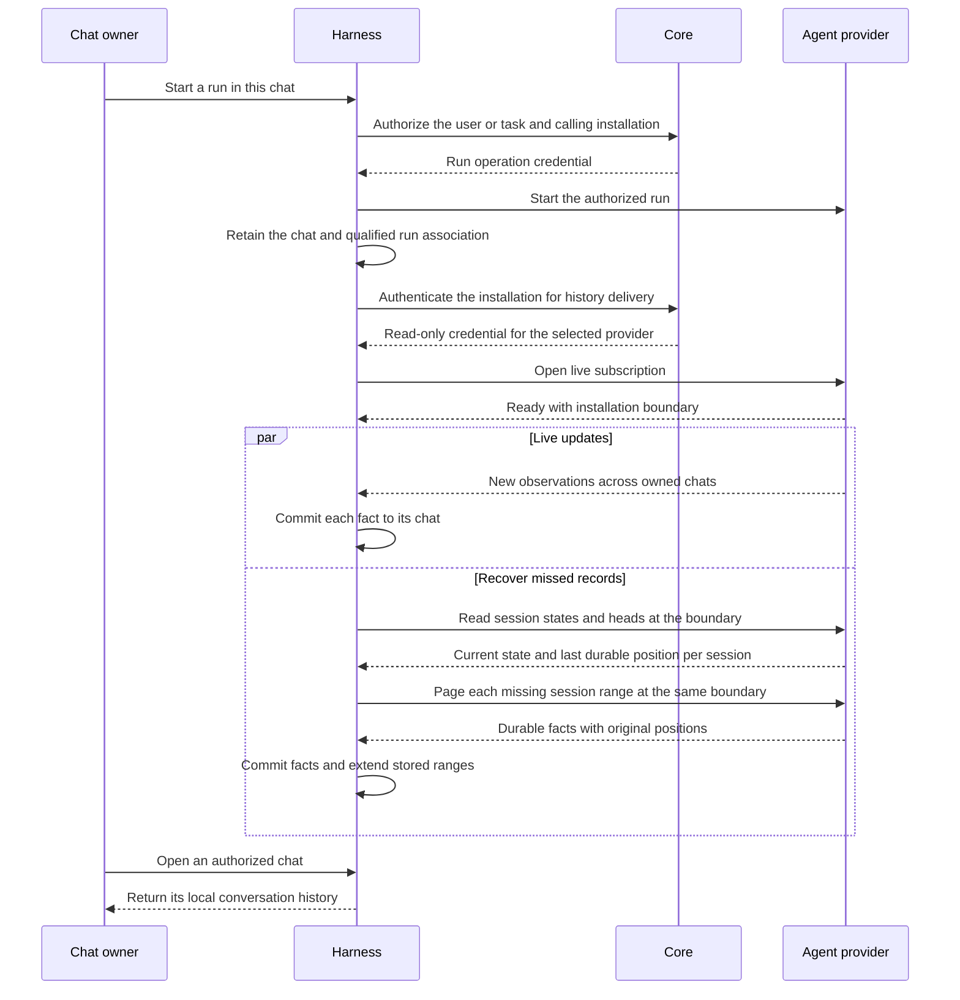

# Agent Provider Execution

Hosty exposes agent execution through an application-neutral HTTP/SSE v1 interface. Core discovers
confirmed `agent` providers and authorizes exact operations. A consumer sends inputs and receives
execution data directly from the selected provider; Core does not relay the prompt or event stream.
Generic Core skills, MCP and [Decisions](../shared-decisions/feature.md) retain their separate data
ownership. Provider identity is the explicit `{ appId, installationId, key }` reference, independent
of the provider's vendor or application name.

## Application And Data Ownership

The distribution contains three independently installed Local applications:

| Application directory | Distribution app ID | Native implementation |
| --- | --- | --- |
| `apps/codex-provider` | `hosty.codex-provider` | Pinned Codex CLI/app-server |
| `apps/claude-code-provider` | `hosty.claude-code-provider` | Pinned Claude Agent SDK/Claude Code |
| `apps/ollama-provider` | `hosty.ollama-provider` | Hosty agent loop using a configured Ollama endpoint |

`packages/agent-provider-runtime` supplies engine-neutral implementation mechanisms; it is not another
running service. Each provider application owns its native adapter, account authentication and
refresh, history/skill layout, capabilities, input preparation and settings presentation policy.
The application passes those contracts to the runtime at startup. The runtime owns shared
HTTP/SSE delivery, durable bookkeeping, execution coordination and process containment; it has no
native engine catalogue or vendor SDK dependency.

Each installed app owns its connection settings, Core secret namespace, selected
native homes, session aggregates, execution journal, attachments, pending native questions and
process evidence. Selecting a Codex host-login directory is explicit; setup imports no account,
credential or history from Harness or another provider. The operator supplies project tools on the
host. The Ollama provider neither installs an inference daemon nor downloads models.

Harness owns conversations, profiles, business tasks, preferences and its projection of provider
execution. Its manifest contains one API/UI service; its Docker image and Local bundle contain no
native agent SDK or worker service. Harness persists qualified provider/account selections and
exact outgoing commands. Restarting or disconnecting the consumer does not itself cancel a provider
run. Harness-owned business tools still depend on Harness being available.

Task-capable consumers can declare the reviewed `task-executor` v1 `session-workflow`
capability and bind their own executor installation and conversation UUID in the accepted
`ceiling.workflow` metadata. Core's task tools then forward a signed, exact-byte
`POST /sessions/{id}/workflow` request to that declared interface. The invocation includes the
original user and the exact provider/session/run reference; the consumer checks its current
conversation ownership and retained run before applying its own task workflow. Ordinary agent
consumers require no workflow endpoint. Qualified task-source keys remain separate from executor
keys, and retained task attempts keep their original source identity.

The provider's bounded task business channel calls
`POST /api/internal/apps/{provider}/agent/workflow` with its service identity, the admitted reference,
a fixed task action, object input and optional qualified task source. Core validates the original
actor and current task attempt, then forwards the signed consumer-owned operation. This works with
external task sources under their retained dispatch authority. The channel requires the consumer's
current reviewed `providers.task-executor` permission, its `session-workflow` capability and the
explicit per-run workflow binding. Tool selection and Ask/Run/Disabled policy belong to the accepted
binding; Core enforces the selected subset and Disabled rules, and the provider handles Ask through
its own durable Decisions. The default workflow policy is Ask.

Providers advertise `workflow.subagents` for chat delegation. Consumers also check Core's
`supportedWorkflowCapabilities` on an ordinary agent operation authorization. Earlier Core versions
omit this field, so a consumer can continue chatting without requesting these tools. Consumers explicitly select
`subagent_profiles`, `subagent_spawn`, `subagent_status` and `subagent_wait` in `workflow.tools`.
These actions use the originating conversation and its reviewed `agent-sessions` v1 interface
with the `session.subagents` capability. The provider sends the admitted reference and action
over the same business channel. Core signs the exact callback and checks the original actor.
An omitted tool list selects the legacy task catalog. A mixed list requires both interfaces.
Delegation carries no reusable user credential. Launching a child or resuming a parent follows
the consumer's ordinary authorization for its chosen provider.

Core MCP remains a separate connection with its existing target grants, originating-consumer
rules and tool policy. The bounded business channel leaves those grants unchanged and supports
consumer task tools while general Core MCP is disabled. Core also exposes task workflow wrappers
for callers with normal explicit Core MCP access. Missing task workflow authority is a
setup/availability error. Session workflow commands retain their original request UUID and input
after an uncertain reply, and completion acknowledges the durable report before native stop
settles independently.

Each provider has a Hosty-authenticated `/settings` surface and app-owned connection management under
`/api/settings`. Hosty app-code sign-in and current administrator access protect those operations.
Connection changes use revision checks and refuse changes to an account with an active run.
The settings surface retains the former Harness provider list: compact connection rows, a default
badge, an actions menu, and an Add/Edit dialog. It uses the shared Hosty theme and bundled fonts,
follows Shell theme changes, and removes the duplicate application heading when embedded.
Optional account limits appear beside connection actions, with the same remaining-quota indicator
and detailed windows/credits as Harness. The existing public usage operation refreshes bounded
account telemetry without a model prompt, so an empty consumer chat does not need a first message
to populate its limits. Provider-owned settings use their own administrator-authenticated usage
route and share the same revision-bound cache and refresh throttle.
Codex ChatGPT sign-in reports the failed native phase and a bounded diagnostic code. Recognized
upstream refusals include their HTTP status; native startup and timeout failures remain distinct.
The UI and app logs expose only fixed categories and validated numeric/enum facts, never raw native
error text, stderr, credentials or device codes. Failed sign-in preserves the previous connection
revision and credentials. Temporary login storage is removed only after native process closure is confirmed. A bounded
shutdown failure retains that storage and reports pending cleanup instead of blocking settings;
provider shutdown retries the retained cleanup.
Account sign-in, current-user activity and continuity remain independent for each provider app.
Harness settings open Agent profiles; the former Agent providers tab is removed. Its historical
`/settings/providers` bookmark opens Agent profiles. Accounts and sign-in are managed in each
provider application's Shell settings entry. Conversation provider selection remains available.
Embedded Harness settings use the Shell content width without repeating the application heading;
standalone settings retain their own heading and page spacing.
Harness and the agent provider apps expose no translation interface, translation account selection
or translation-only native execution. The independent [OPUS application](../local-translation/feature.md)
is the distribution's translation supplier. Core and both SDKs retain their generic scoped
translation contract for that provider and independently implemented alternatives; no vendor
identity selects a provider or grants authority.

## Public HTTP And SSE Contract

The first-party interface base is `/api/agent/v1`. Declarations supply the actual endpoint and path;
consumers do not derive them from an app ID. Execution operations require an exact Core credential. Installation history uses a separate read-only credential.
The unauthenticated `/healthz` endpoint reports service liveness only.

| Method and relative route | Operation |
| --- | --- |
| `GET /capabilities` | Version, limits and enforceable/observed capabilities |
| `GET /connections` | Provider-owned non-secret account metadata |
| `GET /connections/{id}/models` or `/usage` | Catalog or optional usage metadata |
| `PUT /attachments/{uuid}/chunks/{index}` | Immutable, actor-scoped attachment upload |
| `PUT /sessions/{uuid}` | Lazy public session creation |
| `PUT /sessions/{uuid}/configurations/{uuid}` | New immutable desired configuration revision |
| `GET /sessions` or `/sessions/{uuid}` | Owned session metadata |
| `PUT /sessions/{uuid}/runs/{uuid}` | Durable native start or explicit resume admission |
| `GET /runs/{uuid}` | Authoritative snapshot and replay cursor |
| `GET /runs/{uuid}/events?after={cursor}` | Sequenced `agent-event.1` SSE replay and live events |
| `GET /history/events` | Installation-owned history across runs, returned as SSE or bounded JSON pages |
| `POST /runs/{uuid}/responses` | Revision-bound approval/question response |
| `POST /runs/{uuid}/cancel` | Cancellation or a lost-start admission fence |
| `POST /runs/{uuid}/controls` | Capability-gated park, barrier, reconciliation or configuration control |
| `GET /runs/{uuid}/controls/{requestId}` | Durable control receipt |

A provider advertising `session.reconnect` can verify a retained native context after
reinstallation. An authorized `GET /sessions/{uuid}` against the current installation checks
the original consumer installation, principal and user, the provider implementation, account
binding, outstanding execution and native session. Codex reads the retained native thread.
A verified response describes the current provider reference and native availability. Reading
does not alter the retained session or authorize an old run.

To adopt that context, the consumer submits a configuration with
`requiredCapabilities: ["session.reconnect"]`, the observed session revision and an exact request
ID. The provider checks continuity again, archives the previous installation's execution record
and records a configuration under current authority. Subsequent resume admission targets the
same native thread. Old run IDs and control receipts stay scoped to their original installation.
[Harness recovery workflow](../provider-reinstallation-recovery/feature.md)

Connection and session lists use the same ordinal ID ordering for sorting and cursor advancement.
Pagination preserves opaque IDs and their case; mixed-case IDs remain reachable across pages.

The TypeScript SDK exports types from `@hosty-sdk/app/agent`, `AgentClient` and exact-byte preparation
helpers from `/agent/client`, validators/SSE helpers from `/agent/server`, and schemas from
`/agent/schemas`. Checked-in OpenAPI, event JSON Schema and conformance fixtures live in
`packages/app-sdk/schemas`. The caller supplies the metadata-only `AgentAuthorizer` callback;
its Core credential stays in that consumer backend. `watchRun` reconnects with fresh authority,
deduplicates events and reloads the authoritative snapshot when replay expires or the stream closes
unexpectedly. A provider sends an SSE `renew` frame with an empty JSON object on scheduled per-run
credential renewal. This allows the client to continue from the same cursor without rereading
the snapshot or spending a retry.

The .NET SDK exposes `HostyAgentExecutionClient`, persisted `HostyAgentPreparedRequest` commands and
`HostyAgentAuthorizer`, plus `HostyProviderClient` authorization/admission/renewal helpers.
`EventsAsync` reads a bounded stream with an explicit replay cursor; `RunAsync` retrieves the
snapshot for caller-managed reconnect/recovery. Both SDKs keep provider credentials separate from
Core service/user credentials and require the explicitly selected installation.

### Installation history delivery

An agent provider advertising `installation-history` exposes one subscription for a consuming
installation across all of its users, conversations and owned runs. A service authenticates to Core
with its app service credential and selects the qualified provider. Core issues a four-hour history
credential bound to the reviewed grants and both installations. The provider introspects it on
connection and every 30 seconds per open stream. Expiry ends the stream. Reconnecting with a new
credential resumes at the committed cursor. Run admission, approvals and cancellation keep their
original user or task authority.



The TypeScript SDK exposes `watchAgentHistory` and `readAgentHistoryPage` from
`@hosty-sdk/app/agent/client`. The .NET SDK exposes `HistoryAsync` and `HistoryPageAsync`
on `HostyAgentExecutionClient`. Both verify the run and generation inside each observation
against its envelope. Consumers persist the outer installation cursor only after applying its
observations. Each run also has its own sequence and cursor.

Providers advertising `installation-history.live` also expose three independent reads under the
provider's `history/` endpoint. They share the installation credential and ownership rules.

| Route | Result |
| --- | --- |
| `live` (SSE) | A ready frame with the registered subscription boundary, then observations committed after it. An optional prior cursor verifies archive ancestry. |
| `states` (HTTP) | The latest run state and durable head per owned session. The caller can pin pages to the ready boundary or request current state without opening SSE. |
| `range` (HTTP) | Consecutive durable records in the requested session and epoch between inclusive positions, paged at a fixed boundary. |

The TypeScript methods are `watchLiveAgentHistory`, `readAgentHistoryStates` and
`readAgentHistoryRange`. The .NET methods are `LiveHistoryAsync`, `HistoryStatesAsync` and
`HistoryRangeAsync`. Durable positions start at one and span runs within a session. Streaming
fragments have no durable position. A prior SQLite journal receives positions in its original
commit order. Source history reconstructed from partial evidence carries `sourceHistoryIncomplete`.
Rolling message and tool limits constrain the run summary independently of this journal.

The provider commits completed messages, tool observations, decisions and execution state to a
SQLite history journal. SSE resumes from an opaque installation-bound cursor. A client can also
request `Accept: application/json` and page with `after`, `limit` and the returned `through`
boundary, then resume the stream from that boundary. Streaming text fragments can disappear
during an outage. Completed facts remain available throughout retention of the source history.
Each run retains a receipt for the journal write. If a restored copy of the journal lacks
that receipt, the provider invalidates the old installation cursor and rebuilds the available
facts from its session records. An older run reconstructed from bounded evidence carries an
explicit coverage gap. The per-run
snapshot remains a summary of currently observable state.

A session UUID, a run UUID, a native SDK session reference and a Harness conversation ID are separate
identities. Protocol identity fields use opaque references rather than private native SDK session
IDs or account directories; connection metadata contains no credential values. Authorized tool
content can still include project paths and ordinary command output.
Session/configuration creation stores metadata and selected skill snapshots without starting the
native engine. A run first commits its input, active slot and public snapshot; initialization and
native reconfiguration occur under its `preparing` phase after Core admission.

Desired configuration carries the exact connection revision, instruction blocks, appended system
prompt, selected skills and supported native-tool/approval/subagent options. Per-run context,
model/effort selection, resource references and MCP selection are separate. Once initialized, a
native session remains bound to its connection/account revision. Unsupported compatibility or
limits produce explicit errors. `resume` with missing native state fails; it does not construct a
new session from the consumer's visible transcript.

There is one active run per public session. Provider capacity defaults to four occupied sessions;
unknown-stop runs and reserved continuations retain capacity. Stable command UUIDs and the SHA-256
of the exact UTF-8 JSON bytes provide replay. Identical retries recover the original operation before
new revision checks; changed bytes under the same identity conflict. A caller persists prepared
bytes before sending and retains those identities after a lost acknowledgement.

## Original Authority And Core Bridges

A reviewed consumer `providers.agent` grant permits app-only provider discovery and installation-bound
read access to that installation's admitted history as described above.
Invocation additionally requires current user access to both apps and the existing administrator
boundary for native execution. The consumer requests `POST /api/internal/apps/{consumer}/agent/authorize`
with provider reference, operation, method, relative path, body digest and bounded resource/configuration
metadata. Task execution can instead retain the exact original dispatch actor and task attempt;
it does not replace that actor with a service administrator.

A task cancellation fences new native admission, responses and execution renewal. The exact current
attempt retains operation-bound run reads, event/control receipt observation and cancellation,
including a cancellation fence for retained start bytes that were never admitted. Core still checks
the current original user/grant, executor installation, latest attempt, immutable input and root
generation. These Stop/observation credentials cannot admit native work, mint MCP authority or pin
skills; a replaced or invalidated attempt remains refused.

Core issues a two-minute operation credential. The provider introspects the exact method/path/body
hash, then admits an accepted run through its own service identity. The durable admitted reference
retains the original authority's absolute expiry. Provider-owned renewal rechecks current users,
installations, consumer grants and task state; it creates no indefinite or background grant.
Harness availability is not part of that renewal check. Expired/revoked authority fences new effects;
a terminal-looking status alone does not free an unconfirmed execution.
Operation credentials outside run admission bind the current consumer and provider permission
revisions. After an ordinary provider update, the same authorized consumer session can discover
accounts and obtain new operation credentials. Previously issued credentials and retained run
admissions still require their original revisions. Repeating the original start request preserves
its admission and cannot renew it across a provider revision change.

Provider bridges below `/api/internal/apps/{provider}/agent` cover `introspect`, `admit`, `renew`,
`mcp/token`, `skills/snapshots` and `workspace`. They operate on the exact admitted original context.
A provider needs no standing Sources, ReadSkills or MCP grant merely to proxy a consumer's authority.
The provider's own Decisions permissions still govern its question records.

- Nonempty skills require the consuming app's current `apps.skills.read`, including task-origin
  execution. Empty selection uses an exclusive provider-owned empty directory. Pinned snapshots
  preserve selected bytes across library updates; removal of a selected package or permission
  revocation blocks reuse. Renewals check current package availability without rereading every body.
- MCP tokens bind the current exact target installation/interface and selected tools. Core dispatch
  enforces that ceiling and disabled policies; UI filtering is not authorization. Native children
  use the provider-owned tool proxy, which obtains fresh Core credentials for dispatch.
- Resource references identify execution context rather than a new collection permission allowlist.
  Initial worktree resolution checks the expected declared context. Existing reviewed collection
  authority also supports MCP-created workspaces. Durable lease intents precede workspace effects;
  cleanup releases only the admission's recorded lease UUIDs, including pre-effect crash recovery.
  It never scans and releases every lease belonging to a conversation.
  Direct and agent-origin MCP lease creation and cleanup serialize within the same admission.
  Cleanup persists a closing fence before releasing claims; the fence survives Core restart and
  prevents later acquisition or replay of released UUIDs. Agent-MCP individual release verifies
  the exact claim owner under the workspace mutation lock and retains its own recovery-safe
  operation identity. Ordinary workspace administration keeps its existing authority.
  After confirmed native stop, the provider durably records pending cleanup before contacting
  Core. Its maintenance loop retries the original admission and release request UUID after a
  transient failure or lost reply, including provider reconstruction, until Core explicitly
  confirms release. Cleanup does not require a snapshot read, pending decision or renewed execution.
  Only a persisted execution start is eligible; superseded reservations and before-start cancel
  placeholders retain their fences without creating cleanup requests.

Before a new run, Harness reads current participation separately for every selected workspace
under the original user or task attempt. A cached association or a missing revision cannot supply
authority. An unprepared next-turn continuation refreshes only its original worktree revisions,
preserving the worktree IDs and their order, including the initial execution directory. A retained
prepared request keeps its original bytes; changing participation still meets Core's normal CAS
and current-access checks.

Blocking native callbacks carry a durable wait age. At five minutes the provider parks an execution
blocked exclusively on those questions, with no active/unknown effects or uncertain response
operation. Confirmed parking revises the pending question to `next_turn` delivery while retaining
its Core link. Nonblocking questions and independent active child work are not automatically parked.

Ollama's remote MCP requests use the remaining finite 15-minute active execution budget, including
human approval waits. Its SDK request and owned HTTP dispatcher have explicit deadlines; progress
does not extend the request indefinitely and Stop aborts it. The dispatcher does not alter global
fetch behavior. The provider proxy separately bounds connection/response-header waiting to two
minutes after approved upstream dispatch. A timeout after dispatch preserves an unknown effect
unless an authoritative result establishes completion.

Provider-native questions are source-owned Core Decision records bound to the exact admission.
The provider observes answers, records immutable delivery and reports continuation status. Metadata
observation, acknowledgement, withdrawal and progress reports remain possible after execution
expiry while the current provider installation, user access, Decisions grants and record ownership
still match. Those operations authorize no native work. Creating questions, answering them or
starting another native attempt still requires the relevant current authority. A parked/next-turn
answer can reserve a public continuation identity while reporting `awaiting_authorization`.

## Native State, Events And Stop Evidence

Codex and Claude resume provider-owned native state through their SDK/CLI interfaces. Their context
is engine-managed and can be compacted; it is not a permanent in-memory transcript or a filesystem
snapshot. Ollama persists Hosty's loop messages, summary and effect receipts and supplies bounded
context on each inference request. Ordinary consumer reconnects do not resend UI history as a new
native conversation.

Atomic provider session aggregates retain public snapshots, sequenced events, decisions and command
receipts; a private native execution journal remains separate. Replay is bounded to 64 MiB per run
and seven days after confirmed completion. Snapshot recovery replaces state and cursor together;
expired replay returns an explicit reload requirement. Native context, pending questions and
mutation tombstones have separate lifetimes; replay expiration does not purge them.

The optional `latestContext` snapshot field retains the latest root context-usage observation at
its original public event sequence. Explicit null usage clears the previous measurement. Harness
uses the same run-qualified identity for snapshot and live-event projection, so reconnect restores
the latest missed measurement without duplicating a received event. Intermediate offline
measurements are not a per-request ledger. Older records without the field remain compatible;
startup does not backfill processed native history.

Native subagent events carry `source.agentId`, `parentAgentId` and `parentToolCallId` when reported.
This observes SDK-owned child work; there is no public client-spawn endpoint. Codex advertises
observed policy and summary coverage; Claude advertises enforceable enablement with partial coverage;
Ollama advertises no native subagents. Unsupported concurrency guarantees are rejected. Correlated
child output does not replace the root result, and inclusive usage is not counted again as separate
child consumption.

A child entry in `agent.updated` and the run inventory can include `prompt` and `response`.
Installation history retains each observed change. The first-party providers publish up to 64 KiB
of UTF-8 per field and set `promptTruncated` or `responseTruncated` when clipped. The compact
inventory has a shared 128 KiB budget for these fields and can omit text still available in the
event history. Providers with status-only observations can omit both fields.

Harness retains the public provider, installation, run, generation and agent ancestry with
messages, streamed text, tool calls/results, approvals and questions. Its replay reducer applies
`agent.updated` as well as snapshot inventories. The chat shows one collapsed row per parent in a
qualified run, with a bot icon, child count and status counts. Expanding a child shows its delegated prompt, observed final response and separately
attributed activity. A uniquely linked launch can provide the prompt in older conversations.
Progress messages stay in activity until the provider identifies a final response. Missing details
are labelled unavailable and truncated text is labelled partial. Child text streams are independent
of the main response. Approval and question controls stay visible in the
main conversation with their child attribution. These observations do not create business tasks.
A lost connection, interrupted run or missing current child inventory shows an unknown/last-known
status rather than continuing a stale running badge. Interrupted partial messages remain labelled;
old source-less history keeps its existing presentation. Confirmed whole-run containment also
confirms observed child stops; it does not invent a successful child result.

The [message footer](../ai-gateway-chat-ui/feature.md#message-formatting) shows the stored date
and time for user prompts, assistant replies and assignments from a parent chat. Hovering,
focusing or tapping the timestamp reveals the full local date, time and timezone. Harness omits
the timestamp when the stored value is missing or invalid. Individual tool events keep their own
compact presentation.

Claude correlates an Agent or Task launch with its prompt and the child result, including text
from a matched foreground tool result or background stop. A progress message or launch
acknowledgement alone leaves the final response unavailable.

Claude distinguishes a root model result from completion of the native execution. The pinned SDK's
background inventory and task notifications retain child identities, active tool receipts and
logical outcomes across an interim root response. A successful root result is deferred while
non-ambient native agents or their proven background descendants remain active. Native task ancestry
is retained from inventories and task events after a parent completes or leaves the live inventory.
Unrelated parentless background shells and ambient watchers do not create this dependency.
An empty agent inventory or a later substantive root result cannot complete the execution: queued
child notifications can produce progress turns before the final parent synthesis. The provider
observes the native CLI's host-only `session_state_changed` frames through the supported process
spawn hook, because the pinned SDK filters those frames from its public iterator. A native idle
boundary is correlated with its preceding root result's session and UUID; completion waits until
that exact result reaches the SDK iterator. An idle observed while owned descendant work remains
invalidates its result candidate: an empty inventory cannot make that old result complete later.
Completion requires a subsequent root result and a fresh idle boundary without owned work.
The bounded observer passes stdout through unchanged and retains only lifecycle metadata. The provider does not synthesize a continuation prompt or
infer completion from a delay. Disabling predictions while children are active changes
prediction policy without closing the native query. Explicit Stop still stops the whole owned
execution and drains exact late tool terminals; an idle notification during interruption cannot
publish a pre-cancellation result as success.

Codex observes pinned SDK subagent activity and reads only a verified completed child turn through
the read-only native `thread/read` operation. This supplies attributed tool summaries, a uniquely
identified text assignment when available, and a message marked as the final answer. Codex also
reports the prompt of a single-recipient native spawn and the completed recipient's reply when
its collaboration events carry them. Interrupted, missing or superseded child history marks tools
coverage as truncated. Closing an already verified completed child preserves its recorded history.

Claude keeps an observed background Bash invocation pending until the native task reports a terminal
outcome for that exact run and tool call. The command card then shows completion, failure or
cancellation, including inside a subagent that has already yielded. A launch acknowledgement and a
task notification do not provide stdout or a structured exit code. Missing terminal evidence leaves
the outcome unknown. The shared provider projection keeps the same command status in the live
event and snapshot, even when no exit code, duration or summary is supplied. During suggestion
collection, Harness can retain the first confirmed result for an already recorded command with
the same provider run, generation and tool identity.

Claude can supply a nested command's text result without structured exit metadata. The provider
retains that output and its child provenance while reporting the command outcome as unknown.
A matched native tool result can close its invocation receipt without inventing an exit code.
When cancellation omits a registered child terminal from the live stream, the adapter can read
that exact child's messages through the pinned SDK's public `getSubagentMessages` API. It waits
for the SDK iterator and every captured native process handle to close first. The read runs in
one tracked, bounded helper with the selected connection's canonical durable history home and no
Core or provider credentials. Execution discovery HOME and durable history have separate,
provider-owned bindings. The reader accepts only the owned execution HOME's `projects` redirect
to that exact history directory, with identities checked before and after reading; native history
files and their canonical parent paths do not traverse links. Session, turn, parent, agent,
API assistant-message and tool identities must match the
already observed command. The SDK normalizes multi-block assistant messages into live frames with
different envelope UUIDs; the reader retains live and persisted UUIDs as separate provenance and
uses the preserved API message ID for their join. A matching error result closes the invocation
as failed; the command's exit status remains unknown. This does not restart or resume a native
session.

The history reader supports direct project paths with an encoded name of at most 200 characters,
first-level children, a child transcript of at most 1 MiB, a sidecar of at most 64 KiB and one known
session directory of at most 256 files. It reads at most 128 SDK messages per child, eight known
children and sixteen registered calls. Hashed or relocated project layouts, deeper children,
unrelated redirects or linked history files,
ambiguous identities, oversized history and missing results retain unresolved effects. Neither
physical process exit nor result text alone settles an invocation.

Console diagnostics distinguish admission, binding, file/history guards, terminal availability
and helper deadlines through fixed codes, counts, timings and bounded SHA256 bindings. They omit
raw paths, identifiers, commands, message content and SDK error text, and do not settle effects.

During normal completion, native shutdown can emit terminal callbacks while the worker owns its
journal lock. The worker drains already registered tool/effect and child terminal evidence before
publishing the final receipt. It matches retained run/source/call identities and rejects new work,
foreign ancestry and conflicting duplicate outcomes. These callbacks do not reopen a completed run;
a missing terminal still leaves its effect unresolved.

Harness retains each run's canonical cancellation bytes and acknowledgement independently of its
pending outbox. An applied receipt can remove the pending entry without losing its UUID, body hash
or original optimistic revisions. Repeated Stop and restored execution observe that same control;
an unknown attempt can retry only its exact original bytes. A missing previously acknowledged
receipt fails closed rather than replaying input or inventing a replacement cancellation.

Harness also checks retained configuration-control receipts before admitting the next turn. A
terminal run snapshot can precede the final control receipt in the event stream, so this check
reads the original request through its receipt endpoint. Applied or rejected receipts settle only
their matching run, request and generation; accepted, unknown, missing or unavailable receipts
remain pending. Disabling predictions reuses an existing matching request and sends no new
configuration command after confirmed stop.

Before recording local cancellation, Harness projects the authoritative stopped snapshot inside
the session's existing serialization lane. Older queued observations cannot rewind that snapshot.
An explicitly qualified temporary observation failure preserves only the same run, generation and
tool-source pairing until its authoritative final output arrives; ordinary errors, foreign output
and new user turns remain separate transcript boundaries. This retains genuine tool results without
reopening a stopped conversation or treating an unknown command outcome as success.

`state`, `phase`, `freshness`, effect certainty and `stopConfirmed` are independent snapshot fields.
An accepted cancel/control receipt is not proof of process exit. Supported SDK stop-and-wait,
provider-owned process containment and resolved tool effects determine stop confirmation. POSIX
launches use a separate receipt writer and anchored process group. Native stdout/stderr receive
fresh blocking pipe endpoints; Node forwards them with backpressure instead of inheriting its
nonblocking output descriptors into the native binary. Native exit initiates owned descendant
cleanup, while pipe EOF and output flush remain separate completion facts. Receipts distinguish
physical tree closure from output delivery; producer loss never manufactures SDK-stop confirmation.
Windows uses a suspended native launch assigned to a non-breakaway kill-on-close Job Object and
handle/accounting checks. Private
control channels stay separate from native stdin/stdout/stderr. Native environments exclude Hosty
service/control credentials and unrelated tool bearers.

When the native receipt confirms physical exit but effect outcomes remain unresolved, the provider
emits a distinct diagnostic and keeps ordinary execution fenced. Harness reports unreconciled tool
outcomes separately from missing stop evidence. The original provider exposes `runs.retire` for an
explicit owner-confirmed Harness Delete. It verifies the exact retained terminal journal, SDK exit
and owned process-tree receipts, including records written before retirement support. The provider
fences new work on that native session and applies the retirement receipt after releasing the
original admission's workspace claims. Once the receipt is applied, the retired session leaves the
provider's session list. The provider retains the native journal and authorized installation-history
replay, including unresolved outcomes and recorded gaps, across restart and any subsequent Harness
conversation cleanup failure.
For an interrupted journal, SDK and process-tree receipts establish exit if the Worker has released
its execution handle. An unverified exit continues through normal Stop and reconciliation.

The retirement request carries the exact run generation and revision. Harness saves the request
before dispatch. Retrying after an uncertain reply or app restart reuses the same request and awaits
the same cleanup. Ordinary cancellation, message admission and task completion still use
`stopConfirmed`.

Before launching a child, the provider durably records its intent. Durable SDK-stop confirmation,
matching child receipts and a sealed/exited producer support reconciliation after restart. Missing
proof stays `unknown`; a client-supplied stopped flag or a saved PID does not establish it. Automatic provider recovery
never terminates processes by PIDs loaded from receipt files. Workspace release uses the original
admission and begins after the provider confirms stop or accepts retirement.

Codex protocol acknowledgments have a 30-second deadline, with a two-second polite interrupt
budget and independently bounded metadata diagnostics. These bound RPC acknowledgments rather
than active inference or human approval waits. Interrupt requests carry the correlated thread and
turn IDs; without a known active turn ID, cancellation proceeds to owned stop directly. A rejected
or unanswered polite interrupt cannot prevent supported stop-and-wait. Acknowledged Codex
interruption drains the exact turn's terminal notification within the same two-second budget.
Codex background terminals receive the pinned SDK's thread-scoped cleanup request; exact known
command identities remain accepted after their originating turn ends. Root completion waits for
bounded cleanup and typed command-terminal events before worker teardown. Cleanup acknowledgement
alone does not settle an effect. A missing terminal result retains uncertainty rather than
manufacturing successful effects; teardown has one additional bounded cleanup attempt if the
polite interrupt cannot finish.
Provider shutdown asks the driver to stop before draining background controls, so an accepted cancellation cannot block its
own shutdown. Neither deadline nor a successful control receipt replaces native exit evidence.

Claude's polite interrupt has a two-second bound and its complete SDK stop/stream-exit wait has a
ten-second deadline. After the acknowledgement it allows up to two seconds for exact pending
tool terminals before closing the SDK stream. Repeated Stop shares the existing shutdown. Once stopped, the adapter admits
no new tool permission or question, while retaining exact registered late tool terminals from the
current turn. Missing/foreign/replayed results cannot settle effects. Owned process-tree cleanup
still runs if SDK completion is unconfirmed; physical exit alone does not become SDK stop proof.
Its stopped-state PreToolUse hook also denies new native tools in the SDK's permission-bypass
mode. An unstructured local SDK cancellation error cannot certify a remote MCP operation's outcome.
The child-history helper uses the same ten-second stop deadline and requires its full two-second
budget after native closure. A missing native-close event or unconfirmed helper exit leaves stop
unconfirmed rather than extending the deadline or fabricating an outcome.

## Local Builds, Transport And Cutover

Each provider's Local/dev setup calls the shared `local-runtime.mjs prepare <provider-directory>`.
It snapshots only that app, shared runtime/SDK and projected locked dependencies into its own
`HOSTY_APP_CACHE_DIR/provider-runtime` generation. Keys include input bytes, Node version, OS and
architecture. The selected native SDK is included; unrelated providers, Next and test toolchains are
excluded. Concurrent setup uses an owner lock and atomic publication. `start` imports the prepared
executable; it does not install into the source checkout or prune another provider's dependencies.
Older generations stay in place for their existing consumers. Source changes during preparation
reject publication rather than mixing revisions. Published generation directories use a compact
UUID name; the full input fingerprint stays in the pointer and bundle receipt. This avoids adding
the 64-character fingerprint to native executable paths, which can exceed Windows process-launch
limits even when npm successfully installs the same files in the shorter staging directory. Existing
fingerprint-prefixed generations remain readable and are never renamed beneath active consumers.

The three provider applications publish independent stable 0.1.0 releases through the
[repository release model](../repository-release-model/feature.md). Public feeds select stable
for new installations, retain the exact source commit and manifest assets, and require Core
0.180.0 or newer. The catalog cards state the Git, Node.js 24/npm and account prerequisites;
Ollama also requires an independently installed server and models.
[Marketplace catalog membership](https://github.com/alex-de-haas/hosty-catalog/pull/26) includes all
three providers. Fresh installs select their public stable feeds through Marketplace and the normal
Core runtime/permission confirmation; authenticated settings work without Harness.

Dependabot tracks all three provider applications and the shared runtime through the root npm
workspace lockfile. Docker updates cover the production Harness coordinator; the retired embedded
worker has no npm or Docker update target.

Provider updates require operator-prepared quiescence: finish or cancel active runs through the
provider API and wait for authoritative stop/effect confirmation before using Core lifecycle.
Core's Local Stop forcibly terminates its app process group/job; it does not perform an SDK drain.
Restarting an active provider can therefore retain an interrupted/unknown execution, even after
its processes disappear. Client attestation cannot replace the missing provider-owned proof or
settle unresolved effects, and the old input is not replayed automatically.

The native HTTP listener uses the assigned `HOSTY_PORT_HTTP` on IPv4 `0.0.0.0`; authenticated API and
settings operations enforce their distinct credentials. Consumers use Core's direct transport
address, with Docker host-loopback rewriting where applicable. That rewrite alone does not prove
reachability for another daemon topology. Public browser navigation and backend transport addresses
remain separate.

The extraction has a clean-slate boundary. Install and configure desired providers first; stop and
confirm all old work before updating Harness. Remove selected old conversations/history and stale
bindings using their owning controls, and separately verify legacy native-history cleanup. The
startup inventory guard refuses pre-extraction conversation records or an unreadable initial
inventory and writes a new consumer-format marker only after that check. It does not certify that
old processes stopped or that a separate legacy native store was erased. No automatic account,
credential, native-session or history migration occurs. Core workspaces, source trees, Git metadata,
profiles, business tasks and unrelated app data retain their separate ownership. The explicitly
approved ordinary-host cutover on 2026-11-13 completed backed-up legacy-history cleanup and workspace
activation. All three Local providers and Docker Harness report healthy; normal Shell identity
resolves newly configured Claude and Codex accounts as Ready. This readiness check is separate from
paid SDK inference and cross-platform acceptance.

The offline [legacy history cleanup helper](../../../scripts/cleanup-legacy-harness-history.mjs)
provides a separate, explicitly confirmed cutover operation. First stop both old Harness services
through Core and verify that their native consumers have stopped. Keep a reviewed backup before
removing history. Supply the real absolute Harness app data directory and the exact selected
observation owner; the helper never discovers an installation or chooses a user:

```sh
node scripts/cleanup-legacy-harness-history.mjs plan --data-dir <absolute-data-root> --owner <owner-id>
node scripts/cleanup-legacy-harness-history.mjs apply --data-dir <absolute-data-root> --owner <owner-id> --plan-digest <reviewed-sha256> --request-id <stable-uuid> --confirm-delete-legacy-history
```

Both phases acquire the existing coordinator and worker SQLite ownership locks. Planning requires
an empty global conversation directory, orphaned observations belonging to the selected owner,
confirmed native exit, terminal worker receipts with no pending callbacks, and applied controls.
Schema-valid parked barriers are retained checkpoints rather than active callbacks; only stopped
checkpoints without effects qualify. A pending old cancellation is removable metadata only when its retained run has
confirmed exit and no conversation. These checks preserve unknown executions for recovery; they do
not stop processes or replace Core lifecycle verification.

The digest covers the exact inventory and bytes of only `provider-sessions`,
`worker-service/provider-sessions`, `worker-service/runs` and `agent-observations.json`. The helper
refuses linked paths, unknown native layouts, changed reviewed inputs and an existing consumer-format
marker. It removes only those four targets. Connections, credentials, profiles, tasks, workspaces,
cache, owner databases and the stateless cursor key remain intact. A private durable receipt permits
an interrupted deletion to resume with the same UUID and digest; new or changed history blocks
resumption. Planning reports counts and the update-time range for recognized historical `started` or
`unknown` effects, without execution IDs or content, and sets
`requiresUnknownEffectsAcknowledgement`. Apply refuses those histories unless the operator also
supplies `--acknowledge-unknown-effects` after reviewing that exact digest. This confirms deletion
of uncertain outcome evidence; it does not settle, reverse or repeat an external effect. Unknown
metadata shapes, unconfirmed exit and pending callbacks remain blocking even with that flag.
The helper does not inspect or remove a user's host-native SDK directories or claim
account-secret cleanup.

The read-only provider doctor reports startup prerequisites and workload-dependent tools without
installing packages, altering a shell or importing credentials. Startup requires Node.js and npm,
plus executable `/bin/ps` on POSIX hosts or stock Windows PowerShell 5.1 on Windows for native
process-stop verification. The doctor recommends installing Linux procps or restoring the macOS
system utility when `/bin/ps` is missing. Git remains a workspace prerequisite, and project SDKs
remain optional workload tools. Independent source-only provider
releases and selected lock closures are described in the
[repository release model](../repository-release-model/feature.md).

## Testing Expectations

- Cover authenticated inspection and reconfiguration of a retained context across an installation
  change. Check exact actor/account/thread identity, rejected busy/foreign records, replay of
  the configuration and preservation of the original run authorities.

- Capture a live boundary while two users generate events. Read state at the boundary, read an
  owned range, and verify that the stream starts after the cut. Check a foreign installation,
  a deleted range, archive replacement and migration of an existing SQLite journal.

- Stop the consuming Harness while three runs complete at the provider. Use two password-authenticated
  users with two chats for one owner and one for the other. Check all three durable transcripts
  before the next login, confirm each owner sees exactly one result in the correct chat, and reject
  cross-owner reads. Exercise expiry, grant revocation, unrelated consumer and provider
  installations, read credentials on mutation routes, and recovery after the detailed replay window.

- Run the common runtime suite and each affected provider application's type checking, tests and
  production build. An unrelated injected engine exercises startup, settings, capabilities and
  generic connection bookkeeping. Architecture checks reject native engine references and
  application imports in shared production infrastructure.
- Keep adapter parsing, authentication/history/skill integration and native fixtures with their
  owning provider. Build metadata declares native dependencies/assets; generic packaging must
  also build an unrelated provider and keep private native helpers out of other app bundles.

Codex sign-in coverage exercises native startup/exit, protocol rejection, timeout and invalid response
paths, safe diagnostic propagation, cleanup after actual process exit, and preservation of an existing
working account. A synthetic protocol check does not establish real OpenAI account authorization.

- Core HTTP tests cover an empty/independent app boundary, exact operation/hash/install binding,
  current original authority, task chains, revoked grants, selected tools, pinned skill availability,
  precise lease cleanup and retained Decision metadata without renewed native authority.
- Lease interleaving tests hold real workspace mutation locks to verify direct/MCP acquisition,
  cleanup and individual release. They cover durable closure, replay, cancelled waiters, unrelated
  admissions, revocation recovery, foreign claim replacement and interrupted owned-release records.
  Provider regressions cover transient cleanup failure, lost replies, explicit release confirmation,
  reconstruction, concurrent cleanup and shutdown drain without native replay or snapshot-driven retry.
- Harness context recovery tests subscribe before emission, await the exact committed context
  notification, and verify durable event identities and offline recovery without resubmitting input.
- SDK fixtures cover exact bytes, response identity, snapshot/replay boundaries, correlated child
  sources, bounded streams, duplicate controls and changed inputs/installations.
- Provider tests cover lazy creation, strict resume, account/configuration compatibility, the fixed
  five-minute parking deadline with a controlled clock, revised next-turn delivery, lost
  admission/cancellation races, interrupted storage, decision delivery, process evidence and stdin
  protocol preservation. Unknown native stop or tool effects keep the slot occupied.
- Core authorizes fresh agent operations across a provider permission revision change using the
  same consumer grant. Old credentials and old run admissions remain fenced. The managed provider
  update test checks discovery and usage across an actual update with the same Harness process and grant.
- HTTP/SDK pagination tests enumerate mixed-case session and connection IDs one page at a time,
  requiring complete results, unique cursors and bounded invalid-cursor rejection.
- Native transport fixtures exercise multi-MiB synchronous stdout/stderr, paused consumers,
  notifications before acknowledgments, duplex requests, terminal output drain, stubborn descendants
  and producer crashes. Cancellation fixtures cover rejected/hung interrupts, exact turn identity,
  thread-scoped background cleanup, late correlated command completion after turn termination,
  cleanup ACK/error/missing-result uncertainty,
  finite RPC acknowledgments, active approval waits and shutdown behind an accepted control.
- Claude background lifecycle regressions exercise an interim root result with three background
  children, predictions disabled during their work, late successful/failed tool terminals, native
  parent continuation, idle ordering, stale task runs, ambient tasks and explicit whole-run Stop.
  Queued-notification regressions complete all children while a parent progress request is pending,
  then require the final synthesis to survive the adapter and worker journal with predictions on
  and off. Raw stdout may reach idle before the SDK iterator drains its final result; result/session
  correlation must prevent early completion. Cancellation before final synthesis cannot publish success.
  Nested-command cases retain completed native agent ancestry, await actual background Bash output
  and resumed child summaries, and require one final parent synthesis before confirmed exit.
  They cover predictions on/off, explicit cancellation, stale idle, inventory-only ancestry and
  unrelated parentless/ambient background work. The exact invocation receives its command outcome
  only from a matching native terminal, with no duplicate launch result.
  Native SDK tests use an empty temporary home and a deterministic loopback model fixture; these
  establish SDK/process behavior separately from hosted-model quality or account authorization.
- Harness reducer/manager and browser checks cover child attribution, actionable child decisions,
  independent text streams, unknown status, same-cursor recovery, bounded snapshot gaps and replay
  without duplicate groups. Timestamp checks cover local time, old history and keyboard/mobile access.
  Run the installed-app browser fixture with `HOSTY_NATIVE_SUBAGENTS_BROWSER=1` alongside the
  `agent-providers` integration suite. A scripted Codex App Server exercises delegation through
  the installed provider and Harness to the browser, including the prompt and reply after reload.
  Additional browser fixtures exercise interleaved child activity, decisions and missing status.
- Claude child-history fixtures cover the SDK's normalized live UUIDs, preserved API message IDs,
  exact native agent/session/parent/input binding, ordered error terminals, missing or ambiguous
  identities, bounded history, metadata changes, native-close barriers and helper deadlines.
- Local packaging tests cover concurrent independent providers, preserved source dependencies,
  cache reuse, source changes, damaged/failed generations and direct-SDK dependency selection.
  Cover compact published paths, legacy generation pointers, malformed pointer rejection and actual
  Windows native process launch from a prepared generation. Codex sign-in startup verification uses
  the pinned npm wrapper with an empty isolated home and confirms initialization and shutdown.
  CI/release fixtures require a Codex-only SDK pin to leave Claude, Ollama and Harness unselected.
- Retirement tests cover a retained terminal journal with missing tool results, an unconfirmed process,
  foreign ownership, stale revisions, a lost reply, exact workspace claim release and a fenced native
  resume. The managed `agent-providers` suite exercises owner Delete against a retained provider run
  with synthetic incomplete search outcomes and verifies that the dirty worktree survives.
- Cleanup fixtures cover both storage locks, exact inventory digests, changed/linked paths, foreign
  or unsettled execution metadata, interrupted/replayed deletion and preservation of unrelated data.
- Runtime acceptance uses Core-managed apps, normal password/app-code identity, separate test data
  and actual Docker-to-host transport. Native inference and process behavior need the target OS;
  scripted engines and macOS tests do not establish Windows/Linux or paid-provider inference.
- Recorded local build evidence includes all three isolated npm installs/production bundles,
  Core NativeAOT publication on macOS arm64 and .NET SDK tests/net8 compilation. No Windows/Linux
  native execution or live paid SDK inference is established by those build checks. Ordinary-host
  cutover has separate explicit approval and recorded live readiness evidence. Remaining acceptance is tracked in [the implementation plan](plan.md).
