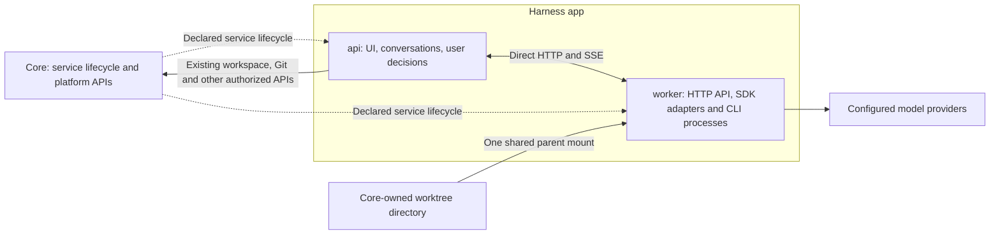

# Harness Worker Service And Direct Execution API

## Goal And Review Boundary

Replace the special Core-managed agent worker with an ordinary Harness service. Harness calls
its worker directly; Core manages declared services and retains its normal platform APIs.
Support native Windows Core with Linux containers in the first release and keep a clean client
boundary for eventual independent agent-provider applications.

This consolidated plan incorporates the owner's 2026-10-20 clarifications in
[vision decisions 50 and 51](../../vision.md). The owner approved the design and selected simple
HTTP JSON plus SSE, deferring separate protocol adoption, on 2026-10-20. The same conversation
requested model and reasoning-effort selection as part of this refactor. Implementation began on 2026-10-20 after explicit owner authorization. No production reset or workspace cleanup is authorized by this
documentation update. [feature.md](feature.md) continues to describe the shipped implementation.

Planning baseline: `ad9368ecbd6d48c6bfb03a8a8dea05e0eabedd4f`, Core 0.146.0 / Harness 0.62.0.
Reconcile the implementation branch with the then-current code before making changes; these are
baseline versions, not frozen release targets.

## Required Change

| Baseline | Target |
| --- | --- |
| One manifest service plus special top-level `agentWorker` | Ordinary `api` and `worker` entries in `services[]` |
| Core creates an extra worker generation and runs provider commands through Docker exec | Core starts/stops declared services; worker launches its own SDK/CLI processes |
| Harness sends execution traffic through Core's agent-worker routes | Direct versioned HTTP API and SSE between Harness and worker |
| Provider-specific environment, stdio and lifecycle logic in Core | Provider adapters and process handling in worker |
| Host/container path equality and macOS/Linux/Unix-socket restrictions | Generic mounts, container paths and actual Linux Docker engine capability checks |
| Special worker status/recovery surface | Ordinary service health, logs and resources; Harness owns run state |

## Final Architecture

- Declare both services in every supported profile. Docker uses two ordinary Linux containers;
  Local uses native commands over loopback without requiring Docker; development recipes remain
  separately marked. Keep Docker as default and respect explicit stored profile selection.
- `api` depends on worker's private port and consumes `HOSTY_SERVICE_WORKER_URL`. Keep Docker
  execution endpoints off the public/browser surface. Use normal service networking and health.
- Install SDKs, CLIs and execution dependencies in the worker image. Move Codex/Claude adapters
  there, including translation and any provider setup/probe path that launches a CLI. Provider
  login/refresh behavior remains available through typed application operations.
- Worker stays running while idle. Docker retains one active workload, with no new queue,
  scheduler, dynamic container creation or per-session containers. Preserve Local concurrency.
- Start, stop, update, failed-start rollback, health, logs and resources use ordinary app lifecycle.
  A healthy worker without a configured provider reports that configuration state separately.
- Neither service receives a Docker socket or engine credentials. Core handles no prompts,
  provider stdio, agent events or model traffic. Existing authorized workspace/Git and sandbox
  operations remain normal platform responsibilities.

## Core-Owned Workspaces: No Migration

Core already owns all workspace storage independently of Harness:

| Core storage | Ownership |
| --- | --- |
| `core/development/workspaces` | Registry records, owners, bindings, leases and operation state |
| `core/development/trees` | Actual working directories, dirty and untracked files |
| `core/development/repositories` | Shared Git repositories and linked-worktree metadata |

Harness is a client of these APIs. Moving or resetting Harness does not move, import, convert,
restore or re-create any of this storage. No workspace migration mechanism or preservation job
is required. Verify this existing ownership boundary as a regression check.

External principal/task ownership, paths, branches, Git metadata and activity leases remain
unchanged. Parallel external agents continue using their current directories. Harness's External
workspaces view reads Core's inspection API and needs no conversation/history import. Resetting
a conversation may remove its UI link; it does not transfer workspace ownership or delete source.
Old workspaces remain available for subsequent explicitly requested inspection/cleanup tests.

### Shared Mount And Cleanup

Mount the entire `core/development/trees` parent once at worker startup, plus the separately scoped
read-only Git repository storage. Give each run its assigned cwd. Sibling-tree access is an
accepted limitation of this shared administrator runtime; per-user/per-session isolation belongs
to the separate containment feature.

Creating or deleting an eligible child directory changes directory contents, not the parent mount.
The parent stays in place. Neither worker nor Harness restarts for allocation or ordinary cleanup.
There is no dynamic mount/unmount operation on each run.

Use existing activity leases for the particular worktrees assigned to current work, including
declared additional repositories and known background jobs. Acquire before work and release after
known writers stop. Keep uncertain claims; an SSE disconnect or finished response is not proof
that a background command stopped. Do not clear another client's lease during update or cleanup.

Classify the generic shared collection mount as an access grant, not a blanket active consumer
of every child. Preserve normal checks for dirty/unmerged work, ownership, specific activity
leases, direct worktree mounts, source overrides and runtime/sandbox consumers. An idle worker
does not block deletion; work in A does not alone block deletion of an eligible unrelated B.
Retire the old special global worker lease with its executor, without exempting Harness by app ID.

This is cooperative coordination, not detection of every escaped process or undeclared sibling
access. Keep normal refusal/retry for real file locks and uncertain specific consumers. No
automatic force deletion, process killing, lease clearing or application restart is a cleanup step.

### Paths And Git

Use logical workspace/repository IDs, binding revisions and relative file paths in the worker
API. Core resolves approved mounts; requests cannot supply arbitrary host paths or Docker options.
Stable container roots are `/mnt/development/managed/trees` and the sibling `repositories`.
Never rewrite existing `.git` links, repository extensions, provider databases or transcripts as
part of updating Harness.

Existing Core workspace Git tools remain authoritative for managed operations on every host;
worker edits/builds the mounted files directly. Container-local Git reads can use compatible
links. Universal shell-Git compatibility for legacy host-absolute links is not a condition for
retaining or inspecting external workspaces; no Git proxy or metadata mirror is introduced.

For freshly initialized managed repositories, use the native relative-worktree layout after a
Git 2.48+ capability check. Keep repository/tree relative locations consistent on host/container.
Do not enable that extension implicitly on an existing shared repository used by external agents:
reused legacy repositories retain their format and existing Core Git route.
[Git documents relative worktree links](https://git-scm.com/docs/git-worktree/2.48.0).
Test fresh Windows/Linux execution separately from unchanged legacy external-workspace access.

## Ordinary Process Management

Worker's HTTP backend owns the SDK/CLI processes it starts: launch, event reading, cancellation,
exit and errors. Use SDK cancellation and ordinary child/process-group handling. A standard small
init may handle container signals/orphan reaping if needed; it is not another app service or an
agent policy engine. There is no bespoke supervisor, per-UID process census/kill sweep, custom
privileged host helper or requirement to destroy all processes after each turn.

A supported long-lived CLI can remain available between turns. On cancel, request provider stop,
terminate the known child/group if necessary and observe its exit. If a known writer might still
be running, retain that run's uncertain state and its specific worktree lease. A normal CLI crash
fails its run and allows the backend to launch a replacement. Do not claim adversarial descendant
containment or assume all detached work is discoverable.

Normal operator Restart is exceptional recovery for a stuck service, not routine run completion
or cleanup. The baseline lacks public per-service restart; adding it is not part of this feature.
Local retains supported native controls/concurrency without claiming container isolation.

## Direct Worker API

Use application-owned HTTP JSON commands and SSE events, independently of Core's HTTP API.
Owner decision, 2026-10-20: implement this small versioned contract now. Do not introduce AHP,
ACP, A2A or OpenAI-compatible model-generation endpoints into this service refactor. Keep wire
DTOs and the worker client separate from Harness persistence/UI and native provider SDK types.
Standard-protocol adoption stays in the existing AHP and independent-provider plans; no protocol
research spike blocks this implementation. A future independent worker can reuse this HTTP API.
Adopting a third-party protocol later requires an adapter and compatibility tests, not a promise
of automatic compatibility.

| Route | Behavior |
| --- | --- |
| `GET /v1/capabilities` | Protocol version, supported providers/operations, model/effort selection support and capacity |
| `GET /v1/connections/{connectionId}/models` | Authorized connection-scoped model choices, per-model effort choices/defaults and catalog revision; no credentials in response |
| `PUT /v1/runs/{runId}` | Durable idempotent acceptance; identical retries return the receipt, changed input or occupied capacity returns conflict |
| `GET /v1/runs/{runId}` | Current state, generation, result and recoverability |
| `GET /v1/runs/{runId}/events` | Ordered SSE with event IDs and cursor replay |
| `POST /v1/runs/{runId}/responses` | Approval/question response with unique control ID, event ID and expected revision |
| `POST /v1/runs/{runId}/cancel` | Idempotent cancellation; request receipt is distinct from observed stop |

A submission contains conversation/run identity, operation kind, connection ID/revision, model and reasoning-effort selection,
bounded input, resource references and coordinator-authorized policy. Events contain run ID,
generation, sequence, type and payload, including output, tools, approvals/questions, usage and
terminal result. Credentials travel separately from retained run/event payloads. No arbitrary
executable, raw provider stdio tunnel or generic shell endpoint is exposed.

The coordinator owns UI history, user identity and decisions; worker owns execution state and
native session state. Preserve Normal/Autonomous behavior, supported same-runtime resume,
translation, attachments, connection setup/renewal and app MCP callbacks. An agent-controlled
policy field is not new authority. Reject stale/cross-run control responses.

Use one worker-local durable journal/event store, implemented as atomic fsynced per-run JSON records, with no separate database
service or broker. Commit acceptance before replying. Coordinator reconnect retrieves the known
run; worker restart marks interrupted work and never automatically repeats side effects. Keep
small request-ID/hash tombstones so retries after event expiry cannot relaunch old work.

Bound commands, events and replay storage; initial defaults are 1 MiB JSON commands, seven days
of replay and 64 MiB per-run event retention. Expiry/overflow produces explicit snapshot resync,
not silent gaps. Persist bounded current/final results independently of replay; excessive output
fails explicitly. A lost HTTP response/SSE connection never repeats or implicitly cancels work.
Final typed fixtures are D16/D19 outputs; these are not a public provider standard.

## Model And Reasoning-Effort Selection

Owner addition, 2026-10-20: expose both model and reasoning effort in the chat composer as part
of this refactor, for Codex and Claude. This is model selection within the existing provider and
account. Switching Codex to Claude or transferring native context remains owned by
[shared history](../assistant-shared-history/plan.md); translation keeps its independent settings.

- Offer **Agent default** and model choices supplied by worker for the selected connection. The
  worker uses native catalog/capability APIs where available; any versioned fallback suggestions
  must be identified as suggestions, not proof of account entitlement. No model list lives in Core.
- Offer **Default** and only the effort values supported for the selected model and native runtime.
  Preserve provider values on the wire and use readable labels, such as `high` / High and `xhigh` /
  Extra High where supported. Do not give every model one universal list or equate reasoning effort
  with a token budget, subscription tier or permission/autonomy mode. If support is unknown, expose
  only Default with an explanation until capabilities are known; do not guess an effective level.
- Allow changes only between turns, including before the first message. Disable both controls
  while a turn is running, waiting for approval/input, or still stopping; enforce the same rule
  server-side. Changing a selection sends no prompt and starts no agent task.
- Save model and effort together in the Harness session through its ordinary permission-checked
  API, with a revision check against concurrent edits/sends. A model change preserves effort only
  if compatible; otherwise the UI visibly selects Default before saving the pair. The server
  rejects stale or incompatible combinations instead of silently downgrading them.
- Snapshot the selected pair into each accepted run and its idempotency hash. An explicit null
  means native Default, including after an earlier explicit choice; omitted update fields preserve
  the previous choice. Existing sessions with no fields retain default behavior without a batch
  migration. Persist the selection for reopen/resume and retain per-turn attribution so changing
  a model does not relabel old answers. Record requested values separately from effective values
  reported by the native runtime; unknown is not inferred. Surface a provider-reported downgrade.
- Worker validates the pair and applies native options before submitting the next prompt. Codex
  uses its app-server turn model/effort fields. Claude uses supported SDK model/effort controls;
  when the pinned SDK cannot change effort on a live Query, close the idle native Query and resume
  the same native session with the new options before sending. This may replace a child process,
  never restart Harness or the worker service. Verify native session identity, history, cwd, MCP
  configuration and approval policy across the change. A failed change must not silently create
  an empty session or execute with the old selection.
- Return a useful error for unavailable models or unsupported effort, preserving history, draft
  input and workspace. Bound/cache catalog reads by connection identity/revision; no recurring
  model-list polling or extra discovery service. Preserve pending UI edits when data refreshes.

Implementation evidence to pin in D27: the current chat adapter contract lacks model/effort
options; translation already passes a model independently. Local Claude SDK declarations expose
model selection and an effort query option. The upstream
[Codex turn schema](https://github.com/openai/codex/blob/main/codex-rs/app-server-protocol/schema/json/v2/TurnStartParams.json)
describes per-turn controls. These observations support feasibility, not completed runtime
verification: confirm behavior against the exact packaged CLI/SDK versions with both providers.

## Minimal Generic Core Contracts And Service Trust

Use existing service/dependency/health/discovery mechanisms. Limit new platform behavior to
reusable service facilities; validate them with a non-agent two-service fixture.

| Generic extension under `app.0.1` | Proposed contract |
| --- | --- |
| Credential/settings injection selection | `services[].injection: { appServiceToken: false, appIdentityToken: false, settings: [] }` for worker; explicit settings allowlist for api |
| Contained data/cache targets | Add relative `subPath` and `mode: "ro" / "rw"` to existing targets; resolve multiple applicable targets per service |
| Managed collection mount | `externalMounts.development: { kind: "managed-workspaces", scope: "instance", service: "worker", mode: "rw", required: true }` with existing reviewed full-source authority |

Omitted injection fields retain existing defaults. An empty settings list injects none, including
secrets. Native worker environment is built from necessary OS variables and declared inputs,
excluding inherited Core/provider secrets. No entrypoint-only unsetting of already exposed tokens.
Keep broad Core/coordinator credentials and other connections' credentials outside agent execution.

An omitted subPath retains the existing root; omitted mode is rw. Exact profile targets override
type defaults for the same service/environment; reject duplicate variables/destinations and
conflicting nested mounts. Validate traversal/symlinks/junctions under app-owned storage. Preserve
normal backup/removal semantics and host-readable ownership without recursively chowning source.
Local path/mode declarations are not a security boundary against the same host user.

Api uses its normal app data root. Worker receives only its `worker-service` subdirectory at
`/control/state`, its own cache and the small `service-auth` subdirectory read-only at
`/control/auth`. Protect trusted control paths with normal image permissions and control/execution
user separation; launch CLI non-root. This does not require a bespoke process supervisor.
Do not rely on Windows bind-mount mode reporting alone to protect secrets.

The source mount exposes trees rw and repositories ro, not Core registry files, credentials,
settings or other app data. Retain the existing host-path mount restrictions. Shared collection
semantics must be explicit and generic. Revoking actual filesystem access requires ordinary Stop;
this is distinct from deleting an unused child worktree while the mount stays active.

Install/update review shows exposure. Keep-apps adoption validates normal instance/app/installation/
service identity, image and effective mounts/injection; a deliberately tokenless service is still
managed. Count worker once in ordinary service resources/admission, including child Core startup
and Finish; remove special reservation credits only after verifying this accounting.

Api creates a random 256-bit installation-scoped service secret in `service-auth/worker-auth.json`
using an atomic write. Worker reads its read-only copy. Health works before bootstrap to avoid a
dependency deadlock; execution readiness waits for authenticated protocol/installation handshake.
Requests use the shared bearer secret with constant-time verification on the private app network
or Local loopback. Core neither issues nor validates this credential. Api checks current user
authority; worker checks correlated run/control state. Existing scoped MCP callback credentials
remain separate and grant no worker-control authority.

Service secrets survive ordinary restart; explicit rotation drains work, replaces the secret and
uses normal lifecycle. No new JWT framework, per-run service-token issuer or unauthenticated
pairing is introduced. Secrets never enter CLI environments, logs or retained run events. Remote
providers later use TLS and their own credential provisioner through the same client interface.

## Windows And Supported Profiles

The first-release acceptance target is native Windows x64 Core controlling Docker Desktop with
Linux containers/WSL 2. Core running inside WSL is not equivalent evidence. Also verify macOS arm64
Docker Desktop, Linux amd64 Docker Engine and both Linux amd64/arm64 image variants.

- Use normal Docker connection support, including Windows named pipes. Check actual Linux engine
  availability; remove agent-specific host-OS, `unix://` and host `id` requirements.
- No host-installed agent CLI is required in Docker. Verify Linux bind ownership and Desktop
  sharing using actual writable access, not Windows UID/GID assumptions or root agents.
- Cover drive-letter paths, another local drive, spaces, Unicode, separators and junction escapes.
  Network/UNC roots and remote daemons are outside the first acceptance matrix.
- Verify discovery, health, normal password login, Core/Shell preview, app MCP and workspaces in
  a managed sandbox. Local remains a production option with its existing behavior/concurrency.
- Verify profile selection and fresh sessions in both profiles. Historical native session import
  and seamless cross-profile resume are not release gates; ordinary same-runtime resume remains.

## Clean Harness Update

The owner accepts clean Harness app state and fresh provider login. Old conversations, native
histories and caches need no importer, migration journal or special rollback machinery.
Workspace data is not in this reset scope: it remains Core-owned throughout.

1. Use the existing Core's ordinary Harness Stop while its legacy cleanup is available. Verify
   termination of exact owned legacy execution/resources; reconcile unknown old state. Do not
   stop external agents, unrelated apps or clear their activity leases.
2. Install the compatible Core/Harness release and reviewed two-service manifest. Reset only
   Harness-owned app state where required. Leaving incompatible old Harness files unused is
   sufficient on local if it avoids unnecessary deletion; no conversion is required.
3. Start declared services, initialize service trust/worker state, configure providers normally
   and verify direct execution. External workspace inspection continues through Core immediately,
   without restore, import, path changes, ownership rebinding or fabricated conversations.

Remove `AgentWorkerService`, execution endpoints/DI/serialization, provider-specific Core logic,
special `agentWorker` startup, `core-exec.ts`/`core-worker.ts` and replaced Docker plumbing. Preserve
generic workspace/Git, Docker, identity and lifecycle APIs. Reject retired candidates and execution;
keep installed legacy baselines readable for normal stop/remove/update without restoring the executor;
old Core must reject the new unsupported mount kind before startup. No permanent legacy transport
or agent cleanup controller remains in new Core. Test incompatible-version startup refusal.

Failed startup uses ordinary diagnostics/retry or prior artifacts. It never triggers a workspace
reset or history migration. This plan authorizes no live production cutover during planning or
sandbox verification.

## Future Independent Providers

Keep the worker client/contracts independent of Harness UI/database, private Core routes and
container names. Its boundary is endpoint URL, credentials, capabilities and run/control/event
contracts. Prove that seam using a separately hosted fixture with independent storage.

An independently deployed provider must explicitly declare how resource access works; a URL does
not imply shared host files. This refactor supplies the seam, not transfer/synchronization, public
`providers.agent`, discovery/authority standards or an independently installed app. Those belong
to [Agent Provider D1-D3 and its remaining deliverables](../agent-provider-interface/plan.md).
Do not assume an OpenAI/Ollama model-generation API covers stateful runs, approval and cancellation.

## Deliverables

Historical D1-D15 are completed/retired. Keep D16-D26 stable; D27 adds model/effort selection. Deliver the implementation in one
branch/PR. Checks record completed implementation and its verification; platform/live-provider acceptance remains D25.

### Phase 1: Contracts And Ordinary Services

- [x] D16. Finalize typed HTTP/SSE API and manifest compatibility examples against this owner-approved plan before implementation; no unanswered product decision is delegated to Core agent-specific behavior.
- [x] D17. Implement generic service injection filters, contained storage targets and managed collection mount/consumer semantics; verify a non-agent fixture, existing app compatibility and specific-worktree cleanup checks.
- [x] D18. Package and declare api/worker for Docker, Local and development, with SDK/CLI dependencies, discovery, health, normal lifecycle/rollback and resource limits.

### Phase 2: Execution And Source Access

- [x] D19. Implement direct HTTP/SSE client and worker adapters, durable/idempotent runs, controls, trust, cancellation and provider/translation/attachment/MCP parity.
- [x] D27. Implement connection-scoped model and per-model reasoning-effort choices, between-turn UI/session updates, native adapter application, per-turn attribution and resume/error coverage for Codex and Claude; no service restart or Core agent API.
- [x] D20. Implement portable resource/path access and fresh-runtime Git behavior; verify that existing Core-owned external workspace records, metadata, files, owners and leases remain unchanged and usable. No workspace migration/import implementation.
- [x] D21. Implement ordinary process handling, specific worktree activity and service accounting; verify creation/deletion while services stay running, known background work, uncertain specific consumers and recovery. No bespoke supervisor or per-run containment.

### Phase 3: Replacement And Verification

- [x] D22. Deliver clean Harness update and remove the Core execution proxy, special worker lifecycle/manifest and global worker-cleanup paths; reject incompatible versions and retain normal platform APIs.
- [x] D23. Show worker through ordinary service health/logs/resources and expose useful run status/errors in Harness without a separate container-management surface.
- [x] D24. Verify the same client against a separately hosted provider fixture and reconcile Agent Provider D1-D3 ownership without implementing its public platform.
- [ ] D25. Pass native-Windows/Docker acceptance plus macOS/Linux regressions, both providers/profiles, cleanup without restart, external-workspace non-regression, failure cases, image checks and sandbox Finish.
- [ ] D26. Update current-reality docs and related plans, record release versions/evidence, regenerate the index and delete this plan only after all preceding deliverables are verified.

## Verification And Completion

Implementation is in progress in the registered Core workspace. Verified local evidence:

- `npm run harness:test`: 937 tests passed after review fixes; `npm run harness:lint` and the web production build passed.
- Full Core regression: 3901 passed, five opt-in integration tests skipped. After the final generic
  storage/adoption changes, all 227 affected Core tests passed again in an isolated artifacts directory.
- `npm run cli:build` and `npm run core:aot` passed. Native AOT targets macOS arm64 with no new
  trim/AOT warnings; existing compiler/platform analyzer warnings remain.
- Shell: 193 Node tests and 368 Vitest tests passed; production build passed; lint has zero errors
  and two existing warnings in unchanged code.
- CI-selection and Docker fault-proxy tests: 30 passed. Version, documentation/link and whitespace checks passed.
- API and Worker images built for linux/arm64 and linux/amd64. Both Worker architectures passed
  credential/process/Git probes, including root-owned source reads and relative Git worktrees.
  Actual credential-free Codex/Claude native model/control handshakes passed in the arm64 image.
- Isolated child Core passed normal setup/login/app authorization, declared Docker services,
  Docker/Local/Docker switching, stop/start, state preservation and sandbox Finish/resource removal.

Review verification on 2026-10-21 adds 211 passing affected Core tests and covers all four findings:
cancellation/detach cannot wait on a coordinator callback queued behind cleanup; implicit Local data
remains available; installed retired baselines can stop/remove/update while new candidates and
execution are rejected; internal app-creation/handoff dispatches carry the model selection revision.
The initial PR CI and first review-fix CI completed successfully. The latter required one retry of
Windows detached-helper recovery after an unavailable test Core; the unchanged commit passed.
A subsequent review identified cancellation during slow reservation/startup: the client now waits
for a terminal receipt with a bounded deadline and retains leases on timeout or interrupted exit.
The 18 affected HTTP/client protocol tests pass, including this slow-start regression. This final
cancellation fix passed full CI. Two further review findings cover terminal delivery and native
error text: confirmed terminal events now persist with a stable receipt revision, retry transient
store failures, recover append-before-clear crashes without duplicates and detach on shutdown.
All 24 affected HTTP/client protocol tests and full CI pass for terminal persistence. A subsequent
review identified replay-expiry notice collisions with terminal revisions. Resync notices now stay
outside the durable sequence; all 28 affected tests pass, including successful/failed recovery with
and without snapshot text. The replay-resync fix passed local checks. Before its CI could start, main advanced through
PR #634; a regular merge preserves those settings changes and removes the obsolete retention
injection from the new service manifest. The combined Harness tests, web build and Shell tests
pass; 200 affected Core tests pass against the final combined source. Managed collection paths use JSON to preserve commas and other valid host-path characters;
operator-bound mount slots retain their existing format. The provider-state migration review
request is intentionally declined under the Clean Harness Update decision above. The combined
candidate requires full CI before merge.

These checks use the implementation and review-fix batches; the full Core regression preceded the final
affected-test rerun. AMD64 image execution on this machine uses emulation, not a native Linux host.

D25 remains open for actual native Windows Core + Docker Desktop, native Linux host acceptance
and live authenticated Codex/Claude turns/resume/tool flows. No provider credentials were copied
from live installations. Linux containers on macOS and synthetic native protocol fixtures are
reported separately from that evidence. D26 retains final evidence reconciliation and plan removal
until every required deliverable passes. A draft PR does not represent release acceptance.

During implementation use focused contract/lifecycle/provider tests, `npm run harness:test`,
`npm run harness:lint`, `npm run build --workspace @haas/hosty-harness-web`, `npm run core:test`,
`npm run core:build`, `npm run core:aot`, `node scripts/check-versions.mjs` and docs validation.
Run Shell/SDK checks if their code changes. Report commands/results and untested platforms honestly.

| Acceptance | Required evidence |
| --- | --- |
| Ordinary services | Both visible with health/logs/resources; normal install/start/stop/update/remove and partial-start cleanup; no hidden containers |
| Direct execution | Codex/Claude work with old Core agent routes absent; CLI dependencies are inside worker; no Docker socket or agent exec bridge |
| Process behavior | SDK cancel/known-child exit, CLI crash/relaunch, retained uncertain leases, no required per-turn restart |
| Shared source | With worker running, create A and remove eligible B; with an active lease on A, deletion of A is refused; specific mounts/sandboxes and external leases still block correctly |
| Workspace ownership | Snapshot Core records/paths/Git metadata/files/leases in an isolated fixture; reset/update Harness; compare invariants and continue through the existing external principal without import/rebinding |
| Provider behavior | Fresh chat/tools/approval/question/cancel, same-runtime resume, translation, attachments, connection renewal and app MCP for both providers |
| Model/effort | Both providers: select before first turn, change model/effort between turns, return to Default, reopen/resume; preserve native history/workspace/MCP/policy; reject busy/stale/invalid choices; show unavailable or downgraded values honestly; no service restart; verify UI and actual native options |
| Reliability/trust | Duplicate/lost requests, replay gaps, stale controls, service/Core restart and unavailable Docker; no secret leakage or silent re-execution |
| Platform | Actual native Windows Core + Linux Desktop, macOS/Linux regressions, both architectures, supported profiles and normal Core/Shell authentication/preview |
| Update/extraction | Known legacy stop, incompatible-version refusal, reset limited to Harness, independent endpoint fixture with no private storage coupling |

Use registered Core workspaces and managed sandboxes with separate test data/users; do not test
cleanup by deleting the owner's existing external workspaces. Reuse the sandbox during iteration,
preserve useful sanitized evidence and Finish through its owner with resource-removal checks.
Sandbox success does not authorize live-data trial or production cutover.

Implementation changes platform contracts and Harness behavior: apply minor versions to the
then-current Core/CLI and Harness artifacts, keeping related images/package versions in step.
Bump other artifacts only when their code changes. One PR lists D16-D27, this folder and version
outcome. Current release versions are Core/CLI 0.148.4 → 0.149.0, Harness 0.64.1 → 0.65.0 and Shell 0.109.1 → 0.109.2.

## Related Scope

- [AI Agent Bridge](../ai-agent-bridge/feature.md) supplies the ordinary Core responsibility boundary.
- [Runtime manifests](../runtime-app-manifest/feature.md), [mounts](../external-mounts/feature.md) and
  [workspaces](../assistant-session-workspaces/feature.md) own reusable platform behavior. Core
  workspace ownership remains current reality, not a new Harness deliverable.
- [Containment](../assistant-runtime-containment/plan.md) and
  [execution authorization](../assistant-execution-authorization/plan.md) retain stricter process,
  session and restricted-user guarantees. This shared cooperative runtime does not complete them.
- [Agent providers](../agent-provider-interface/plan.md) owns independent app/public API design.
- [Development controls](../app-development-controls/plan.md),
  [source workflows](../runtime-source-workflows/feature.md) and
  [sandboxes](../app-sandbox-runtimes/feature.md) retain their scopes and explicit live trial/Return.
