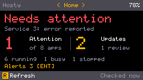
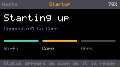

# Cardputer Operator Shell

## Short Operator Sessions

The native ESP32-S3 firmware targets M5Stack Cardputer ADV, with a 240 x 135
display, keyboard and 8 MB flash. Version 0.2.1 supports a short session: switch
on, inspect Home, optionally operate apps, switch off.
It has no Hosty runtime manifest and uses the native ESP-IDF build/USB workflow.

Home, Apps, Updates and Device remain keyboard-driven. Home `R` refreshes and
`Enter` opens the latest notification. Home always shows snapshot age. App status
appears before the supplementary notification/Core-update reads. Missing data
is explicit rather than rendered as successful zero counts. The Attention count
is independent of Running: a running app can require configuration, permission
repair or restart, or report health/update errors. These predicates follow
[Shell app states](../app-lifecycle-states/feature.md).

The display and USB remain active until the physical power switch is used. No
SSE connection, standby state machine, timed alert check or IMU work runs. Theme,
sound and quiet-hours settings remain; legacy power settings are ignored without
deleting credentials. Explicit checks can sound for an unread warning/error.

There is no idle status polling. Operator-started operations receive bounded
follow-up reads, at most once per two seconds for two minutes while the worker
is idle. A settled app operation ends this window early. Snapshot age continues
to advance without network work, using neutral Checked-now/seconds/minutes/hours
text. Age alone does not turn a successful snapshot into a transport failure.
Failed refreshes retain last-known data and its actual age, and show Check failed.
Offline, revoked access and unsupported Core remain distinct outcomes.

## Home And Startup Presentation

Home gives the check outcome the largest text: All clear, Needs attention,
Checking status, Check incomplete, Apps are busy, New alerts, or a connection
failure. It reports the first affected app and a bounded short reason, preserving
space for the reason even with a long name. Missing notification/Core-update data
cannot produce All clear. Attention and Updates use large counts, with compact
running/busy/stopped, review, alert and Core-update context below. Core version is
on Device; all existing keyboard commands remain available.

Startup uses one stable layout with Wi-Fi, Core and Apps steps. Clock validation
and authorization belong to the Core step. There are no animation delays or
additional network calls. App status replaces this screen immediately after the
required reads, while the outcome stays Checking status until supplementary data
arrives unless an app already needs attention. Setup, enrollment and failure
dialogs remain explicit overlays.

Amber uses a black background, light text, muted secondary details and an amber
accent; red emphasizes problems. Ocean and Violet remain selectable. The display
retains its existing 8-bit framebuffer and pixel font, scaled only for the main
outcome/counts. Host renders include lowercase glyphs and scaled text.

Synthetic host-rendered examples at the native 240 x 135 resolution:

## Startup And Transport

Wi-Fi operates without modem power saving. SNTP retains a short random startup
delay of at most 100 ms. Local HTTP can continue before time is available; HTTPS
requires time at or beyond a UTC epoch embedded by CMake, independent of the
builder's local timezone. Certificate and hostname validation remain enabled.

The serialized HTTP adapter reuses one handle for sequential reads. It clears
body, content type and authorization between requests and refuses automatic
redirects. Failed requests release the handle; idle connections are released
after five seconds. OTA releases the ordinary connection before creating its
own TLS connection. Mutations are not replayed automatically after failures.

Startup logs separate Wi-Fi readiness, authorization, first app data and completion
of supplementary reads. Request logs include duration, HTTP/protocol/transport
outcome and free/largest heap, without credentials. Streaming parsers retain the
existing 64-app/16-notification bounds.

## Core Compatibility And Operations

Device-code enrollment and `/api/auth/session` retain the administrator-role
check. Normal app start/stop/restart, autostart, update checks and routine updates
use Core's contracts; system-app lifecycle actions remain hidden. Review-required
updates remain in Shell. Fleet update checks run on a worker and do not freeze
the keyboard task.

Core restart reads `/api/core/development`, sends its instance/source revision
with a random 32-hex request ID, and observes `/api/core/operations/{id}`. Only
completed receipts count as success. An uncertain restart retains its ID for
another explicit recovery attempt during the same firmware session. Core update
is presented as accepted, with explicit refresh to inspect the resulting version.

Wi-Fi settings and tokens retain their NVS keys. Battery guards and A/B OTA from
the compiled-in firmware origin remain. The firmware README discloses plaintext
credential storage, administrator authority and the local-HTTP exposure.
[The plan](plan.md) tracks outstanding storage migration, OTA rollback and
additional hardware acceptance rather than treating them as verified.

## Verification On 2026-10-23

Version 0.2.1 is built with ESP-IDF 5.5.4 and flashed over USB to the connected
Cardputer ADV; esptool verifies the written image hash. The final application
image is 1,298,016 bytes, leaving 68% of its OTA slot free. NVS remains intact:
the existing Wi-Fi connection and authorization token work with Core 0.150.2.

The captured boot reads the session, Core status, all 11 apps, notifications and
Core update status successfully over HTTPS. First app data arrives about 4.7 s
from the bootloader start and supplementary reads finish about 5.4 s from that
start. Firmware-relative diagnostic timestamps are 4,280 ms and 4,959 ms.
The first snapshot has 84,940 bytes free heap and a 38,912-byte largest block.
These are single-boot observations, not a controlled speed comparison: the
preceding 0.2.0 boot measured 5.9/6.5 s with a longer Wi-Fi connection phase.

The USB capture also records the operator's Home R refresh, with all four reads
returning HTTP 200 and the worker completing normally. Between boot and that
explicit refresh there are no HTTP requests. The operator confirms the new Home
is readable without overlaps and manual refresh works on the physical device.

Host tests, HTTP-adapter regression tests, rendering, production build, version
consistency, documentation/link validation and whitespace checks pass. Home,
Device and startup renders have been visually inspected. Layout tests cover
long names, 64-app/update counts, very large unread counts, incomplete data,
transport failure and retained snapshot age, including text bounds/overlap.
The HTTP tests cover ESP-IDF's absent Content-Type result when clearing a GET
body, which does not block the request.

Live Core/app lifecycle mutations, token revocation and OTA rollback have not
been exercised in this session; the running Core remains unchanged. Remaining
hardware acceptance and storage hardening are tracked in [the plan](plan.md).

## Testing Expectations

- `apps/shell-cardputer/tools/host-test.sh`: bounded JSON/protocol/state, Attention
  semantics, rendering, clock floor, actual HTTP adapter reuse/isolation and Core
  restart requests through an ESP-IDF test seam. Home checks cover incomplete data,
  retained ages after failure/disconnection, long problem names, maximum counts
  and text bounds/overlap in the 240 x 135 layout.
- `apps/shell-cardputer/tools/render-harness.sh`: inspect all four 240 x 135 views,
  themes, update availability, age and action menus, plus healthy/failed/partial
  Home and all three startup phases.
- `apps/shell-cardputer/tools/idf.sh build`: pinned ESP-IDF 5.5.4 production target;
  check the generated configuration and image/OTA-slot size.
- Verify USB flash hashes, actual boot, retained settings, fresh app data and
  manual refresh on a Cardputer ADV. Distinguish these results from host tests.
- `node scripts/check-versions.mjs` and `node scripts/docs-index.mjs --check`.
