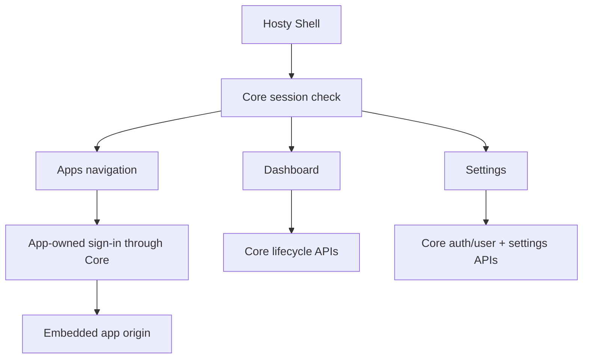

# Core App Shell

Hosty Shell is the Core-managed browser UI runtime app. It renders a single authenticated Shell surface backed by Hosty Core APIs; it does not own Core lifecycle logic and it does not reintroduce the retired combined Next.js Host package.

The Shell frame stays within the viewport. Its navigation, workspace and right panel have
independent bounded scroll areas: expanding navigation sections does not grow the document,
and the account footer stays visible below the navigation. Navigation scroll gestures do not
propagate to the surrounding page when the list reaches an edge.

## Scope

The implemented Shell provides:

- an administrator-only Dashboard: Core's status and version beside every installed app, with install,
  lifecycle, configuration, updates, logs, backups, restore, prune, and removal;
- administrator host management in Settings: users and invitations, Core's own settings and ingress
  connection, and host-wide shared mounts, alongside each user's personal settings;
- direct Apps sidebar navigation for authorized apps that declare shell UI metadata, with
  embedded and standalone opening;
- embedded app workspaces whose apps establish their own Core-authorized sessions.

The route table and sidebar structure live in [Shell Navigation](../shell-navigation/feature.md).

Shell retains its app grant in an app-bound HttpOnly cookie. `/auth/start` generates independent
state and a private verifier, keeping state/protocol, verifier and return path in three state-specific
five-minute HttpOnly attempt cookies. For protocol 2 its fixed-action, origin-referrer form posts
the public S256 challenge to Core's sign-in-intent broker. `/auth/callback` checks its own state
and verifier cookies, exchanges the code with the app service credential and revalidates its
audience before setting the grant cookie and clearing the attempt. A verified Core upgrade
replaces an obsolete protocol-1 attempt once with fresh proof; refusals cannot downgrade. Same-origin `/api/core/...` handlers send the server's service credential and
app-bound user grant to Core. Core checks the app's confirmed permission and the user's current
role/assignment. Core's primary cookie is never forwarded to Shell; no credentialed Core CORS
exception remains for Shell. Public status comes from `/api/core/status`; protected data comes from Core APIs such as `/api/auth/session`, `/api/apps`, `/api/auth/users`, and `/api/apps/{appId}/...` lifecycle endpoints. If a protected Core API returns `401`, Shell treats that as an authentication-required state and navigates to its `/auth/start` flow instead of rendering a reduced unauthenticated Shell surface. `403` responses remain visible authorization or CSRF failures.

Shell is a thin browser client for Core APIs. Its browser-facing Core origin comes from `HOSTY_CORE_PUBLIC_ORIGIN` or, for client-side build compatibility, `NEXT_PUBLIC_HOSTY_CORE_PUBLIC_ORIGIN`. `NEXT_PUBLIC_HOSTY_CORE_ORIGIN` is accepted only as a legacy fallback. Core injects its effective public origin when it starts Shell. Without injection, Shell's server helper falls back to `http://core.hosty.localhost:<core-port>`; the checked-in local source launch profile explicitly configures `http://[::1]:3001`. `HOSTY_CORE_ORIGIN` is reserved for runtime process-to-Core calls; Docker runtimes may receive it as `http://host.docker.internal:<core-port>`, but Shell must not serialize that internal container origin into browser fetches or login links.

Without an explicit public origin, Core derives separate per-app browser names under `hosty.localhost`, keeping the assigned ports. Login, account/consent, setup/recovery and status links use these effective browser origins; internal transport remains separate.

## Client Module Structure

Shell keeps one persistent client orchestrator at `apps/shell/src/app/shell-client.tsx`. The root App Router layout creates this orchestrator once around the route `children`, so Core state, session/auth state, sidebar compact state, app registry data, CSRF mutation ordering, dialogs, and embedded workspace launch state survive navigation between Shell routes.

Feature UI lives under `apps/shell/src/app/shell/`:

- `types.ts`, `core-api.ts`, `shell-routes.ts`, `theme.ts`, `state.ts`, and `server-env.ts` define shared contracts, low-level helpers, and server-side Shell environment resolution;
- `shell-context.tsx` exposes separate persistent Shell state and action contexts to route pages;
- `shell-route-pages.tsx` adapts individual App Router pages to Shell feature components;
- `sidebar/` contains Shell navigation and account/theme controls;
- `pages/` contains the Dashboard and Settings view components, including the Settings sections
  for Core and shared mounts;
- `dialogs/` contains install review and installed-app detail dialogs;
- `workspace/` contains embedded app workspace loading and iframe surfaces;
- `ui.tsx`, `settings.tsx`, `app-helpers.ts`, and `clipboard.ts` contain shared presentational and formatting helpers;
- `settings-draft.ts` holds the app settings form's pure rules — the draft, the configure payload, and
  a secret field's rendered state — kept out of the JSX so they can be tested directly.

Each top-level route file renders only its route surface; the route table, the legacy paths that
still resolve, and the sidebar's two groups are described in
[Shell Navigation](../shell-navigation/feature.md). Administrators land on Dashboard. Ordinary users
land at `/`, with an empty main surface and their authorized app sidebar; there is no duplicate
Apps overview. The legacy `/apps` path redirects to `/`, which resolves to Dashboard for
administrators. An inaccessible administrator-only surface redirects an ordinary user to `/`;
personal settings remain available under their existing tab-aware authorization.

The sidebar is a persistent desktop-style rail with an expanded and a compact mode; the selected
mode — like the right panel's docked state — is stored in a cookie the server layout reads, so the
first paint after a reload is already in the stored state instead of rendering the default and
animating the correction. A missing cookie falls back once to the legacy local-storage value. The
chrome's column animation stays disabled until the first Core load settles, so the right panel
column appearing with the apps response snaps into place rather than looking like it opens itself.
Because the sidebar and Core/session state are owned by the root layout, moving between routes does
not remount it or briefly render the unauthenticated navigation state.

The sidebar's Apps heading is noninteractive. Compact mode retains direct app rows without an
All apps catalog icon. On phones, Apps opens the app sidebar and first collapses an expanded tool
sheet; it does not navigate, reset the app document, or release retained tools.

Hosty Shell is installed as a system runtime app and does not appear as an entry in the Apps
sidebar.

## Sandbox Overview

Dashboard combines child Core environments and individual app sandboxes in one initially collapsed
Sandboxes list. Rows identify their workspace by name; expansion exposes applications, observed
states, authorized preview links and existing lifecycle controls. Confirmed-empty lists hide the
section, while inventory, startup and cleanup failures remain visible. Saved launch permissions
remain available in Settings → App permissions. See [Core Sandbox Instances](../app-sandbox-runtimes/feature.md)
for isolation, ownership and recovery contracts.

## Installed apps

Dashboard is the administrator management surface for installed apps. System and ordinary apps
share one table; system and active-Shell role icons retain their explanatory tooltips.

Core and app rows share four columns: flexible identity, 188px status, 144px resources and 136px
actions. Version/source and runtime sit under the name. Narrow layouts use the available container
width; the details are described in [Shell Navigation](../shell-navigation/feature.md).

Apps expose actions according to Core state, plus — for the two entries that are optional app features rather than lifecycle verbs — the `logs` and `backup` capabilities the app declares (see below):

- start, stop, and restart;
- install from an `app.0.1` manifest URL, local manifest file path, or local app directory containing `manifest.json`;
- configure settings and autostart;
- plan and apply updates;
- inspect logs and health;
- create, restore, delete, and prune backups;
- remove an app, with optional backup deletion.

For administrators, clicking noninteractive app-row space opens standalone App Details at
`/apps/<app-id>`, outside Settings, with a `Dashboard / <app name>` breadcrumb linking to
`/dashboard`. Former `/settings?tab=manage:<app-id>&section=<section>` bookmarks migrate to this
canonical page with their requested section. This replaces More > Manage application. The app name is a
native Manage link for keyboard access and opening another tab, without an extra row tab stop.
Runtime app rows have no service expander or inline expanded service/network panel; More no longer duplicates Manage application. Buttons, menus, version/source
disclosures and resource popovers keep their independent actions rather than also navigating.
Modified/nonprimary clicks and text selection do not activate row navigation.
Core has no expander or expanded detail panel. Its Dashboard row retains metadata, status,
resources, Logs, Runtime / workspace, Restart, Update and Source settings. Settings > Host > Updates
contains read-only Core information from the existing Shell status: listen address and public origin
with copy buttons, data root, runtime host and ingress mode. Missing status or fields show Unavailable;
a known status without a public origin shows Not configured. The block makes no additional requests
and does not reset unsaved Core settings.

Manage retains per-service runtime state, health messages, resource usage and, for image-based
services, locked, running and available image digests. Network retains endpoint keys, service
addresses (`not assigned` until Core has assigned them) and public browser addresses with copy/open,
port and origin controls. Stopped apps retain declared endpoints; missing observations stay explicit.

Core and app rows show status text with a dot or distinct attention/error/working shape. The label
composes lifecycle and health when they differ, following [App Readiness](../app-readiness/feature.md).
Pending start, stop and restart operations appear as Starting, Stopping or Restarting in this main
status, without a duplicate verb beneath the app name. Active update progress sits below that
current runtime/health status in the Status column, including for source/workspace rows. Core
reports the runtime transition independently of update progress; Shell does not infer lifecycle from
an operation label. Observed Running, Stopping, Starting and Stopped remain primary, with degraded
health composed into a running status and missing runtime observations shown as Unknown. Update
phases `stopping` and `starting` use only Updating below that status, without a service suffix.
Other supported phases retain Update queued, Preparing update, Creating backup, Installing,
Downloading or Checking readiness, with the reported service when present.
Terminal update outcomes add no row message or expiry timer. Existing success, failure and readiness
toasts remain; problem icons and Manage retain diagnostics. Separate configuration and Restart
required information remains visible. Dashboard rows do not display a Manual start marker. Autostart
remains configurable in More and Manage > Launch.

Dashboard's Apps heading contains filters and Install app. Search and aggregate resources occupy the table
header. Fleet Check updates is in App actions at every width; Update all is also a visible contextual
action when routine updates are available. Checking updates keeps the menu open with progress.
Routine updates use Core's queued update endpoint without a confirmation popup. Update all
submits only routine plans and queues Shell itself last. New permissions, provider roles and
other review-required manifest changes still open Core confirmation through the plan view.
Core validates the cached plan, current permissions and installed base; stale plans do not apply.
During a Shell self-update, the page waits for Core's operation to settle and the new Shell origin
to respond before reloading. Interrupted reads are retried without repeating the mutation.
Each app row has one contextual action beside More. Pending, Configure, Update and Start keep their
existing priority. For a running app, administrators see Logs only when the observed aggregate
service health is degraded or unhealthy and the app supports logs; otherwise they see Stop.
Update, manifest, permission and previous-operation diagnostics retain their icons and details
without changing this shortcut. Missing, unknown or startup health is not treated as a failure. Non-administrators retain their existing Logs shortcut and never gain
Stop. More retains supported operational actions and their existing busy/permission guards;
Manage is opened from the row rather than a duplicate menu item.
Runtime-app Logs and More > Console logs retain their entry points and select Logs in Manage at
`/apps/<app-id>?section=logs`; readiness and update-notification log actions use the
same destination. Logs is a capability-gated tab after Launch, with the existing 200-line console
tail, Refresh, per-service selection and aggregate fallback. It reads only while selected and
aborts obsolete app/scope requests, preserving mounted configuration drafts. Core's Logs shortcut
and dialog are unchanged. The entire second metadata line — package
version or source name and runtime — is monospaced; available Core and app updates
read current → new. Core offers Update as its contextual action after Restart and diagnostic Logs,
with the same action retained in More. Routine target versions are Info blue; app updates requiring
Core confirmation use Attention amber for the target version and Update action. The action also
exposes an accessible review label and keeps the existing Core approval flow. App-version hover shows revision/build information only. A failed update check
keeps its full diagnostic tooltip on the problem icon after the name and diagnostics in Manage,
without a duplicate native error title on the version wrapper. Error, warning and permission-problem
icons use the shared shadcn Tooltip on hover and keyboard focus rather than browser-native titles.
Diagnostic text preserves line breaks and wraps within the viewport; permission buttons retain
their direct transition to Permissions.

Removal entries in Dashboard and Manage open Core's isolated approval directly. Shell does not show
a preliminary cleanup dialog. Core presents removal impact, cleanup choices, runtime-state and Shell-availability warnings, source-safety facts and the final
destructive action. Shell reserves the popup in the initiating gesture and retains a blocked-popup
link, original-request recovery, cancellation/denial and visible failure. The app/selection remains
until Core confirms successful removal. See [trusted confirmation](../app-installation-sdk/feature.md#trusted-confirmation)
for cleanup defaults, compatible client behavior and authorization.

Core and active source apps replace the package version with only the workspace display name or
observed Git branch. A decorative hammer precedes a registered workspace name; a Git branch icon
precedes a source branch or folder label. Both icons are 12px. The disclosure has zero horizontal
padding, and the monospaced name retains its dotted underline without a Workspace/Branch prefix
or background highlight. Core uses the same icons and
muted `text-xs` source-label styling as app rows. Source/workspace rows omit the pseudo-runtime
words and their separator; package releases retain their concrete production runtime/profile name.
Raw development recipes stay hidden.
Source details include the installed package version, branch, commit, file counts and available line
totals. Hover and keyboard focus expose a tooltip; click/touch opens the same information in a popover.
Missing observations are explicit. Core and source/workspace apps retain `SourceChangeSummary`
after the workspace or branch name on the same second metadata line, separated by a dot. The summary
shows additions and deletions when available, then the observed count labelled `files`, with a `+`
suffix for truncation. It wraps naturally at narrow widths without a forced third line. Missing line
totals are omitted rather than zero-filled; failed or unavailable inspection produces no invented count. The full tooltip/popover and source
inspection tools in Manage application remain available alongside the visible summary.
App-owned controls and disclosures use a single visible 2 px lime (`#A3E635`) focus outline or
ring in both themes, without an additional halo or ink edge. The theme bridge preserves lime on
Harness and Marketplace controls inside the SDK host. Grouped inputs use only the parent lime
outline, or red when invalid; invalid borders stay red. SDK-owned rail and chooser controls retain
their existing styling.

The app Runtime / workspace submenu contains installed package profiles and applicable named
workspaces, retaining supported source/branch choices.
It appears only when at least one available choice differs from the current target. Selecting a
package returns to the installed package; no separate previous-runtime action is required. Core
retains the last package runtime. Shell preserves exact request IDs across self-switch/reconnect and
opens Core confirmation when a candidate requests additional authority. A submitted selection does
not replace the current source label before Core reports the new selection.

Core's More > Runtime / workspace submenu offers Release and eligible existing named workspaces.
It does not expose a generic Source/main target. Core-only reviewed selection explicitly deselects
every app participant and reuses the supported workspace handover API. Source settings remains a
separate action, and unmanaged/IDE or unavailable launch control stays factual and disabled for new
selection without hiding retained recovery.

The Core submenu loads candidates and retained operations with one uncached metadata catalog
request, independent of the number of workspaces. It does not enqueue per-workspace activation
plans or Git inspections while opening. Catalog errors leave switching disabled and visible;
Reopening the menu reloads the catalog. Ordinary selection has no separate details or refresh
action: choosing a target opens its confirmation. A contextual progress/recovery item appears only
for an unfinished, failed or conflicting Core switch. The selected workspace is reviewed independently.

A named workspace selection reviews a direct Core-only handover while the current Core keeps
running. Its confirmation shows Current Core and Switch to by name, explains preservation of
application runtimes/current data and starts one switch. A workspace-to-workspace switch requires
no intermediate Return or Release. Preparation, build, restart and readiness use an animated,
motion-aware progress indicator and plain text; request UUIDs and raw lifecycle phases remain
internal. Success requires the reviewed workspace/worktree/project and exact factual generation,
PID and process-start identity. A completed activation for the old target cannot confirm a newly
selected target. Closing More or the dialog preserves the original recovery request.

Release selection retains explicit current-data compatibility acceptance before returning the
captured original Core target. A direct workspace chain retains that original baseline, rather
than returning through each intermediate workspace. A confirmed Release baseline completes the
selection without a second restart. A saved development baseline requires explicit continuation
to installed Release. Interrupted or unconfirmed operations expose Check progress, Retry switch,
review, continue or pause actions as appropriate; ordinary completed selections show no manual
status controls. Recovery remains scoped to user/Core origin, and obsolete responses cannot apply
to another identity. See [Core development mode](../core-dev-target/feature.md) and
[workspace activation](../workspace-live-activation/feature.md).

A registered workspace alone does not change a package runtime's version display. Dashboard shares
workspace inventory across rows and refreshes on selection, app/workspace events and visibility
restoration. Renaming a workspace changes its label without changing its process. Core uses its
factual development project for workspace provenance, retaining branch details for unregistered or
ambiguous paths; configured next-restart source is not treated as the currently running source.

### Secret settings

Core masks a `secret: true` setting's value out of the app summary and serves it only from
`/api/apps/{appId}/settings/{settingKey}/value`, so the settings form never receives it with the rest
of the app record. The field therefore renders from three states rather than one stored string:

- **Untouched.** The input is empty and reads `Unchanged` when a value is stored, `Not set` when none
  is. Revealing it fetches the stored value for display only — it never enters the draft, so looking at
  a secret cannot mark the form dirty or resave it. Hiding discards the fetched plaintext, so the next
  reveal fetches again.
- **Touched.** The input renders exactly what the operator typed, the empty string included. An
  untouched field may stand in the stored value; a touched one never does. (Falling back to the stored
  value whenever the draft read empty made a revealed secret impossible to delete: deleting the last
  character restored the whole value.)
- **Cleared.** A touched, empty field is a pending delete and says `Will be cleared on save`.

Core merges a configure payload key by key, so what the form omits decides what survives: an untouched
secret is left out and keeps its stored value, while a touched one is submitted verbatim. A clear is
submitted as `""` rather than `null`, because Core reapplies the manifest default over a `null` on the
next rebuild (install, update, or runtime switch) while an empty string stays empty.

Clearing a secret that the manifest marks `required` is allowed; Core then refuses to start the app
with `app_required_settings_missing` until it is set again.

### Lifecycle operations vs. app capabilities

These are two different things, and only one of them is the app's to declare.

**Lifecycle operations are inherent to Core managing an app** — start, stop, restart, update, remove, autostart. Core authorizes them on the administrator session at the endpoint (`RequireAdminSessionAsync`) and never consults the manifest, so an app cannot decline to be stopped or updated by omitting a token. Shell gates them on administrator rights and current operation/configuration state. System apps use the same lifecycle and reviewed-update paths as other apps; Shell warns when an action affects its own availability. The one genuine Core-side refusal is a live source runtime, which has no reviewed update because its manifest is adopted on restart rather than advanced through a plan.

**The manifest `capabilities` list describes optional app *features*** a client may surface, and its canonical vocabulary is therefore only `backup` and `logs` — things that genuinely depend on the app (does it have data worth snapshotting?). Core normalizes a declared list to that vocabulary, dropping the retired lifecycle tokens (`update`, `stop`, `restart`, `remove`) and the two that no client ever read: `open` is derived from the app's endpoints, and `restore` lives inside the backup panel. A manifest that declares nothing gets the full default set.

This list is a client hint, never a grant. The separate manifest `provides` field is the axis on which an app declares a role to Core (see [Runtime App Manifest](../runtime-app-manifest/feature.md) and [Core Extension Model](../core-extension-model/feature.md)); self-description is load-bearing there and is guarded by explicit operator consent instead.

System Apps are inspectable and configurable in Shell. Administrators can open their ordinary settings dialog, switch runtime profiles, and apply reviewed updates — system apps update through the exact same plan/apply flow as every other runtime app. Logs remain available when the `logs` capability is present. System classification does not hide lifecycle or removal controls: they use the same administrator and current operation/configuration guards as other apps. Backup and restore additionally require the `backup` capability. Stopping or restarting the active Shell retains the warning that the action affects its own availability. This lets Marketplace own its catalog URL as a manifest setting without adding Marketplace logic to Core. Core remains the source of truth for what operations are allowed.

## Profile and authorization surfaces

Shell renders display-name editing at `/settings?tab=profile` through its app-session BFF.
Shell owns source connections and Git identity at `/settings?tab=security&section=connections`, under its optional
`sources.connections` grant. Administrators review that grant explicitly in Core. Harness consumes
selected accounts but does not manage them. Shell also selects private manifest/Git connections for
installation and reviewed source-binding updates. Core keeps persistence and ownership checks in the API; it serves no profile/settings page.
An authenticated app can read and edit its current user's profile without `users.read/manage`.
The API accepts profile fields only; user administration remains a separate permission boundary.

Credential issuance stays at Core `/account/tokens`, and OAuth consent at `/oauth/consent`.
Installation/permission confirmation stays on Core's isolated origin. Source selection is app UI;
Core remains responsible for validating ownership and the final reviewed installation.

Assistant handoff uses a same-origin Shell server endpoint and the optional `providers.assistant`
grant. Core chooses the confirmed provider endpoint and validates the acting user; the browser
receives the handoff result, not provider credentials. The old embedded delegated-token responder
is disabled. Harness MCP authorization is tracked in
[local browser origins](../local-browser-origins/plan.md).

## Embedded Apps

An app appears in the Apps navigation only when its installed manifest includes a `ui` contract. Public runtime endpoints alone do not create Shell navigation, and the Shell itself is excluded from the group.

Ordinary and system apps share one group and one deep link, `/workspace?app=<app-id>&path=<app-path>` (Shell 0.49.0). Core filters `GET /api/apps` and app identity issuance using the same assignment rule for system and ordinary apps: enabled administrators have implicit access; other users need an explicit assignment. A stopped UI-capable app stays listed but disabled with its runtime state, and direct navigation reports that state.

Shell opens app UIs through the app-owned origin returned by Core. Local runtime app browser origins use the generated names described in [local browser origins](../local-browser-origins/feature.md). If an app endpoint has a configured `HOSTY_PUBLIC_ORIGIN_{ENDPOINT_KEY}` value, Core uses that public origin for Shell and standalone links, while endpoint summaries still keep the local `url` and expose the external value separately as `publicOrigin`. All four embedded launch paths open the app URL directly. The app SDK establishes or recovers its own identity through Core; Shell does not issue cross-app launch codes. For standalone tabs, Shell uses `/api/apps/{appId}/open?redirectUri=...`.

The app receives a short-lived code and exchanges it with Core for app-scoped identity. Shell does not proxy app HTML, rewrite assets, or forward Hosty session cookies to the app origin.

The workspace URL also carries `hosty_launch=embedded`, which tells the app that Shell is rendering its name and its `ui.navigation` pages so it can drop its own copies — see [Embedded App Chrome](../embedded-app-chrome/feature.md). Only the workspace URL carries it; the standalone href behind "open in a new tab" never does, because that link exists to leave Shell.

An active embedded app may send the versioned `hosty:install-feed` intent with an HTTP(S) `feedsUrl` and optional `feedId`. Shell accepts it only when the message source is the active iframe, the origin exactly matches the resolved app origin, the payload is bounded and well formed, and the URL uses HTTP(S). A valid intent opens Core's generic reviewed feed-install dialog; it never installs directly. This is how the Marketplace system app hands discovery data back to Shell without receiving Core lifecycle credentials.

Embedded workspace iframes are hosted in a Shell-owned `bg-background` surface. Shell keeps the iframe transparent until its document fires `load`, then reveals it and posts the current Shell theme. Theme posting is best-effort because local app restarts can leave the iframe on `about:blank` or a browser error document with a different origin. This masks the browser's default white iframe canvas during dark-theme app navigation and initial app loads without surfacing transient `postMessage` origin errors.

While an embedded workspace route is launching before the iframe exists, Shell shows a plain theme-background workspace surface without a spinner or opening label. Launch errors remain visible on that surface.

## Gateway Boundary

The removed Legacy Host included `/ingress` and gateway exposure UI. That route tree no longer exists in the repository.

Public exposure goes through [Cloudflare ingress](../cloudflare-ingress/feature.md), configured in Shell's Settings. Shell presents no `/ingress`, `/api/gateway/*` or `/api/ingress/*` surfaces.

## Links

- [App UI surfaces](../app-ui-surfaces/feature.md) - where app pages, settings and panels are placed.
- [Marketplace System App](../runtime-app-marketplace/feature.md) - the first storefront using the generic system-app and install-intent paths.

## App Icons

Dashboard and sidebar app rows prefer the manifest's `catalogMetadata.icon` image. When that image
is absent or fails to load, Shell renders the Lucide name declared in `ui.icon`, which Core projects
as `AppSummary.icon`. Component names such as `BarChart` and dynamic keys such as `bar-chart`
resolve to the same icon. Named icons load on demand; missing or unknown names retain the surface's
generic fallback. This behavior is the same for live development and compiled runtimes.

Image failure state belongs to its URL. A changed URL starts a fresh image load instead of carrying
a previous failure into the new version's icon.

## Build

Shell development explicitly selects Turbopack. Next transpiles the workspace SDK's TypeScript
sources in place, and Turbopack resolves their `.js` imports without custom aliases. The explicit
dev flag selects Turbopack despite the retained webpack configuration. Development disables
Turbopack's persistent filesystem cache: each managed process restart rebuilds the HMR entry graph,
preventing a restored graph from repeatedly reloading the browser. In-process Fast Refresh remains
active. Production builds explicitly
select webpack; its extension aliases resolve `.js` imports to TypeScript sources. The Docker image
uses the same production build command.

Shell ships as the `ghcr.io/alex-de-haas/hosty-shell` image, published by `shell-image.yml` (see
[repository and release model](../repository-release-model/feature.md#release-artifacts)). Core
installs it as the system app `hosty.shell` from the release-owned distribution list
([removable system apps](../removable-system-apps/feature.md)); its manifest defaults to the
`docker` profile and also offers a `dev` `localCommand` profile. An installed Shell advances only
through the operator's reviewed update flow, like every other runtime app.

Shell's app-session proxy uses a 15-second response-header deadline for reads and auth checks,
and a 10-minute operation deadline for mutations, matching the local CLI's operation budget.
Starting a local app can install dependencies and build its UI before Core responds. Shell does
not cancel that setup at the short read deadline. Browser disconnects still cancel the request;
streaming responses remain tied to that signal after headers arrive. A proxy deadline returns
`core_request_timeout` (504), with guidance to check current state before retrying. Shell never
replays a mutation automatically.

## Assistant MCP Review

Harness configures its own MCP target access, instructions and tool rules in its settings. Shell's
Agents settings remain a fleet-wide administrative view. Embedded Harness can send
`hosty:request-mcp-review` with a target ID; Shell validates the sending frame and origin and derives
the assistant ID from that mounted frame. It opens Core's isolated review page and exposes a fallback
link if a popup is blocked. Message-supplied assistant IDs and URLs are not trusted.

## App permission overview

The administrator Security settings include an App permissions tab. It presents Core's complete
app permission and provider-role catalogue, descriptions and the apps holding each entry, with
search and refresh. The [permission management feature](../app-permission-management/feature.md#host-wide-overview)
describes the read-only projection, authorization and verification.

## Testing Expectations

`npm test --workspace @haas/hosty-shell` runs `node --test` over the pure TypeScript decision
modules and Vitest for component and embedding behavior. Keep payload and access decisions in
separately testable modules; component tests cover their UI wiring.

Required coverage:

- Embedded MCP review accepts only the mounted frame and exact origin, derives the assistant identity
  locally and ignores forged assistant IDs or review URLs;

- `settings-draft.ts` — the draft's untouched/cleared split, the configure payload it produces, and a
  secret field's display value and placeholder across the reveal-and-delete sequence;
- `app-problems.ts` — the problems derived for an app row, including settings a required field leaves
  missing;
- `runtime-states.ts` — the busy/idle/up predicates and their mutual exclusivity;
- `shell-routes.ts` — route parsing and building agreeing in both directions, legacy paths
  canonicalizing without looping, and administrator-only surfaces;
- Home and legacy `/apps` navigation keep the ordinary user's main surface empty and retain the
  authorized app sidebar; administrators land on Dashboard. The Apps heading is noninteractive,
  compact mode has no catalog icon, and direct app launch/start guards remain intact. Phone Apps
  collapses the default tool sheet before opening the sidebar without route navigation, document
  reset or released tool presentations;
- `workspace/install-intent.ts` and `workspace/insecure-embed.ts` — the versioned install-feed intent's
  accept/reject rules and the insecure-embed guard;
- `ingress.ts` — public-origin and ingress-provider resolution.

Build and lint checks complement these suites. Behavior requiring a live Core browser session is
verified against a Core-managed Shell rather than a standalone app without Hosty identity.

- Dev bundler changes cover stable Dashboard loading after managed Shell restarts, with no repeated
  entry-level HMR restart or full-page navigation, as well as normal password login on an isolated Core, client and server SDK
  imports, navigation between Dashboard, Settings and embedded app workspaces, and Fast Refresh
  of workspace SDK components without losing the document or session. Compare first visits and
  repeated transitions separately; retain the webpack production build check.

- Icon coverage includes manifest-declared names without catalog metadata for both live and compiled
  runtimes, unknown names, image priority, and recovery after a failed URL changes.

- Dashboard component checks keep runtime selection visible, select package/workspace targets directly,
  preserve multiple development runtime choices, distinguish source folders from registered workspaces
  with one source/workspace/package label, hide menus without an available alternative, and
  remove workspace metadata after Return. Source labels contain only the workspace or branch name,
  with monospaced dotted text, a decorative hammer for a workspace or Git branch icon for source,
  and no type prefix, background highlight or extra padding. Source/workspace rows have no
  pseudo-runtime word or orphan separator; package runtime names remain unchanged.
- Recover a retained switch receipt even when its package is already selected or the app is initially
  starting, stopping or updating; a completed Return must not block the next workspace selection.
- The full version/source and runtime metadata line is monospaced; Core source labels
  share app rows' muted text-xs styling. Core and source/workspace apps show `SourceChangeSummary`
  after the source name on the same second line, separated by a dot, with line totals before the
  `files` count, retained truncation and unavailable totals omitted. Narrow widths wrap naturally.
  Failed inspection never fabricates counts. Hover, keyboard focus and
  click/touch still expose the complete retained details.
- Administrator row clicks and keyboard activation of the app-name link open standalone App Details
  at `/apps/<app-id>`, with a native Dashboard breadcrumb and migrated legacy Manage section links.
  Settings Apps lists only declared app-owned `ui.settings` surfaces and has no installed-app catalog.
  Preserve embedded settings identity, full-height layout and independent drafts. There is no runtime app expander, inline
  services/network panel or duplicate More > Manage application. Embedded controls/disclosures keep
  their own actions. Core has no expander; Settings > Host > Updates retains all five host facts
  and address copy buttons, including unavailable states, administrator gating and unsaved forms.
  Core actions stay on Dashboard. Manage retains all former service state, health, image-revision,
  resource and endpoint controls.
- Runtime-app log entries and direct links select Manage Logs without a popup; Core logs retain
  their dialog. Cover tail/Refresh, service selection, empty/errors, no hidden reads, scope/exit
  aborts and retained drafts. A visible assigned app with logs may retain the ordinary-user logs-only
  page with its accessible Home breadcrumb linking to `/`, but other Manage sections and controls stay
  administrator-only. Core's existing log API
  authorization and any refusal remain unchanged; navigation adds no grant.
- Removal remains administrator-only. Dashboard and Manage removal entries open Core directly,
  preserving cleanup choices, impact/runtime warnings, source safety, popup fallback, denial/errors and original-request recovery. No opening or unknown status reports success.
  App-version hover retains revision/build details; the after-name problem icon retains the full
  update-check error in the shared Tooltip on hover and focus, without native error titles.
  Permission-problem tooltips preserve the direct Permissions action; tooltip interaction does not
  activate the Dashboard row.
- Pending lifecycle verbs appear once in the main status; configuration and restart-needed details
  remain independently visible. App-owned focus indicators are a single visible 2 px lime
  (`#A3E635`) outline or ring in both themes, including SDK-hosted app controls, without a halo or
  ink edge. Grouped inputs keep one parent lime/red outline with red invalid borders retained.
  Check SDK-owned rail and chooser controls separately.
- Core Runtime / workspace offers Release and eligible existing named workspaces, retaining Source
  settings and source/IDE labels. Verify explicit Core-only selection, app exclusion, compatibility
  acceptance and confirmed Return before a freshly reviewed next target. Retain exact request IDs,
  repair review after a stale digest, actor-bound queued cancellation and unknown/failed recovery.
  Release completion needs a new factual Release instance, including after a prior source Return.
- Core source matching uses its factual development project inside a unique active registered tree;
  packaged Core, pending source settings, path-prefix lookalikes and inaccessible inventory never
  produce a workspace label. Core-only workspaces and rename events retain the shared read.
- Workspace source matching requires an exact bound path; stale responses, inaccessible inventory,
  released worktrees and packaged runtimes never imply an active workspace.
