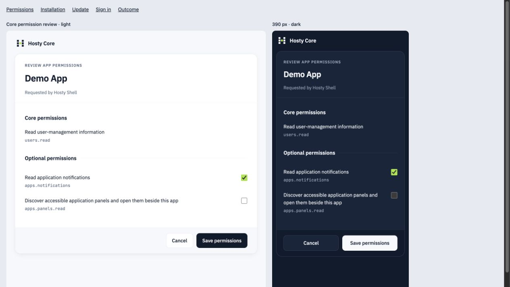

# Core Confirmation Design

Core's compact authentication and operation-confirmation pages use the visual
language in the owner-supplied Hosty Style Guide HTML: mist/white surfaces, ink
actions, lime interaction, IBM Plex Sans, JetBrains Mono and the seven-cell mark.
The wider [design-system plan](../design-system/plan.md) remains separate.

## Surfaces

`CoreBrowserPages` supplies the shared styles, brand header and approval layout.
Login, initial setup, recovery, invitation acceptance and plain Core status pages
use its authentication styles. Installation, updates, app permissions, assistant
MCP access, workspace manifest access, host path changes, removal and trusted Core
launch consent use the existing approval renderer with the shared card.

The approval header identifies the operation, app/request name, available version
and requesting application. Required permission descriptions and identifiers remain
visible; optional choices use labeled native checkboxes. Runtime review, autostart,
private-source grants, warnings and other existing review content remain in the form.
Removal uses a danger action. Terminal outcomes show a status label and distinct
symbol/color without offering an action that the underlying operation cannot perform.
The existing popup-completion script and native POST decisions remain unchanged.

Removal shows impact, a short runtime-state explanation and stop/removal and active-Shell warnings
on the Core page. One Removal options checkbox section covers app data, backups, source and ignored
runtime errors, without a duplicate static options list. The runtime-state explanation preserves the
prepared cleanup flag, including an explicit legacy keep choice. Changing choices rebuilds the same installation's
review facts and renews the nonce/digest before final confirmation. Unsafe source deletion leaves
Remove disabled with an explanation. The [installation contract](../app-installation-sdk/feature.md#trusted-confirmation)
owns defaults, compatibility and execution checks; Shell opens this page without a preliminary dialog.

Dark colors follow `prefers-color-scheme`. At narrow widths, cards and text wrap
within the viewport, input text uses 16 px and actions stay reachable by ordinary
document scrolling. Keyboard focus uses one 2 px lime (`#A3E635`) outline with zero offset,
no ink edge and no shadow/halo. Forced-colors mode uses a 2 px system Highlight outline.
These pages introduce no animation or frontend framework.

Compact credential actions and protected settings reviews use the same design. App sign-in
relay/storage pages retain their domain presentation.
The [settings experience](../settings-experience/feature.md) owns the API/review behavior and
configuration editors in Shell.

## Local Assets And Authority

Six embedded WOFF2 files cover Latin, Latin Extended and Cyrillic for the two
variable font families. Fixed `/core-assets/<filename>` routes serve only those
files with `font/woff2` and `nosniff`. Core ships the corresponding OFL notices
beside the assets. IBM Plex Sans files come from the Google Fonts URLs in the
provided reference; JetBrains Mono files come from its embedded assets.
Browser pages do not contact an external font service or load publisher logos.

Approval CSP permits same-origin fonts and retains its other restrictions,
including no framing and same-origin form submission. Session/origin checks,
decision nonce, optional permission defaults and mutation authority are unchanged.
Login continues to disclose no deployment origins and retains password-manager
autocomplete attributes. Untrusted caller/app names, versions and errors are encoded.

## Verification Evidence

Baseline: main `751a7e72ddca17ebeaeda400e01ce6c3b4df70c7`.
Platform version for the combined settings and confirmation feature: `0.147.8` to `0.148.4`.

- `dotnet build apps/core/src/Haas.Hosty.Core/Haas.Hosty.Core.csproj --nologo -v:minimal`
  succeeds. Four existing warnings remain in unread configuration parameters and
  cross-platform Unix file-mode calls; none originate in the presentation helper.
- `dotnet test apps/core/tests/Haas.Hosty.Core.Tests/Haas.Hosty.Core.Tests.csproj --no-restore --nologo -v:minimal --filter
  'FullyQualifiedName~InstallationApproval|FullyQualifiedName~CorePageMarkup|FullyQualifiedName~AuthEndpoints|FullyQualifiedName~AuthCsrfLogout|FullyQualifiedName~HostPathApproval|FullyQualifiedName~RemovalApproval|FullyQualifiedName~WorkspaceManifestApproval|FullyQualifiedName~OAuthHttp|FullyQualifiedName~CoreEnvironmentConsent'`
  passes 208 tests with no failures or skips.
- The final full Core suite passes 3,944 tests, with five opt-in runtime integration
  cases skipped. A subsequent focused credential/settings run passes all 57 affected
  tests after the final credential-review metadata edit.
- Browser inspection uses HTML exported from the production renderers with synthetic
  data. Permission forms are inspected in light/dark and at 390 px; login, installation,
  update, scrolling, visible focus and success/cancellation/failure outcomes are inspected.
  The comparison explicitly fixes the preview theme; production uses the system theme.
- `node scripts/docs-index.mjs --check`, `node scripts/check-versions.mjs` and
  `git diff --check` pass.

The connected external-workspace client does not expose child-sandbox creation. The combined
settings acceptance therefore uses a separate local Core data root and its Core-managed Docker
apps, built from the task worktree. Normal setup/password login verifies Shell embedding, Core
review cancellation/apply and credential revocation. QA containers and listeners are removed/stopped through their owner after acceptance.
The operator's Core and apps are untouched.
Native AOT publication is outside this local verification; CI retains its platform matrix.

## Testing Expectations

Retain approval HTTP coverage for nonce/origin/session checks, required/optional
permissions, runtime review, stale requests, cancellation and all supported plan
kinds. Font routes must return valid WOFF2 before login and must not expose arbitrary
embedded resources. Keep password-manager attributes and the no-origin login rule.
Check long text and native forms at narrow widths, both themes and keyboard focus. Keep the
single 2 px lime outline at zero offset without an ink edge or shadow/halo, with a 2 px Highlight
outline in forced-colors mode. Never remove a review field or recovery action to match an incomplete
visual reference.
