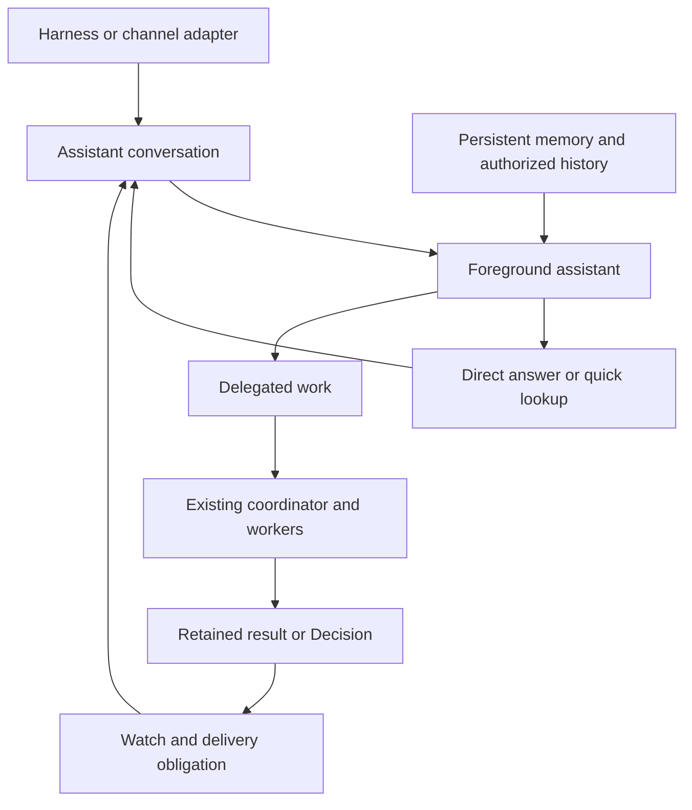

# Personal Assistant

The owner wants a conversation that still reads naturally the next day. They can add a detail
while work is underway, ask about another subject and get a useful answer while the first request
continues. For example, with access to the relevant workspace and film library:

> **Owner:** Sketch a plan for offline access in the library app.
>
> **Assistant:** I’ll have a draft prepared in the library workspace.
>
> **Owner:** Downloads only need to work on one device for now. Also, anything short to watch tonight?
>
> **Assistant:** I’ll pass on the one-device limit. *My Neighbor Totoro* is in your library and runs under 90 minutes.
>
> **Assistant, later:** The offline-access draft is ready. It covers downloads on one device. One question is still open: how long should a download stay available?

The film and result are illustrative. In use, the recommendation comes from an authorized lookup,
the plan update from its actual receipt, and the report from the saved document. The owner can
ask to resolve the open question or edit that same draft from here. A request for a plan can start
planning immediately. Implementation follows the separately authorized scope.

## Goal And Owner Direction

Provide one continuing point of contact that accepts unrelated requests, arranges independent
work, answers questions about its progress and reports selected outcomes. The assistant keeps a
recognizable identity and useful personal memory across interactions without loading its entire
history into every model request. Development, research and ordinary personal work are examples;
a repository, workspace or team is not required for an assistant interaction.

On 2026-11-16 the owner requested this Draft and detailed planning of the shared capabilities it
needs. Persistent memory is part of the requested target, including recalling discussions by
date or keywords. Existing delegation, events and recovery may be extended or refactored when
their present contracts do not fit; reuse must not force an unsuitable interaction model.
Adapt the canonical implementation instead of creating a second task engine, transcript store,
notification transport or scheduler. This authorizes design/documentation only, not implementation,
Ready status, deployment, commits or publication.

On 2026-11-17 the owner described the intended use in their own terms. The
[Owner Scenario](#owner-scenario-2026-11-17) records it and takes precedence where earlier text here
conflicts. The assistant is the owner's single entry point for work, not a dispatcher that turns
every message into a visible task. This refinement remains design/documentation only.

The earlier exclusion of learned memory from Composable Human And Agent Work remains valid for
that independently useful composition. This request selects a separate memory investigation for
Personal Assistant; it does not make memory mandatory for Core, ordinary chats or delegation.

## Owner Scenario (2026-11-17)

The owner described the target in their own words. The points below are requirements unless marked
open; open points are repeated under [Decisions Before Ready](#decisions-before-ready).

- **One chat everywhere.** The Shell side-panel assistant becomes this continuing assistant: one chat
  without a session list, scrollable back through its whole history, loaded progressively and marked
  with timestamps. Date navigation is open. Telegram, other channels and every connected device show
  the same synchronized timeline. Ordinary sessions stay available elsewhere in Harness and
  workspaces; their exact place is open.
- **A single entry point that discusses first.** The owner drops requests, questions and ideas here.
  A request may begin with a long discussion. The assistant analyzes it, asks for missing details,
  summarizes the agreed scope and dispatches when the owner asks for execution. A clear initial
  instruction to execute is sufficient. An idea can become quite specific while still under discussion.
  It never sends the owner to a worker's session to explain the request again.
- **Specialist knowledge in the same chat.** When the owner discusses, for example, a feature plan,
  the assistant brings an expert role such as planning or business analysis that knows the platform
  and advises what to do or avoid. The mechanism is open; see
  [Specialists And The Assistant Profile](#specialists-and-the-assistant-profile).
- **Delegation without clutter.** The assistant does little work itself and engages other agents.
  Delegated work must not pile up as dead records in the global Tasks list, and a trivial question
  must not set the whole task machinery in motion. Work is visible where it matters: in the work
  overview and in the workspace it concerns. See
  [Delegated Work Weight And Visibility](#delegated-work-weight-and-visibility).
- **No surprise permission failures.** Check known prerequisites against the selected worker before dispatch. If access
  changes later, surface the concrete blocker in this chat.
- **Responsive conversation.** The owner can send another message while work runs. Measure the
  time to a useful reply under load and show delays when the provider is saturated.
- **Conversation continuity.** A follow-up is understood in the context of the recent dialogue,
  including a recent exchange across midnight, without the owner repeating it. A fresh execution must not feel like a new
  session on every message.
- **Cumulative memory.** Memory accumulates without losing details through repeated compression. The
  assistant orients itself chronologically and loads only the relevant memory and history.
- **Work overview.** A compact live summary shows which agents work on what, their stage and
  progress, what is blocked and what recently finished. It appears in a side panel of the Harness
  client and, on request, as a short report in chat and Telegram. See [Work Overview](#work-overview).
- **Quiet by default.** Finished delegated work may be announced by a short system message without a
  model call. Stage-by-stage progress is not pushed unless requested, routine work may need no report
  at all, and Telegram must not buzz for every step.
- **Recurring routines.** The owner can say "check X every morning". The routine stays silent unless
  something needs attention, then reports the problem or raises a Decision.
- **Decisions for real choices.** Human input uses Decisions, also from Telegram, and only for
  choices that need the owner’s answer or approval. Ordinary conversational clarification stays in chat.
- **Configuration.** The assistant has its own configuration with a selected model and a default
  reasoning effort.
- **Harness first.** The assistant is built into Harness. Extracting it into a separate application,
  or making Harness part of Core, is outside this plan.

The owner asked to compare how existing systems solve these points before choosing mechanisms, rather
than inventing them; see [Research And Design Rationale](#research-and-design-rationale).

## Baseline And Required Changes

Inspected repository baseline: `7a428feedf5da2a42d367cc09cb2bdf86a39d211` (2026-11-16).
The local Core reports 0.180.0 and installed Harness 0.99.0. Source inspection and those version
observations are not runtime acceptance of this proposal.

| Existing behavior | Required change and owner |
| --- | --- |
| [Profile delegation](../profile-task-delegation/feature.md) supplies task trees, separate attempts, result review, local child delivery, parked waits, source claims and root limits. | Dispatch independent roots from assistant requests; coordinators keep using this engine. Add missing source-consumer or dispatch correlation support there, rather than adopting the assistant into a task. |
| [Message queues](../harness-message-queue/feature.md) accept input while an ordinary chat runs, but dispatch waits for that conversation; task attempts reject ordinary queues. | Reuse command identities, receipts and attachment handling while admitting independent short assistant interactions. Generic admission/context changes belong to Durable Agent Jobs D7; assistant-specific routing belongs here. |
| [Agent providers](../agent-provider-interface/feature.md) own native execution outside Harness. | Use bounded invocations through their public contract. [Invocation admission](../agent-invocation-admission/plan.md) owns shared capacity and enforceable limit extensions; do not put native SDKs back in Harness. |
| [Conversation History](../conversation-history/feature.md) provides authorized lexical search and provider-owned source reads. | Its [recall plan](../conversation-history/plan.md) adds temporal filters, surrounding context and explicit coverage. No assistant-private copy/search database. |
| User history, profiles and skills exist; reusable personal facts have no common memory contract. | [Persistent Memory](../persistent-memory/plan.md) owns durable facts, scopes, correction, forgetting and retrieval. This feature consumes it. |
| Child-task delivery and [Decisions](../shared-decisions/feature.md) already retain outcomes and continuation evidence. | [Assistant Events](../assistant-events-and-continuation/plan.md) adds assistant-addressed watches and input delivery; use Decisions for required human answers. |
| Core notifications persist human-facing records; Core domain SSE is an ephemeral refresh hint. | [Notifications D6/D7](../notifications/plan.md#deliverables) retains generic durable delivery and external channel ownership. A live stream alone cannot fulfill a notification promise. |
| The [Shell side panel](../assistant-entry-points/feature.md) hosts the Harness chat with a session list. | It becomes the continuing assistant timeline without a session list; ordinary sessions remain reachable in Harness and workspaces. Shell keeps hosting the panel and Harness owns its content. |
| [Basic Tasks](../basic-tasks/feature.md) shows the owner's numbered tasks in the global Tasks view; success needs an explicit result, a confirmed stop and the selected review. | Assistant delegation must not flood that view or impose the full barrier on trivial requests. The weight/visibility model is open below; global list changes belong to [Work Orchestration D3](../harness-work-orchestration/plan.md#deliverables). |
| Each provider app admits at most four occupied sessions by default since the 2026-11-16 extraction, and rejects further runs without a queue. | The owner questions this cap; [Invocation Admission](../agent-invocation-admission/plan.md#owner-question-on-capacity-2026-11-17) records the decision. |
| Scheduling is planned in [Durable Agent Jobs D1-D3](../durable-agent-jobs/plan.md#deliverables). | Recurring routines created from the assistant consume those schedules; this feature adds no scheduler. |

### Changes On Main Since The Initial Assessment

As of 2026-11-21 (`239bd85d`), an ordinary chat can delegate to a saved profile, read child
status and wait for a retained result. A child can run while the owner continues talking to the
parent. Reuse this path when a request needs a specialist without a numbered task. A child can
also acquire a workspace that becomes associated with its parent. The assistant needs to keep
each request bound to its own workspace, even when several children have different work in
progress. After a cold restart the existing parent continuation may wait for an authenticated
visit. The promised-report scenario still needs its own offline delivery check.
[Harness session subagents](../harness-session-subagents/feature.md)

Native subagent activity and results are now available to the parent. Harness can also display
new messages while it repairs gaps in retained provider history. Use these sources for execution
details and recovery. The assistant still needs the shared timeline, topic attribution and personal
memory described below. [Provider interface](../agent-provider-interface/feature.md) ·
[Harness history durability](../harness-history-durability/feature.md)

## Product Behavior

The initial product serves the current authorized operator in Harness. Ordinary-user execution
remains under [User Agent Sessions](../user-agent-sessions/plan.md); channel support cannot bypass
that boundary. One assistant address per owner is the recommended initial default, with the
configuration resolving an authorized provider, model and supported default effort. How these
settings are stored and whether the assistant itself uses a saved profile remain open.

| User action | Expected behavior |
| --- | --- |
| "Build an expense application; tell me when I can review it." | Persist the request and review-ready watch. Dispatch the agreed work with a coordinator when needed, and distinguish accepted, queued and actually started. |
| Send another unrelated request while planning or implementation continues. | Accept and handle it independently, without waiting for the task coordinator or a previous notification summary. |
| "What happened to the login fix?" | Resolve the task reference and read current authorized task/result/workspace evidence. Explain freshness, blockers, next action and links. |
| "Remember that I prefer concise Russian progress reports." | Save a scoped, inspectable preference under the memory policy and acknowledge the actual write result. |
| "What did we decide yesterday about currencies?" | Resolve the date in the user's timezone, search the relevant history, read surrounding messages and distinguish proposal from decision. |
| "Use dollars instead" or "cancel that." | Resolve the intended request/task, serialize against its current revision and confirm the supported disposition; ask if genuinely ambiguous. |
| A worker needs an answer. | Present the existing addressed Decision and route the answer to that exact question/attempt. Other conversations and tasks stay usable. |
| Close the browser, then reopen or reconnect after a restart. | Recover accepted requests, task links, memory and pending delivery from their owners; show uncertain work explicitly. |
| "I want feature X; let's think it through first." | Discuss in the timeline with suitable specialist knowledge, ask for missing details, summarize the agreed scope and delegate only after confirmation or an explicit go-ahead. |
| "What is happening with my work?" | Answer from the work overview: running work with stage, blocked work with reason, pending Decisions and recent results, with freshness. |
| "Check CI every morning; tell me only if something is wrong." | Create a recurring routine through the scheduling owner; successful runs stay silent, problems arrive as a short report or Decision. |
| Delegated work finishes and no report was requested. | Apply the request or routine preference. A quiet completion can update the overview alone. An enabled completion notice uses the retained outcome directly. |
| A worker would need a permission it lacks. | Detect known missing prerequisites before dispatch and ask once; needs discovered during execution arrive as Decisions in this timeline. |

The assistant can answer from the recent exchange or make a quick authorized lookup itself, for
example in the owner's film library. It delegates work that takes sustained investigation or
produces an artifact. A worker can prepare a workspace and write a draft while the owner continues
talking to the assistant. Simple
delegated work uses one executor; a complex request selects a coordinator that can assemble a
task-specific group from existing profiles and supported one-off configurations. A saved
team/organization hierarchy is not required. Catalog discovery uses concise descriptions; load full
skills only when relevant. The owner is never redirected to a worker's session to restate a request.

## Discussing An Existing Workspace Or Plan

“Which questions are open?” reads the current plan. “Add the one-device limit to that draft”
requests an edit now. “Help me think through the expiry question” can remain a discussion until
the owner asks to record a decision. Treat creating a plan, amending one, resolving a question
and starting implementation as distinct intents. Return the answer or the actual saved change
with a link in this chat. When a question needs specialist input, send the relevant brief and
keep the conversation here.

Resolve “that plan” from an explicit reply or link, then from the recent topic and its selected
workspace/session/document. Use the authorized directories to locate other work. If two plans
fit a proposed edit, name both and ask one short question. Pin the resolved workspace, plan path
or provider reference and source version to the request. A topic switch or another worker's
result cannot redirect a pending edit. Keep these references and outstanding requests across
compaction. Re-read current source before reporting status or applying an edit. If it changed,
reconcile the intended change against that version.

Use existing version-aware plan reads such as `get_plan` and `plan_workspaces` where available.
A delegated writer uses the owning workspace's normal edit workflow, preserves concurrent changes
and returns the document reference and outcome. An associated session is reachable only under
its access policy. [Documents](../documents-app/feature.md) · [Plan tracking](../plan-tracking/feature.md)

## Reading The Conversation Across Topics

Publish each reply as a coherent message tied to the user input or work that prompted it.
The film answer can arrive first. When the draft arrives later, refer to the offline-access plan
by name and link it. Keep the public order stable on reconnect. Workers return findings through
the existing result path. The assistant presents the relevant answer once. A plain system notice
can deliver a requested completion when a model summary adds no value.

Keep tool traces, partial worker streams and execution details in the existing authorized
execution views. Harness can offer expandable details and task progress. A private channel such
as Telegram can present the same exchange as short messages, with a reply reference or a link
where supported. The conversation should make sense with every trace collapsed or omitted. A worker can return
a ready user-facing answer with its source references. Route it into the right reply without
requiring another model call just to rewrite it.

## Delegated Work Weight And Visibility

The owner's concern on 2026-11-17: if every request becomes a full task, trivial questions create
numbered records, review barriers and orchestration overhead, and the Tasks list fills with dead
weight. Delegation should cost in proportion to the request and appear only where it is relevant.

- The work overview shows what the assistant runs now and what recently finished.
- A workspace shows the work associated with it, as it does today for linked roots.
- The global Tasks list does not show assistant-internal delegation by default. The owner expects to
  start most work through the assistant; whether that list keeps its role, gains a separate kind of
  owner-tracked work or is reworked is open.
- The owner can request tracking or a report explicitly. Show active delegated work in context and
  allow routine completions to fall out of the default overview. Visibility, report subscription
  and deletion are separate choices. Any eventual expiry must respect active work, promised
  reports, Decisions and the timeline's retention policy.

Options to compare before Ready; none is selected:

| Option | Shape | Cost |
| --- | --- | --- |
| Hidden roots | Reuse root execution and its completion checks. Extend attribution and list filtering to keep internal work out of the default global view. | Trivial requests still pay task creation and result-recording costs. Automatic expiry would need a separate retention decision. |
| Child-chat delegation | Use the existing saved-profile child chat and its retained result for a specialist consultation. Create a linked task if the owner subsequently wants separately tracked work. | Avoids numbered tasks for casual requests. Measure the cost of a full child chat and choose how to present completed consultations. |
| Task model rework | Treat a task as work the owner wants to track and link it to the executions that contribute to it. | Requires changes to existing task providers and views. |

Any choice keeps one execution engine, recoverable results and delivery obligations. Task changes stay
with [Basic Tasks](../basic-tasks/feature.md), [Profile Delegation](../profile-task-delegation/feature.md)
and the task-list presentation in [Work Orchestration D3](../harness-work-orchestration/plan.md#deliverables).
The 2026-11-16 direction already permits refactoring contracts that do not fit.

**Dispatch prerequisites.** Before delegating, the assistant resolves the executor and checks what can
be known in advance: provider sign-in and capacity, the workspace or source access the request needs,
background authority for unattended work, and Ask/Disabled MCP preferences for operations the work
clearly requires. A missing prerequisite produces one Decision or a clear explanation before dispatch,
not a failure halfway through. Needs that appear only during execution still reach the owner as
Decisions in this timeline. The check reads existing policy and grants nothing. The owner wants
permission handling to stay out of the way; simplifying the policy itself belongs to the permission
features, not this plan.

## Specialists And The Assistant Profile

The common settings already support a connection, model, default reasoning effort and selected skills.
Harness locks a session’s saved profile at its first dispatch. A role or profile change during an
ongoing discussion therefore needs a supported interaction boundary or a change to that contract.
Worker profiles and actual permissions keep their existing owners. [Agent Profiles](../agent-profiles/feature.md)

The following alternatives are for the owner to compare. The first two can be tried together.
The examples describe how the referenced systems work. The costs and fit for Harness are design
judgments to check with the same planning discussion.

| Approach | What happens when discussing the film-library app | What to compare |
| --- | --- | --- |
| General assistant with skills | The assistant sees descriptions of available skills and loads planning guidance when needed. It can ask the next question itself. [Claude Code skills](https://code.claude.com/docs/en/skills) | Preserves the recent exchange and adds guidance on demand. Check whether it catches a missing requirement and drops irrelevant guidance after a topic change. |
| Specialist consultation | The assistant sends a focused brief to a specialist in its own context, receives findings and explains them in the same chat. [LangChain subagents](https://docs.langchain.com/oss/python/langchain/multi-agent/subagents) | Useful for a second opinion. Passing a brief and relaying the answer can lose detail or add delay. Lengthy consultations must let other messages proceed. |
| Role switch or conversational handoff | A stored step can select different instructions and tools for the next turn, or route several turns to a specialist. The specialist asks questions directly in the same chat. [LangChain handoffs](https://docs.langchain.com/oss/python/langchain/multi-agent/handoffs) | Useful when several follow-ups need the same expert. Specify how to return, what context follows and how an unrelated question escapes that topic. |

Use the general assistant as the baseline for the comparison. Compare expertise, repeated questions, unnecessary
dispatches, latency and cost before choosing extra mechanisms. The assistant's saved configuration,
any conversational specialist and the profile that executes a task are distinct choices.

## Work Overview

The overview is a derived view over authoritative task, routine and Decision state of the work the
assistant started, not a second status store. It groups running work with its current stage and last
progress, blocked work with reason and next action, pending Decisions and recently finished results,
each with freshness. The side panel renders it live. In chat and channels the assistant reads the same
view and answers briefly. Stage detail depends on what executors report, such as task plans; missing
progress is shown as unknown rather than guessed.

Resolve the current owner's assistant-originated work through the retained request-to-work links.
Read authorized task and attempt state for those references, including the reported executor.
Filter a workspace view by its resource association and group children under their root. Paginate
the underlying records and indicate unavailable sources or incomplete coverage. Direct replies
and finished one-off consultations need no durable card in the default work list. The current
task-list API supports status, ancestry and removal filters. An origin filter, if selected, needs
an extension to that contract.

## Lifetimes And Ownership

Proposed vocabulary is not a shipped wire schema:

| Record | Lifetime and responsibility |
| --- | --- |
| Assistant address | Owner/installation, selected configuration and preference references; survives individual interactions. It is not an authority principal. |
| Timeline | Existing Harness-owned conversation/history storage, extended with logical input/reply relationships; one authoritative visible record, independent of native context. |
| Input receipt | Stable channel/request identity, content fingerprint, sequence, purpose, configuration/context revision and disposition. Survives a lost response. |
| Interaction | A conversational request and its context references. Several inputs can target one active run. A detached lookup or worker has its own execution identity and returns an attributed result. |
| Task link | Input to qualified root/attempt reference and dispatch receipt; points to task-owned state instead of copying its lifecycle. Carries the selected visibility and notification level. |
| Watch binding | Assistant Events-owned subject, condition, recipient, authorization, cancellation generation and delivery obligation. |
| Memory reference | Persistent Memory-owned revision, scope, provenance and applicability; never a task-status authority or permission. |

Extend Harness's existing durable storage and history projections. A small assistant correlation
index is reasonable; a second message payload ledger is not. Compaction alters model input only.
Users can page/search retained original messages regardless of a short interaction's context.
Define deletion, reset, archive and task cancellation separately; deleting a short run's cache
cannot erase task results, outstanding obligations or the visible transcript.

## Simple, Reliable Operation

On 2026-11-16 the owner clarified the design preference: choose simple, dependable solutions,
without making fault tolerance a reason to overload the architecture. A task may fail; accepted
work or a promised report must not silently disappear. Apply this through the existing persistence,
task, recovery and delivery owners, not a separate reliability subsystem.

- Persist acceptance, dispatch/watch correlation and the result/report obligation at their existing
  owners. Use a local transaction where state shares an owner; otherwise reconcile the retained
  identities through the existing outbox/inbox path. Do not introduce distributed transactions.
- Recover pending accepted inputs and reports without another user message. Extend existing
  startup/reconnect recovery and a bounded retry pass over due pending records; a live event is a
  wakeup, not the only opportunity to discover completion. No periodic model call is required.
- Save a report to the existing timeline idempotently before considering its local delivery done.
  A model-generated summary is optional for delivery: on summary failure, retain a plain outcome
  and authorized result link. An external-channel failure does not rerun the task or erase the report.
- Bound retries and expose unresolved work as pending or needs attention, with a reason and a
  supported next action. Preserve accepted-work/result references through ordinary idle cleanup
  until settled or explicitly abandoned under the owner's retention policy. Silence alone does
  not prove that a worker stopped; use provider/task evidence before any new execution attempt.

The target is recovery from component interruption or a missed delivery while retained storage
survives. A stopped host cannot respond until it returns; storage loss and replicated/high-availability
deployment are outside this feature. Start with the existing stores and consumers. Require a concrete
failure case before adding infrastructure, another queue, or another durable state representation.
The detailed recovery and delivery rules remain with D7 of Durable Agent Jobs and D3/D5 of Assistant
Events; D6/D9 here integrate and verify them rather than implement a second recovery loop.

## Responsive Intake And Short Execution

Persist an input and its dispatch intent before acknowledging server acceptance. Retain the exact
request after uncertainty; changed input under the same identity conflicts. Queue acceptance,
model admission, answer creation and channel delivery have separate receipts. Bounded queues
reject new input visibly at capacity without evicting accepted work.

First evaluate keeping a compatible foreground provider session across a stretch of dialogue.
When idle, admit the next turn on that session. When busy and eligible, Auto can forward an
authenticated user follow-up to its current run under the shared active-input contract. The owner
can deliberately queue a next turn. Preserve recent replies, source references and open work across
context compaction. Reset, incompatible configuration, an exhausted context or failed resume can
require a new segment with bounded reconstruction from authorized history. Elapsed time or each
new message alone need not create a new segment.

An active run may incorporate a correction and answer a quick question at its next opportunity.
It may also be waiting on a slow operation. Hand long setup, planning and worker supervision to
their owners promptly. If that still leaves independent questions waiting, compare an isolated
lookup or short interaction using the existing execution path. A quick read-only lookup can run
directly with the selected tools. Use the simplest route that passes the overlapping-requests
test below. Native steering by itself provides no guarantee of a parallel answer. On a provider
with only next-turn input, label queued corrections and keep independent assistant intake available.

Correlate each user message with the relevant work, reply and exact run where applicable.
A correction received before dispatch updates the brief or fences pending dispatch on its revision.
After dispatch, route a supported amendment to the exact worker or show what needs changing.
Report whether the update reached that work. An acceptance receipt from the foreground session
alone cannot establish it. Approvals, tool callbacks and Stop keep their exact run bindings.
[Input During An Active Agent Run](../active-run-input/plan.md)

`task_adopt` intentionally binds its originating conversation to a root attempt. Do not use it on
the persistent assistant timeline or hold that timeline in `task_wait`. When delegation uses a task
root, create it through the task provider/executor path and pass the selected request, constraints, relevant memory/evidence
and result criteria. The root's separate coordinator owns child waits and review. Reconcile a lost
root-creation/start response before issuing another command. Task completion never means automatic
publication, resource removal or authorization to start unrelated work.

Four is the provider runtime’s default ceiling for occupied sessions. It allocates no dedicated
slots to the assistant. A worker, a run whose stop is unconfirmed or a reserved continuation can
occupy capacity. Compare observed time to the first useful answer at different loads and limits.
Test the simplest configurable policy first. Consider a protected interactive allowance only if
contention still makes the assistant miss its response target. Identify automatic summaries and
maintenance as background work in that comparison. The [admission plan](../agent-invocation-admission/plan.md)
owns the choice and the response when a provider is full.

Provider capabilities determine which restrictions are enforceable. At the baseline Codex does
not advertise `nativeTools.none`, and current adapters reject some hard output/tool-call limits.
Role instructions alone cannot establish a strict coordination-only execution boundary. Before
Ready, select a compatible first provider/configuration or finish the necessary shared capability
extension. Retain measured, observed and enforceable limits separately; unsupported configurations
must be visible instead of silently weakening the requested behavior.

Use the admitted MCP/workflow selection to expose task discovery/root dispatch/status/control,
authorized memory/history operations, selected quick read/search tools and the selected Decision/watch operations. Do not expose
implementation, arbitrary lifecycle/publication, task adoption or parent-wait operations in this
short invocation. This is an invocation capability subset under existing policy, not a new profile
principal. Native-tool restrictions alone do not constrain broad connected MCP tools. Verify actual
denials when the model requests an operation outside the admitted subset.

Fresh runs also need provider-owned retirement. The common invocation plan owns safe native session,
attachment and receipt retention; Harness only requests the supported operation after confirmed
stop and settled obligations. Retiring native state preserves the visible timeline, task results
and replay fences. A short-run feature is incomplete if it grows provider storage without bounds.

## Memory And Context Assembly

Persistent memory is part of this product's first complete acceptance, not postponed as an optional
enhancement. Start with explicit user facts/preferences and confirmed decisions. Optional background
extraction can propose memories later under the memory owner's policy; whole-history extraction,
self-modified instructions and automatic learning are not prerequisites.

The owner asks for memory that accumulates without degrading. Repeated re-summarization must not be
the only copy of old details: retained originals in history stay the source of truth, summaries are
navigation aids with covered ranges, memories carry time, and recall loads only the needed excerpts.
Select the mechanism by comparing the systems listed under research.

Assemble bounded input using common Durable Agent Jobs D7 services in this order:

1. Stable role/policy, chosen profile and a compact tool/skill directory.
2. A small revisioned personal memory pack and relevant project/activity-scoped memories.
3. Recent relevant messages and a versioned discourse summary with its covered source range.
4. The current request and explicit task/question/reply references.
5. Retrieved history excerpts and current task/resource observations when necessary.

Keep stable prompt prefixes cacheable. Budget recent messages, memory, retrieval and tool output
separately; neither "last N messages" nor a rolling prose summary is the sole context policy.
Memory avoids repeatedly rediscovering stable preferences and project facts. Mutable task state,
availability and permissions still require an authoritative read before a current-state claim or
action. Allow already-loaded memory to be reused only while its revision/access invalidation and
freshness policy remain valid. Record source revisions and distinguish remembered from observed.

For "yesterday," first use explicit reply/task references, then personal memory/topic pointers,
then date/keyword history search, then a bounded surrounding-message read. Use source event time
rather than projection update time. If several discussions fit, present the candidates. A recalled
proposal is not a decision; a superseded preference is not current. Failed or partial searches must
not become "we never discussed this." Personal memory is shared across this owner's authorized
interactions/channels, not automatically across users or every worker. Handoffs select only relevant
permitted facts and evidence; task membership does not share private transcripts.

## Watches, Questions And Channels

"Tell me when it is ready" creates a retained watch with an explicit criterion: accepted result,
review-ready material, failure or required input. Define whether it targets one attempt or the
logical task across retries/reopening. Register the obligation before making execution eligible,
or atomically correlate it with dispatch and reconcile retained outcomes to close the early-result
race. Exact task result/review state determines success; a finished model response does not.

Reuse the shipped result persistence and local outbox/inbox mechanisms, adapting their recipient
contract under Assistant Events. A personal assistant is a valid observation target without being
the task's parent. The local path and a later cross-app transport must share event/obligation
identities so they cannot both notify for the same outcome. State reconciliation can recover a
retained terminal result; it cannot claim to reconstruct every lost intermediate transition.

Meaningful events can append a passive message or request a short summary interaction. Model
inference is unnecessary while waiting. Summary failure must leave the outcome deliverable through
a bounded fallback message and retryable state. Delivery failure never reruns the completed task.
Cancellation of a watch, stopping a reply, cancelling a task and disabling background admission
are separate controls. Each request or routine has a notification level: silent, completion only or
every stage. Completion only is the proposed default for delegated requests; routine success is
silent. A completion message is built from the retained outcome without a model call, and a model
summary is produced only on request. The owner's explicit request takes precedence over defaults.
Show an actionable blocker once and link any required Decision. Keep routine progress in the
overview. A connected device can catch up on the conversation independently of whether it issued
a push alert. External adapters project the authorized messages their channel can represent and
record their own delivery status. Confirm default notices and channel alerts before Ready.

An external adapter normalizes authenticated sender, conversation/thread, message ID, attachments,
reply reference and destination into the same input contract. Pair it with the actual Hosty user;
bot possession, display names or a group member's message are not that identity. Outbound content
is authorized for the exact audience. Group and private history are not silently combined.
Reuse existing background grants for offline/event-driven work; interactive admission does not
create permanent unattended authority. Expired authority parks work visibly. Channels present
Decisions with native controls where available, such as message buttons, and accept a free-text
answer; the answer resolves the exact Decision under the same identity rules as Harness.

The Shell side panel and the Harness page are the first UI. They show one continuing timeline
without a session list, loaded progressively with timestamps and the selected history navigation, plus the work
overview, pending Decisions, memory inspection/correction and failed/pending delivery. Authorized native clients can page the same timeline. Channel adapters map messages and
replies to it with stable identities and respect the destination’s available history and controls. SSE/reconnect converges from authoritative state while
preserving drafts. Channel-neutral contracts and an adapter fixture belong to initial
acceptance; a real Telegram/Discord deployment remains Notifications D7 and separate approval.

## Shared Work And Dependency Sequence

| Order | Owning work | Personal Assistant integration |
| --- | --- | --- |
| 1 | [History recall](../conversation-history/plan.md), [Persistent Memory](../persistent-memory/plan.md), [Invocation Admission](../agent-invocation-admission/plan.md), [Active Run Input](../active-run-input/plan.md) | Settle shared schemas, access, provider capability and storage choices against a non-assistant consumer too. |
| 2 | [Durable Agent Jobs D7](../durable-agent-jobs/plan.md#deliverables) | Reusable bounded context, independent input ownership and recoverable short dispatch over current providers. Recurring routines additionally need its schedules (D1-D3). |
| 3 | [Assistant Events D1-D3/D5](../assistant-events-and-continuation/plan.md#deliverables) and [Notifications D4/D6/D7](../notifications/plan.md#deliverables) | Assistant-addressed local watches first if separately approved; general cross-app delivery and actual external channels remain with their owners. |
| 4 | This feature | Connect intake, detached roots, memory/recall, watch policy and the Harness UI; verify the combined user journeys. |

The implementation sequence is proposed, not a mandate to finish every broader Draft first.
Existing features remain independently useful. Before Ready, agree any bounded extraction/transfer
explicitly, preserve stable deliverable IDs and leave remaining scope tracked with its original
owner. One coherent feature uses one branch/PR, not one PR per phase. Do not label a local watch
as the completed generic durable event bus or bounded invocations as the completed scheduler.

## Research And Design Rationale

Sources were inspected on 2026-11-16. Product documentation establishes mechanisms, while issues
and user accounts suggest failure cases; this is not a representative satisfaction survey or a
Hosty benchmark. No external runtime was installed or tested for this Draft.

| Evidence | Useful idea or limitation | Consequence for this design |
| --- | --- | --- |
| [Letta conversations](https://docs.letta.com/concepts/conversations) | Persistent agent identity/memory can coexist with independent conversations and bounded active context. | Separate identity, timeline, short execution and memory; retrieve older evidence as needed. |
| [Hermes Kanban](https://hermes-agent.nousresearch.com/docs/user-guide/features/kanban) | Durable tasks and origin subscriptions cover work that outlives a conversational turn. | Use Hosty's task lifecycle and explicit delivery obligations, rather than retaining a waiting foreground model. |
| [Letta Code #5493](https://github.com/letta-ai/letta-code/issues/5493), opened 2026-11-03, open when checked | Human-reviewed AI-assisted report supplies a reproduction in which a recent-conversation limit excludes an older exact match before relevance search; maintainer confirmation is absent. | Test old-topic recall beyond the recent window; disclose coverage and apply final result limits after eligible candidate search. |
| [Hermes #70846](https://github.com/NousResearch/hermes-agent/issues/70846), opened 2026-07-24, closed completed 2026-09-24 | Users reported missing UI history after compaction; investigation found retained messages hidden by an active-context projection, and follow-up reported a corrected display. | Keep the human transcript independent from the model projection and verify post-compaction browsing/search. |
| [OpenClaw #118625](https://github.com/openclaw/openclaw/issues/118625), opened 2026-08-03, closed completed 2026-08-23 | A report and a production confirmation describe child results stranded during parent compaction. A maintainer reports a durable-delivery fix; this is historical evidence, not a claim of a current defect. | Persist results and delivery obligations independently of compaction/inference; test blocked delivery and restart. |
| [Hermes memory-after-compaction discussion](https://www.reddit.com/r/hermesagent/comments/1x26hq0/memory_after_compaction/), 2026-10-10 to 2026-10-12 | Anecdotal experience describes report-quality regression despite external memory while data processing stayed correct, followed by recovery and moving procedures into skills. A separate comment reports an obsolete decision recurring. | Evaluate useful task behavior and stale-decision errors, not only successful retrieval; keep procedures, facts and live task state distinct. |

The [specialist comparison](#specialists-and-the-assistant-profile) adds first-party examples reviewed
on 2026-11-18 for skills, consultation and conversational handoff.

The working synthesis is bounded shared personal memory plus source-backed episodic recall, short
interactive dispatch and durable task/event ownership. It selects principles, not adoption of an
external framework. Memory backend choice requires the comparison in its owning plan; more stored
text alone is not evidence of better continuity.

## Deliverables

- [ ] D1. Resolve the product/record contracts, initial provider and enforceable invocation profile, authority/retention defaults and exact shared-feature delivery/transfer boundaries; record the selected tradeoffs and obtain explicit Ready approval before implementation.
- [ ] D2. Integrate common command admission and Harness history storage into the assistant address/timeline, reply and topic correlation, qualified workspace/plan focus and routing of reads or amendments to an existing draft, preserving ordinary chat/task behavior and recoverable attachments without a second transcript or dispatcher.
- [ ] D3. Integrate the common bounded context and invocation-admission services for continued foreground dialogue, supported active-run follow-ups, queue fallback and isolated work where needed, including time to a useful answer under load, related-command ordering, run-qualified controls, admitted tool subsets, native retirement, stale-result fences and visible unsupported/saturated states.
- [ ] D4. Connect delegated work and profile selection with retained dispatch references, selected context and task/Decision navigation under the selected weight/visibility model, keeping routine internal work out of the default global Tasks view and checking known dispatch prerequisites first; extend the existing delegation entry point where needed without binding the assistant itself to a root or duplicating task orchestration.
- [ ] D5. Integrate Persistent Memory and extended Conversation History for scoped memory packs, explicit save/correct/forget, date/keyword recall and evidence-backed answers; expose the sources and stale/partial/unavailable outcomes in the assistant experience.
- [ ] D6. Integrate Assistant Events-owned watches and delivery obligations with notification levels and task/Decision presentation, including early results, reviewed success, recovery without another user prompt, durable report append, model-free completion messages, silent routine success, visible unresolved delivery, fallback summaries and separate watch/task cancellation.
- [ ] D7. Deliver the continuing assistant UI in the Shell side panel and Harness page: one timeline without a session list, progressive history loading with timestamps and the selected history navigation, an always-available composer, coherent request-linked replies across interleaved topics, optional execution detail, memory controls and pending questions/delivery; keep ordinary sessions reachable elsewhere and preserve drafts and accessibility across live updates and reconnection.
- [ ] D8. Define and verify a channel-neutral assistant input/reply binding with an independent adapter fixture, reusing common delivery and identity contracts; leave actual external channel deployment with Notifications D7.
- [ ] D9. Run the integrated acceptance matrix and memory/latency evaluations below, report provider limitations and full costs, and resolve failures before claiming the continuing-assistant behavior.
- [ ] D10. Document shipped behavior, limits, retention and recovery in feature.md, reconcile related owners, remove this plan only after all deliverables pass and regenerate the index with the appropriate implementation versions.
- [ ] D11. Deliver the work overview as a derived view over authoritative task, routine and Decision state: running work with stage and progress, blocked work with reason, pending Decisions and recent results, rendered live in the side panel and reported briefly on request in chat and channels.
- [ ] D12. Integrate recurring routines created from the assistant over Durable Agent Jobs schedules, with silent success, problem reports or Decisions, and list/pause/cancel from chat and the overview.
- [ ] D13. Implement the selected specialist mechanism and assistant configuration with model and default reasoning effort, so discussions draw on specialist roles inside the same timeline without redirecting the owner.

## Decisions Before Ready

- Select the first provider/model and supported short-invocation restrictions after capability and
  latency evaluation. Exact model names and numeric SLOs are not selected by this Draft.
- The owner's target is one assistant address with one timeline shared by Harness, native clients
  and channels (2026-11-17). Decide how group chats and project-specific views relate to it, and
  where ordinary sessions remain reachable and how the owner navigates to a past date.
- Set context, queue, concurrency, wake, memory-pack and retention budgets; distinguish hard limits
  from observed usage and target latency. Choose saturation behavior rather than promising zero delay.
- Approve memory packaging/backend and explicit-save defaults under Persistent Memory. Automatic
  extraction, semantic indexing and household/team sharing require their stated separate decisions.
- Agree a bounded local watch/context delivery slice or complete the owning broader features; record
  any transfers before implementation. Choose task/attempt watch defaults across rework/reopening.
- Specify late corrections, cancellation ambiguity and the fallback when a task provider cannot
  apply steering to an active attempt. Never silently mutate its immutable admitted objective.
- Choose the delegated-work weight and visibility model, the future of the global Tasks list and the
  retention of finished assistant delegation.
- Choose the specialist mechanism and whether the assistant configuration is a regular profile.
- Compare continued foreground sessions and independent segments on the overlapping-requests fixture.
  Select the simplest approach that meets response, continuity and recovery targets. Agree the context
  and latency budgets and the fallback on providers with only next-turn input.
- Confirm notification-level defaults per request, routine and channel.
- Decide whether recurring routines belong to the first acceptance or a later phase.
- Define which dispatch prerequisites are checked and how a missing one is presented.

## Verification

Documentation now: regenerate the index, validate documents/relative links against the preparation
base, and run `git diff --check`. No runtime build, sandbox or paid-model run is needed for this Draft.

Later acceptance must cover:

- Hold plan preparation or delegation open. Send a scope correction and a separate film question
  while it is pending. With a ready library fixture, require the actual film answer before releasing
  the plan operation. Then finish the plan, checking the correction against its source. Repeat with
  active-input support and with only next-turn input. Compare time to a useful answer, model/tool
  calls and correctness before selecting the implementation.
- Reopen the timeline and read it with all technical details hidden. Both answers must be attributable
  from the words or reply links, once each, with no mixed worker output. Check the same transcript
  through the plain-text channel fixture.
- Discuss an existing Draft across compaction, inspect its open questions, then request an edit.
  Switch focus to a different workspace while it runs. Verify that only the intended worktree
  draft changed, the returned link resolves to that version and implementation never started.

- Two unrelated requests during a long root task and during a slow summary; verify answer latency
  under saturated worker capacity, not merely an HTTP acceptance receipt. Compare with ordinary
  queued chat using matched provider/configuration and report p50/p95, errors and cost. Include
  a burst of automatic completion summaries and memory work competing with a direct user message.
- Interleaved streamed replies/tools and a late approval/callback/Stop for another interaction;
  verify correct message grouping, exact run control and rejection of disallowed MCP/native tools.
- Repeated short runs and retirement across restart: bounded native storage, retained user history,
  unresolved-run protection and no duplicate action when an old command identity is retried.
- Duplicate input, disconnect after acceptance, crash before/after root creation, conflicting
  correction/cancellation and fresh sign-in after restart; retain one logical dispatch without
  asserting exactly-once external effects.
- Recall yesterday across midnight/DST, an older topic after 100 unrelated conversations, a keyword
  late in a long message, an incomplete provider and ambiguous discussions. Cite exact evidence.
- Correct/forget a preference, compact repeatedly, restart and query again; obsolete or deleted
  memory cannot return as active knowledge through summaries, caches, worker handoffs or pending
  extraction. Explicit historical queries can still read independently retained originals; test
  current-deletion checks on late replies from contexts already dispatched before forgetting.
- Complete several tasks while a new user input and compaction overlap; retain every accepted
  input/result and reconcile delivery without rerunning completed tasks. Exercise review/rework,
  cancelled watches, reopening, missing provider authority and unknown delivery receipts.
- Accept a task with a promised report, stop Harness before delivery, let the independently running
  task finish, then restart Harness without another user message. Recover one retained local report.
  Interrupt again after the report append but before its delivery receipt; replay must not duplicate
  it. Repeat with summary/provider/channel failure and retry exhaustion: show the authorized plain
  result or an explicit pending/needs-attention record, preserve unresolved references through idle
  cleanup, and never rerun the completed task. Use focused deterministic fault fixtures first.
- A task question parks only dependent work; answer its exact Decision through Harness and a
  channel fixture without granting access to another private conversation.
- Display/search the retained transcript independently of active model context; memory and history
  access revocation must invalidate derived context before another disclosure.
- Evaluate the same multi-day scripted journeys with recent-context only, explicit memory plus
  lexical/temporal recall, and any proposed semantic retrieval. Measure correct decisions, stale
  fact use, repeated questions, irrelevant recall, tool reads, latency and total token/cost usage.
- Discuss one request over many turns, then delegate it; the worker receives the agreed summary and
  never asks the owner to restate the request in another session.
- Discuss a feature across midnight, interrupt it with a film recommendation, then return to it.
  “Offline too” updates the brief. Check for zero implementation dispatches during discussion and
  one on “build the version we agreed.” Compare direct, consulted and specialist-led answers.
- Ask dozens of casual questions. Verify correct replies without global task clutter. Check that
  tracked work and its workspace are reachable and unresolved reports survive ordinary cleanup.
- Request work that needs a missing permission; the assistant raises one Decision before dispatch.
- Compare the overview across two workspaces and an unrelated manual task after restart. Verify
  assistant origin, assigned agents, grouping, unknown progress and partial source availability.
- Run a day with several completed requests and routines and count channel notifications; only
  requested completions, Decisions and problems arrive, and routine success stays silent.
- Ask same-day follow-ups that rely on earlier turns; measure correct reference resolution against a
  fresh-context-only baseline.
- Use an empty Core registry and unrelated provider IDs for shared contracts. Integration/browser
  checks use an approved managed sandbox and normal identity. The heavyweight tasks suite runs
  only when explicitly selected by the user or an approved verification plan, per AGENTS.md.

All runtime deliverables remain unimplemented and unchecked. This plan records proposed acceptance,
not results inherited from other systems or prior Hosty feature tests.
