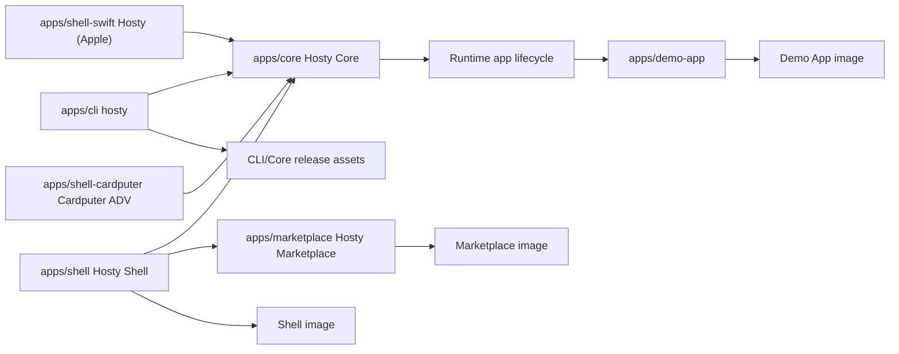

# Repository And Release Model

This document records the current repository layout and release artifact boundaries after the Core/Shell split and retirement of the legacy combined Host package.

The release publisher separates validation, artifact builds and announcement. Runtime application
updates follow the [reviewed update contract](../runtime-app-update/feature.md); Core and CLI use
[paired platform feeds](../platform-release-feeds/feature.md).

## Decision

Hosty uses one repository for:

- `apps/core` - Hosty Core, the local-first ASP.NET Core API and runtime orchestrator;
- `apps/shell` - Hosty Shell, the browser client and Core-managed runtime app;
- `apps/marketplace` - Hosty Marketplace, the optional catalog storefront system app;
- `apps/demo-app` - the first-party example runtime app;
- `apps/cli` - the standalone `hosty` CLI;
- `apps/shell-swift` - the native Apple client (iOS, iPadOS, macOS) for a Hosty host;
- `apps/shell-cardputer` - native M5Stack Cardputer ADV operator-console firmware;
- `skills/hosty-app-skill` - the repository-shipped Codex skill for wrapping apps as Hosty runtime apps;
- product/channel metadata and documentation.

The retired `apps/host` package and `host-image.yml` workflow are no longer part of the release model. Core and Shell are separate components; Shell is distributed and managed as a runtime app rather than bundled into a combined Next.js Host image.

## Component Boundaries



Core owns API, auth, app lifecycle, source/feed state, backup state, local control discovery, and runtime adapters. Shell owns the host browser UI. Marketplace owns its catalog source and storefront UI. The CLI bootstraps local Core and calls Core APIs for ordinary operations.

`apps/shell-swift` sits outside the runtime-app model entirely. It is a client installed on the operator's device, not on a host: it has no manifest, Core neither installs nor supervises it, and it is never a `ui-client` Core can redirect a browser to. It consumes the same browser API as Shell. Its version lives in `apps/shell-swift/Config/Version.xcconfig` and moves independently of every other artifact here.

`apps/shell-cardputer` is also a native operator client rather than a runtime
app. It is ESP-IDF firmware installed on an M5Stack Cardputer ADV, consumes a
bounded administrative subset of the Core API, and has no runtime-app manifest.
Its version lives only in `apps/shell-cardputer/version.txt` and moves
independently of the platform, browser Shell, and Apple client.

### .NET build toolchain

`global.json` requires .NET SDK 10.0.401 or a later .NET 10 feature band/patch through
`rollForward: latestFeature`. Core and CLI retain `net10.0` and Native AOT publication.
The SDK floor includes runtime/Native AOT compiler 10.0.12, which first shipped the
[Mach-O relocation fix](https://github.com/dotnet/runtime/pull/132171) for Apple's
`too many large addends` linker assertion; the older 10.0.11 compiler can fail on Xcode 27.1.
No classic-linker override or separate LLVM linker is required.

Validate macOS Core publication with `npm run core:aot` and CLI with
`dotnet publish apps/cli/src/Haas.Hosty.Cli/Haas.Hosty.Cli.csproj -c Release -r osx-arm64 --self-contained true`.
The Core gate cold-builds the native artifact and rejects new trimming/AOT warnings. Native
publication and execution on one architecture do not establish other release targets' readiness.

### The shared root lockfile

The Node runtime apps, `apps/harness` and `packages/app-sdk` resolve
through one root `package.json` / `package-lock.json` pair (npm workspaces). A component boundary in the
diagram above is therefore not a dependency boundary: one lockfile decides what all of them install.

The root `overrides` block is that shared tree's **security floor**. It currently holds
`"postcss": "^8.5.26"`, above the `8.5.23` that patches GHSA-fxqj-rqcc-2cmp. Two properties of how it is
written are load-bearing:

- **Top-level, not nested under one dependent.** An override nested under a single package (`{"next":
  {"postcss": ...}}`) reaches only that package's copy. Every other nester resolves independently - `vite`
  declares its own `postcss` range and sat on a vulnerable version for weeks behind exactly such a guard,
  where no Dependabot pull request could reach it either, because the root manifest has no direct
  `postcss` dependency to bump.
- **A caret range, not an exact version.** An exact override is simultaneously a floor and a **ceiling**,
  and the ceiling is the half that rots: the removed `overrides.next["."]` pin held Next.js below its own
  advisory fixes until nine of them had accumulated. A caret floats upward on its own.

Changing an override does not by itself re-resolve anything. npm prefers an existing lockfile resolution,
so `npm install` and `npm install --package-lock-only` are both no-ops against an already-locked nested
node; `npm dedupe --package-lock-only` re-resolves it. Verify the result by resolved version rather than by
reading manifests:

```bash
node -e "const l=require('./package-lock.json');for(const k of Object.keys(l.packages))if(/node_modules\/postcss$/.test(k))console.log(k,l.packages[k].version)"
```

A change to this floor is a lockfile-only change and carries no artifact version bump; it reaches hosts the
way any other lockfile change does (see "Ready release publication" for image apps, and the source
commit probe in [Runtime App Update](../runtime-app-update/feature.md) for source-installed apps).

## GitHub Actions Model

[CI Feedback Loop](../ci-feedback-loop/feature.md) owns automatic affected checks, explicit local integration, the stable `ci-required` aggregate and the development/review readiness rules.

`ci.yml` runs on every PR and main push without a workflow-level path filter. Cheap policy, version and documentation checks run first; affected component checks run in parallel. Core unit tests and NativeAOT are separate jobs. Manual exact-revision CI runs the remaining normal checks; expensive native/Docker acceptance uses explicit local commands. Shared web changes affect Shell/Harness; root Node dependencies affect Node consumers; genuine .NET toolchain/configuration changes affect .NET consumers. Strictly verified platform version-only metadata does not run every native scenario.

### Ready release publication

[`ready-releases.yml`](../../../.github/workflows/ready-releases.yml) starts after successful,
trusted `main` push CI. A pull request runs checks without advancing a feed. Manual recovery also
requires exact successful main validation. The publisher refuses a dirty or mismatched checkout.
SDK and Cardputer publication remain independent; the native Apple client has no publishing workflow.

The publisher has three separate decisions:

1. CI selects required checks using `scripts/ci-policy.mjs`.
2. `scripts/releases/prepare.mjs` compares effective build inputs with retained artifact receipts.
3. An application release changes only when its manifest, production source or required artifacts
   change, or a completed candidate still needs promotion.

An unrelated Core change therefore does not rebuild all application images. Shared inputs select
their actual consumers. Unsupported Docker input syntax conservatively includes the whole context
and disables reuse with an explicit reason. npm contexts project the workspace lockfile's nested,
peer and optional dependency closure; the builder receives those exact files, modes and symlinks.
Fingerprints also include the Dockerfile, resolved base images, frontend, builder and build arguments.
Recipes with unpinned package-manager/network setup explicitly disable reuse.

Reuse requires the original input fingerprint, full source commit, signed artifact provenance and
consumer-readable content for every declared platform. A reused service retains its original build
commit. Telemetry's backend and UI can therefore advance independently inside one complete release.
The generated combination passes the actual Core manifest parser for every production profile before
its candidate is recorded. This contract check complements source CI and runtime acceptance; it is
not a claim that a digest proves application correctness.

### Metadata, feeds and concurrency

[`distribution/release-publisher.json`](../../../distribution/release-publisher.json) is publisher
configuration. This distribution declares automatic `daily` and manually promoted `stable`, with
stable as the fresh-install default. Feed IDs, count and default are data; another publisher may
configure one, three or ten unrelated names. No branch is needed for each feed.

Generated metadata lives on the configured `app-releases` branch, separate from authored `main`:

```text
apps/<app-id>/releases/<release-id>/{manifest.json,release.json,...assets}
apps/<app-id>/{candidate.json,feed-state.json,feeds.json,install.json}
apps/<app-id>/promotions/<request-id>.json
platform/releases/<release-id>/release.json
platform/{candidate.json,feed-state.json,feeds.json,bridge-intent.json,bridge.json}
artifacts/images/<image-id>/<input-fingerprint>/<digest>.json
```

Release metadata is written once. Assets and exact metadata commit URLs are verified from the
consumer's side before a separate fast-forward commit moves a feed pointer. Concurrent writers
refresh and retry their changes without dropping unrelated apps or feeds; no force-push is used.
An uncertain successful push is recovered from its retained bytes. Completed release metadata,
original artifact attestations and promoted image/native bytes require retention: deleting them is
a destructive release-management action, not automatic cleanup.

An incomplete app cannot advance its feed. Independently complete apps can still publish when one
image job fails. A missed promotion reuses its retained candidate without rebuilding it. A no-op
source change does not manufacture a new release. Version strings describe compatibility; exact
release identity includes the manifest and content digests, so a dependency rebuild can produce a
distinct release with an unchanged version.

[`promote-release.yml`](../../../.github/workflows/promote-release.yml) takes an exact target,
release ID, feed ID, expected current release (`first` for an empty feed), stabilization evidence and
a persistent promotion UUID. It rechecks existing artifacts, then advances only that feed. It builds
nothing. A stale expected pointer, source regression/divergence, invalid artifact or reused UUID for
another decision is refused. An older retained daily candidate can become stable while daily stays
on a newer candidate. Retries preserve the original decision.

### Compatibility image tags

Release manifests use `repository@sha256:...`, never a moving tag. Build jobs upload unique candidate
tags; first publication may also claim the declared version tag. The durable version-alias receipt
fixes that first digest. Later same-version builds cannot overwrite it, and a missing alias is
recovered from the original claim. Registry access failures do not count as a missing tag. Existing
aliases predating the new publisher stay unchanged. The old app-image workflows and rolling native
publisher are removed. Cardputer alone retains its separate rolling-release freshness guard.

### First publication and existing installations

The rollout sequence is explicit; code availability does not establish public release readiness:

1. Validate and merge the reader/publisher revision through the ordinary repository workflow.
2. Run Ready releases for that successful main revision. Inspect each completed app/platform
   candidate and its artifact evidence. A failed target keeps its previous pointer.
3. Manually promote an exact verified candidate to the configured default feed for every target.
   With this configuration, `feeds.json` is withheld until stable is seeded, preventing the sole-feed
   rule from accidentally making daily the fresh default. No default silently falls back to main.
4. Publish the one-time platform bridge with `platform-bridge.yml`, selecting its exact retained
   reader-capable release. It requires seeded platform feeds and records a permanent intent/cutoff
   before replacing `cli-dev` assets. Retrying uses the same bytes; another release cannot move the
   cutoff. Retain the frozen bridge for old clients.
5. Offer reviewed app source migrations and verify the old-main-to-daily mapping. A source switch
   preserves installed versions, data and runtime. An actual update is a separate reviewed action.
6. Coordinate catalog entries with their repository owners. Each generated `install.json` exports
   the feed URL, default ID and exact default manifest reference for catalog consumers; old static
   main URLs do not become stable merely because Core supports feeds.

The nine repository apps are Shell, Desktop, Documents, Marketplace, Demo App, Harness, Telemetry,
Whisper and OPUS. Docker and supported local production profiles are declared in the configuration;
native source apps retain full commit pins and their existing execution capabilities.

The official app and platform feeds are seeded. The [initial publisher](https://github.com/alex-de-haas/docker-host/actions/runs/41800939028)
retains all nine complete app releases and the four native Core/CLI pairs. Explicit initial stable
promotions publish both entries with stable as the fresh-install default; every promotion revalidates
the retained bytes without building. The [catalog cutover](https://github.com/alex-de-haas/hosty-catalog/pull/21)
changes its eight existing first-party entries and is deployed on GitHub Pages. Marketplace remains
part of distribution installation data and has no separate catalog entry.

The [recovery publication](https://github.com/alex-de-haas/docker-host/actions/runs/41805032955)
uses retained candidates after an overlapping cold-start run was cancelled before publication.
For the Harness-only source change, seven app images and all native platform artifacts are unchanged;
only the two Harness images build. Harness and OPUS source/setup inputs qualify their app releases
separately. Their daily advancement preserves the previously approved stable pointers. Unpinned
build inputs still require the documented conservative rebuild; a skipped unchanged app does not
claim that its recipe is generally reusable.

Two metadata publication attempts receive GitHub's Internal Server Error. The authorized local
publisher connection revalidates signed CI receipts and retains the two immutable alias claims
through the same guarded fast-forward writer. The publish-only retry uses the original build plan
and artifacts, rechecks remote metadata and completes without another image or native build.

Public readback verifies nine app indexes, stable defaults, commit-pinned manifest hashes and
artifact digests, plus all eight platform role/RID entries. The [frozen bridge publication](https://github.com/alex-de-haas/docker-host/actions/runs/41804114629)
retains platform 0.172.0 for old clients. A managed macOS trial upgrades public 0.171.2 through that
bridge and verifies the exact pair and implicit daily migration. A fresh isolated Unix bootstrap
selects public stable and retains the complete paired receipt. These publisher operations do not
change the sources or runtime of ordinary existing installations; app source migration remains an
explicit reviewed operation.

The local installation and source metadata inventory observed on 2026-11-04 contains these external
applications. Repository owners remain responsible for their separate adoption and public rollout:

| App ID | Installed version | Repository / owner | Recorded source ref |
| --- | --- | --- | --- |
| `com.haas.media-server` | 0.93.0 | [media-server](https://github.com/alex-de-haas/media-server) / alex-de-haas | main |
| `com.haas.movie-studio` | 0.2.0 | Not recorded; owner binding required | Not recorded |
| `com.haas.project-manager` | 0.14.2 | [project-manager](https://github.com/alex-de-haas/project-manager) / alex-de-haas | main |
| `com.haas.solitaire` | 0.3.1 | [solitaire](https://github.com/alex-de-haas/solitaire) / alex-de-haas | main |
| `com.haas.torrent-engine` | 0.9.0 | [torrent-engine](https://github.com/alex-de-haas/torrent-engine) / alex-de-haas | main |
| `com.haas.transcode-engine` | 0.14.0 | [transcode-engine](https://github.com/alex-de-haas/transcode-engine) / alex-de-haas | main |

This inventory is not evidence of external adoption. This workspace grants no edits in those
repositories. Each needs a separately authorized workspace, publisher recipes for every production
service, compatible Core/SDK contract checks, complete artifact verification, initial default seeding,
catalog coordination and reviewed legacy source mappings. Movie Studio has no recorded source binding;
its owner must identify one before an adoption can be prepared. Existing installations are unchanged.
The reusable modules under `scripts/releases/` accept publisher configuration; a GitHub fork must
also change registry repositories, distribution URLs, provenance repository/workflow policy and
legacy migration declarations. Familiar feed names confer no special behavior or permission.


### Workflow lint

A `Workflow lint` job runs [`actionlint`](https://github.com/rhysd/actionlint) (pinned image, not
`latest`) over `.github/workflows/**`: expression syntax, `needs`/`outputs` references, action input
names, and shellcheck across every `run:` block.

It exists because a hyphenated `needs.changes.outputs.app-sdk` reference shipped in the first version of
the filtering above. A `-` in an expression property name parses as **subtraction**, so the expression
evaluated to something other than the output it named, and nothing in CI could have caught it. Property
names referenced from expressions are therefore underscored, while job ids stay hyphenated.

Note that shellcheck cannot see through `${{ }}` interpolation - `[[ "${{ matrix.rid }}" == win-* ]]`
reads to it as a comparison that can never match (SC2193). Bind workflow values to `env:` and reference
them as shell variables, which is the recommended shape anyway.

actionlint's shellcheck pass covers `run:` blocks in workflows but does not descend into a composite
action, so the same job runs shellcheck (pinned image, same rationale) over `.github/actions/**/*.sh`.
That is why the publish guard's logic sits in `guard.sh` rather than inline in its `action.yml`: as an
ordinary script it is lintable, and `action.yml` stays declarative.

Image and native release workflows select their affected artifact after successful main CI. SDK workflows retain path-filtered push triggers. The exact automatic policy, component suites and local integration commands are documented in [CI Feedback Loop](../ci-feedback-loop/feature.md). Cardputer CI produces the complete firmware/recovery bundle rather than only an application image.

The root `npm run ci` command remains a local convenience sequence for primary components; it does not replace automatically selected CI or feature-specific acceptance.

### Pull request review

`claude-code-review.yml` runs the Claude Code `code-review` plugin once per pull request - when it is
opened as a non-draft, or when a draft is marked ready for review - and posts its findings as inline
comments. It is advisory: the check is not required, and it does not run on later pushes. A green advisory workflow does not prove a fresh review of a later revision; the upstream plugin can also stop after finding its existing review comment. The job is skipped, not
failed, for drafts, fork pull requests, and bot-authored pull requests such as Dependabot's, because
GitHub withholds repository secrets from the latter two.

It authenticates with the `CLAUDE_CODE_OAUTH_TOKEN` repository secret, a Claude subscription token, and
posts through a Claude GitHub App token obtained via OIDC, so the workflow's own `GITHUB_TOKEN` stays
read-only. The action refuses to run when the workflow file differs from the copy on `main`, so a pull
request that changes the workflow itself gets no review.

In the action's agent mode Claude starts with no tools beyond those the workflow names in
`--allowedTools`, and the plugin's frontmatter is not reliably applied to its subagents, so the workflow
repeats the plugin's own `gh pr`, `gh issue` and `gh search` forms alongside the inline-comment tool. All
of them are read-only except `gh pr comment`, which posts the summary when nothing is found; `gh api` is
left out because it cannot be limited to GET and would write with the App token. The step also sets
`CLAUDE_CODE_DISABLE_BACKGROUND_TASKS=1`, so the subagents run in the foreground and the session cannot
end before they report.

## Release Artifacts

Application releases contain an immutable `app.0.2` manifest, release descriptor and referenced
navigation/catalog assets and skill packages. Docker services name exact OCI digests; production
local-source services name a full Git commit. Core continues reading authored/legacy `app.0.1`.

Core and CLI share one platform descriptor and eight binaries for `osx-arm64`, `linux-arm64`,
`linux-x64` and `win-x64`; `osx-x64` is not supported. Their immutable GitHub tag is
`platform-v<version>-<release-id>`. Asset names remain `hosty[-core]-darwin-arm64`,
`hosty[-core]-linux-arm64`, `hosty[-core]-linux-x64` and `hosty[-core]-windows-x64.exe`.
Each descriptor records role, RID, size, SHA256, original source, input fingerprint and provenance.
Native receipts include resolved NuGet dependencies and the host compiler, linker and SDK evidence.
`VERSION` and `SHA256SUMS` remain compatibility exports. All eight assets must verify before the
platform candidate or feed advances; an interrupted upload cannot advertise a partial pair.

See [Platform release feeds](../platform-release-feeds/feature.md) for saved selection, installers,
paired bootstrap, migration, update preparation and recovery.

Cardputer keeps its independent `cardputer-dev` prerelease, pinned ESP-IDF build and firmware OTA
contract. Its firmware, bootloader, partition table, OTA data and checksum artifacts are unchanged.


### First-party app images

The repository's own app images (`shell`, `marketplace`, `telemetry-ui`, `demo-app`) build on a
base pinned by digest, and each ships the Next standalone bundle rather than a full `node_modules`.
Ownership is stamped by `--chown` on each `COPY`; a recursive `chown` in the runner stage would
rewrite every file's metadata and make overlayfs duplicate the whole bundle into an extra layer.

None of them runs its server as root. Core sets no `--user`, so the image decides:

- **Apps with no data mount** (`shell`, `telemetry-ui`) declare `USER node` and start directly.
- **Apps with a data mount** (`marketplace`, `demo-app`) start as root through
  `docker-entrypoint.sh`, then drop privileges with `gosu`.

The privileged step only resolves which uid to run as. Core bind-mounts the app data directory from
its own `apps/<id>/data` tree, owned by the user running Core — normally not root. The entrypoint
therefore **adopts the mount's existing owner** and changes ownership only when the directory is
root-owned (a fresh volume, or a Core that runs as root). Taking ownership of a Core-owned mount
would fail quietly: on a host whose Core uid differs from the image's, Core would lose write access
to the tree it manages, and "remove app with data" would report success while leaving data behind.
Because the server may run as an arbitrary uid, the Next image-optimizer cache directory in those
two images is mode `1777`, holding only derived, non-secret output.

## Release-Ready Validation

Release validation includes the publisher/context/registry/concurrency tests, exact-source CI gate,
workflow lint, generated manifest validation, affected app builds, and Core/CLI Native AOT builds.
Use a managed sandbox with isolated users/data for mixed-artifact updates, source migration and
ordinary Core/Shell login. Paired native replacement is exercised on the real target OS; unit tests
or another OS do not substitute for Windows replacement acceptance. Public feeds, immutable tags
and the compatibility bridge are operator rollout actions, not test fixtures.

## Versioning

Every component uses semantic versioning `major.minor.patch`, applied per release artifact rather than as one global number. There are three tiers.

### Tier 1 - Platform (`apps/core` + `apps/cli`)

Core and CLI are tightly coupled and ship together as one immutable platform bundle, so they share a single version. The shared version lives in the root `Directory.Build.props` (`<Version>`). Individual `.csproj` files do not set their own `<Version>`; they inherit it.

### Tier 2 - Runtime apps (`apps/shell`, `apps/marketplace`, `apps/demo-app`, and external apps such as project-manager, media-server, torrent-engine)

Each runtime app is its own release artifact (its own image / repository) and versions independently through the `version` field in its `manifest.json`. Shell and Marketplace are versioned exactly like other runtime apps, not as part of the platform.

`version` is a separate axis from `schemaVersion` (`app.0.1` or `app.0.2`), which is the manifest *contract* version owned by Core (`RuntimeAppManifest.cs`). Bump `schemaVersion` only when the manifest format changes; it is unrelated to any single app's `version`. An app declares the `schemaVersion` it targets, and that declaration is the compatibility handshake, so no cross-repository version matrix is required.

### Tier 3 - Native clients (`apps/shell-swift`, `apps/shell-cardputer`)

Native clients install on operator-owned devices and do not have runtime-app
manifests. The Apple client uses `MARKETING_VERSION` in
`apps/shell-swift/Config/Version.xcconfig`. Cardputer firmware uses the single
line in `apps/shell-cardputer/version.txt`, which ESP-IDF consumes as
`PROJECT_VER` and `scripts/check-versions.mjs` validates as semantic versioning.
Each native client versions independently.

### Bump rules

While the project is in `0.x` (current), breaking changes go in `minor` per semver:

| Level | In `0.x` (current) | After `1.0` |
| --- | --- | --- |
| **patch** (`x.y.Z`) | bug fix or small enhancement to existing functionality | same, backward-compatible |
| **minor** (`x.Y.0`) | new functionality, or a large/breaking change to existing functionality | new functionality, backward-compatible |
| **major** (`X.0.0`) | not used; move to `1.0.0` only when the surface is declared stable | breaking change: Core HTTP API, removed/renamed CLI command or flag, breaking manifest/data migration, or requiring a higher `schemaVersion` |

Bump the relevant component's version in the same change that ships the work.

## Testing Expectations

- A .NET SDK floor change preserves supported build environments and passes Core/CLI Native AOT publication on the affected native target, plus affected .NET suites.
- `scripts/check-versions.mjs` fails when any two copies of one component's version disagree.
- `ci.yml` gates each component job on its own paths filter, and a skipped job still reports a status.
- Core NativeAOT CI and Core/CLI release matrices contain the same four supported targets, and release asset preparation requires only their binaries.
- Workflows pass `actionlint`, which type-checks expressions, `needs`/`outputs` references, and every `run:` block.
- Composite action scripts under `.github/actions/**/*.sh` pass `shellcheck`.
- App/platform publishers preserve independent pointers, refuse incomplete candidates and retain
  immutable release bytes on retry. Automatic publication never promotes a manual-policy feed.
- Core-only, app-only, shared-input and missed-publication fixtures select the correct builds.
- Version aliases stay on their first digest across same-version rebuilds and recovery.

- Cardputer host tests and the ESP32-S3 firmware build pass, the binary fits a 3.8125 MiB OTA slot, and release assets carry checksums and provenance.
- The Claude review job runs only on eligible pull requests (non-draft, same-repository, human-authored) and is skipped rather than failed otherwise; it is advisory, not a required check.
