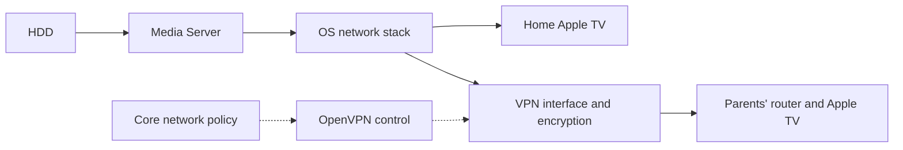

# VPN Provider Networks

## Goal And Scope

Add a provider-neutral network contract to Core and an independently installed OpenVPN provider.
Use one tunnel for selected remote application access and VPN-required workloads without putting
Core or a provider control API in the media data path.

The first implementation supports **one provider runtime: Docker**, with multiple concurrent
network instances and a provider-neutral contract. The reference consumers,
Media Server and Torrent Engine, already run in Docker. Keep routing and enforcement within the
Docker Linux environment, including the Linux VM when the host uses Docker Desktop on macOS.
This is a runtime scope decision, not a claim that Docker networking has no overhead.

Native/localCommand providers and consumers, other VPN protocols, automatic router administration,
DHT repairs and universal access to every device in either LAN are outside this implementation.
The contract must report unsupported combinations rather than silently choosing another runtime.

This document is an implementation proposal. Its creation approves no implementation, application
installation, live VPN/profile change, consumer migration, commit or publication. UI configuration
has a separate owner decision and must not be inferred from the network requirements.

On 2026-11-09 the owner requested publication and merge of this planning document while keeping
its status Draft. The detailed UI flow and implementation contracts remain proposals; the request
does not mark D7 complete or authorize implementation of this feature.

## Baseline And Interactions

Planning baseline is docker-host commit `ff693c29e68bb14029fa9b77580e1a2cdff1d936`.

- [Runtime manifests](../runtime-app-manifest/feature.md) support ordinary installed applications,
  reviewed runtime declarations and independent app releases. Core must discover VPN capabilities
  from declarations and operator selection, never a standard app ID or mandatory installed app.
- [Provider consumption](../provider-consumption/feature.md) supplies reviewed provider discovery
  and authenticated control calls. A provider credential is not permission to attach a workload,
  change routes or expose an endpoint. Its short lifetime must not become a media-session lifetime.
- [Cross-app dependencies](../cross-app-dependencies/feature.md) currently inject endpoint URLs;
  they do not create private cross-app connectivity or enforce a VPN route.
  [That plan](../cross-app-dependencies/plan.md) D2-D4 owns generic network allocation, attachment,
  discovery and cleanup. Reuse those primitives; do not create a competing generic network owner.
  Its native-consumer support and telemetry confinement D6 remain with that plan.
- [Dependency-ordered startup](../dependency-ordered-autostart/feature.md) gates admission, but
  leaves an already-running consumer up when a provider fails. Continuous packet enforcement is
  therefore required independently of readiness and application pause logic.
- [Host networking](../host-networking/feature.md) shares the host namespace. Reject a VPN-managed
  service with that mode unless an explicit reviewed migration removes the conflict. Do not change
  the machine's global default route or reinterpret existing bridge/host declarations silently.
- [Raw ports](../raw-ports/feature.md) distinguish loopback from all-interface exposure, not LAN-only
  or VPN-only access. A VPN binding needs its own source/interface/endpoint rules.
- [Container capabilities](../container-capabilities/feature.md) already support reviewed NET_ADMIN
  and TUN access. Ordinary consumer apps must not gain NET_ADMIN, a Docker socket or blanket privilege
  merely to consume a VPN. The trusted runtime backend installs their network rules.
- [Internal endpoint exposure](../internal-endpoint-exposure/plan.md) addresses a separate public
  ingress concern. VPN publication must preserve endpoint authentication and must not publish Core's
  control surfaces or unrelated applications automatically.

Torrent Engine currently owns OpenVPN, a default-deny firewall and application-level pause/resume
inside its container; Media Server uses a separate network. Their migration belongs to their
respective repositories. This plan owns the platform/provider work and the end-to-end acceptance
handoff, not a second copy of consumer implementation checklists.

## Required Traffic Paths

The reference deployment has a home server and local Apple TV, plus a VPN server on the parents'
router and a second Apple TV on that LAN. The home side initiates the VPN connection.

| Flow | Required path |
| --- | --- |
| Local media | Home Apple TV and Media Server communicate through the home LAN. |
| Parents' media | Parents' Apple TV reaches a selected media endpoint through their router and VPN. |
| Torrent internet traffic | Torrent Engine uses the VPN and the parents' internet connection. |
| Other applications | Only explicitly selected endpoints and source networks gain VPN reachability. |
| Core and unrelated workloads | Existing routes remain unchanged. |

Media Server reads the HDD and writes an ordinary streaming response. Kernel routing and, where
needed, connection-tracked L4 forwarding carry packets to the VPN. No new HTTP/SOCKS media proxy,
Core stream relay, provider RPC containing media chunks, full-file buffering or temporary video
copy is introduced. The provider receives no media-library mount.

A separate VPN container does not imply an HTTP forwarding application. It can be a network gateway.
Packets still incur virtual-interface, routing and encryption costs. Standard OpenVPN processes its
data channel in userspace; DCO is an optional, verified acceleration capability, not a requirement
or a promise of zero-copy. Moving the same OpenVPN process does not itself establish a speed gain.

## Proposed Contract

### Provider And Binding Identity

Introduce a versioned VPN provider interface using the existing reviewed provider mechanisms.
The working category name is `vpn`; freeze its manifest, permission and wire vocabulary in D1.
Keep provider-owned profiles and credentials separate from operator-owned consumer bindings.

A provider descriptor identifies its installation, interface key/version, selected Docker runtime,
opaque profile IDs, supported attachment policies, transports, address families and observed
availability. It reports process state, tunnel state, verified connectivity and applied policy
separately. An existing TUN interface alone is not readiness.

Core stores each binding against the selected network instance/generation and the consumer
installation/service; the network pins its provider installation/interface and profile revision. It includes explicit destinations, selected declared endpoint/port identities,
source CIDRs, allowed transports, DNS behavior and disconnect behavior. Interface names, container
IDs and assigned IPs are observed runtime details, not user-selected authority or durable identity.

The exposure unit is an actual listener/address/port/transport, not an HTTP URL path. Enumerate all
declared endpoints sharing that listener in the review. L4 forwarding cannot expose `/media` while
excluding `/admin` on the same listener. Require a separate app-owned listener for that separation,
or explicit review of the entire shared listener; reject misleading path-only selections. Existing
application authorization still controls each route. Do not add an L7 proxy to emulate this boundary.

Discovery is read-only. Creating or widening a binding requires reviewed operator authority, separate
from provider control-call credentials. A manifest can request compatibility but cannot authorize
its own exposure, egress exception or provider switch. Updates, reinstallations, runtime/profile
changes and revocation revalidate the binding; no automatic replacement provider is selected.

### Multiple Providers And Concurrent Networks

Treat a provider installation, a stored profile and a running network instance as different
resources. One provider may store many profiles and supply several networks simultaneously. A
network instance has its own Core-owned ID and generation, selected provider installation/interface,
pinned profile revision, tunnel worker, routing/DNS/firewall context, status and consumer bindings.
There is no provider-wide `activeProfile` and no global "most recently connected VPN".

For example, **Parents' home** may use an OpenVPN profile for Media Server and Torrent Engine, while
**Downloads** uses another profile for a different service. A third-party provider can supply another
compatible network without changing the consumer contract. An external VPN operator and the Hosty
provider app are distinct: multiple external operators may be represented by profiles in one
OpenVPN provider; another protocol/provider app uses the same versioned Core network interface.
Only OpenVPN is implemented in this scope; another provider is represented by a contract fixture
to prove replaceability, not by an additional production VPN implementation.

The shared provider control app must not become a single shared tunnel namespace. Each network
needs independently isolated tunnel, routes, DNS and guards. Core's trusted runtime must allocate
worker instances from a reviewed provider-declared recipe/image, bound to the owning installation,
Core instance, Docker engine, network ID and selected profile revision. Requests may select only
that reviewed recipe/revision with bounded parameters, mounts, privileges and resource limits;
never an arbitrary image, command, host path, namespace path or firewall script. Allocation uses
idempotent operation IDs and revalidates ownership before replay. Dynamic worker allocation is new
contract work; today's ordinary static app services and NET_ADMIN do not provide it automatically. The provider does not
receive the Docker socket, arbitrary container-launch arguments or authority over unrelated workers.
Keep generic allocation/cleanup primitives with the existing network lifecycle owner.

Stopping or reconfiguring one network affects only its consumers. Provider-wide Stop or removal
affects every network it supplies and must enumerate that larger impact. Saving a new profile
revision does not reconnect all its networks: each active instance retains its reviewed revision
until a separately selected apply operation changes it. Verify VPN identity/session limits before
reusing credentials concurrently; runtime capacity and enclosing environment budgets must account
for all workers rather than allowing worker count to multiply the admitted app allowance.

Initially, a service selects at most one VPN for internet egress, alongside its approved direct
local/control paths. Multiple remote-access networks for one listener are a separate capability:
enable them only when source restrictions, collision handling and symmetric return paths are
implemented and verified; otherwise refuse that combination. Never add implicit load balancing,
cross-VPN fallback or a connection-order-dependent route.

Scope mapping identity to network instance, VPN address, transport and port. Identical remote CIDRs
or VPN-side ports can coexist in isolated network contexts; reject overlaps only where routes or
listeners actually meet and become ambiguous. Consumer attachments must not merge private DNS,
routes or credentials across otherwise independent networks. Failures in network A must not remove
guards, redirect traffic or interrupt established sessions in network B.

### Common SDK And Provider Interface

Use one versioned family of Core-owned types in TypeScript and .NET. The following are proposed
contract responsibilities, not currently available exports; D1 freezes exact names and wire shapes.

| Contract | Responsibility |
| --- | --- |
| Network reference | Opaque network ID/generation scoped to the owning Core, Docker engine/runtime and provider installation; stale or foreign references are rejected. |
| Network descriptor | Display name, provider attribution, supported policies/transports/address families, compatible runtimes and observed readiness, without keys or raw profile data. |
| Service attachment | Consumer installation/service, selected network, requested versus applied policy and listener/source restrictions. |
| Network state | Distinct desired, applied and observed states, stable failure reasons, evidence/time, revocation semantics and per-network failure/recovery events. |
| Provider control | Authenticated capability/profile metadata and per-network lifecycle requests, with stable request IDs, generations and explicit results. |

Consumer SDKs list only networks the caller is authorized to discover and inspect their own effective
attachments. They can report/request supported policy through the agreed authority contract, but
cannot attach themselves, widen exposure or switch providers through discovery alone. Operator
binding mutations remain Core administrative API/CLI operations with their own reviewed authority.
Provider-side SDK support validates its own control credentials and makes bounded requests to the
trusted runtime; it is not a raw networking or container-administration API.

The Core runtime attachment also works for compatible applications that do not use a Hosty SDK.
Applications use ordinary HTTP/TCP/UDP sockets. They need no OpenVPN library, brand-specific network
client, custom video transport or per-provider buffering layer. A running network uses its admitted
packet policy independently of control-token renewal; token expiry must not periodically tear down
video. Core separately applies actual revocation to active bindings.

Resolve compatibility by interface version and the intersection of provider-advertised capabilities
with Core backend enforcement and current observed runtime support, not application IDs or protocol
names. A provider declaration alone does not establish enforceability. A consumer requiring UDP,
VPN-required egress or a particular address family receives an explicit unsupported reason when the selected network cannot provide it.
Do not choose another network, downgrade protection or misrepresent an HTTP proxy as an IP tunnel.
Standardize failure reasons and state transitions across both SDKs, including stale reference,
incompatible version/runtime, unavailable provider, unenforced policy and denied/revoked authority.
Distinguish tunnel connectivity, applied attachment enforcement and verified remote-client access.
SDK or control-plane availability is never the kill switch; packet guards remain effective when
the consumer, SDK or Core is unavailable.

Status subscriptions are per authorized binding/network and follow existing event infrastructure;
do not add continuous polling to rarely changed configuration forms.

### Attachment Policies

| Policy | Enforcement |
| --- | --- |
| VPN-required egress | External traffic and DNS use the selected tunnel; loss blocks that traffic. |
| Remote endpoint access | Selected TCP/UDP endpoints accept only the approved VPN-side sources and have a symmetric return path. |
| Direct local access | Existing approved LAN access remains independent of the VPN. |

Policies apply per service and flow, not by giving every consumer the VPN container's entire network
namespace. Media and Torrent must retain different rules. An HTTP-only proxy is not a generic VPN
attachment and cannot satisfy UDP consumers.

For the initial remote-access mode, expose selected gateway VPN address/port mappings to declared
consumer endpoints using kernel L4 forwarding. Use a bounded return-path strategy, including SNAT
where needed; document any loss of original client IP. Do not require routing the whole home LAN.
Router-side LAN-to-VPN forwarding and its firewall are deployment prerequisites, not Core grants.
Reject CIDRs or port mappings that become ambiguous within an actual shared routing context,
plus unsupported combinations, before activation; isolated networks may reuse private ranges.

An ordinary Docker bridge does not automatically use the VPN container as its gateway. Core's
trusted backend must establish and verify the real consumer route and firewall before releasing
the workload to run. A second unrestricted network must not provide an alternate internet path to
a VPN-required consumer. Narrow control/telemetry allowances must not become general egress.

### Lifecycle And Failure

Allocate stable, installation-scoped network resource identities through the generic network
lifecycle owner. Keep consumer isolation separate from the VPN worker's process lifetime.

- Install guards before first launch and retain them through tunnel loss, profile switches,
  provider/consumer recreation, updates, Core crashes and recovery. Include existing sockets,
  IPv4, IPv6 and DNS; a health check or paused torrent is not the kill switch.
- Starting an admitted VPN-required service reuses dependency startup and waits for verified
  attachment readiness. An unavailable remote-access attachment must not gate the Media Server's
  independent local service. Reject dependency cycles and ambiguous resource ownership.
- Restarting Torrent Engine does not restart the shared tunnel or interrupt parents' media.
  Restarting the tunnel may interrupt remote sessions; report that impact accurately.
- Core keep-apps recovery adopts only observed compatible resources and effective guards. Unknown
  policy state remains unavailable/contained, never an invitation to restore direct egress.
- Provider Stop/removal first closes affected remote exposure and maintains consumer containment;
  cleanup removes only owned rules/resources after dependent traffic is contained or stopped.
  Explicitly reconfiguring a consumer for direct access is a separate reviewed operation.
- Persist stable operation IDs/revisions for activation and rollback. Report desired, applied and
  observed state separately. Preserve an old binding during replacement only while it remains
  authorized. Revocation or explicit removal closes access without waiting for a replacement;
  rollback must never restore a revoked binding. Keep VPN-required consumers contained throughout.

## First OpenVPN Provider

Plan an ordinary, independently versioned app under `apps/openvpn`, with one Docker runtime.
Core contains no OpenVPN-specific process supervision, profile parser or hard-coded provider ID.
The app owns OpenVPN configuration and per-network session supervision; Core allocates reviewed
worker instances, owns authorized network resources and consumer policy, and reconciles actual
runtime/guard state. Worker identities and lifecycle are scoped to each network, not one global app
profile. One Docker runtime supports multiple workers without installing a provider app per profile.

Use reviewed NET_ADMIN and `/dev/net/tun` access confined to the provider's network context. Neither
the provider nor consumer receives the Docker socket, host network namespace or blanket privilege.
The implementation must prove how trusted setup installs per-consumer guards without granting
network administration to the workload. This is a feasibility gate, not an assumed Docker feature.

Profiles and secrets use the supported app-owned configuration, secrets and explicit read-only
mount contracts. Importing an existing Torrent Engine profile requires an explicit provider
configuration/mount selection; never copy live credentials just to make acceptance pass. Treat
OpenVPN script/plugin hooks and pushed routes/DNS as privileged configuration requiring validation
and review; do not execute arbitrary profile commands through Core.

Keep bounded diagnostic status and counters available without collecting media payloads or secrets.
Expose the actual OpenVPN version, transport, effective cipher and DCO state when observed. Do not
install host kernel modules or change the remote router automatically to enable an optimization.

## Generic Application Access And Addressing

The same binding must support a third-party application with an unrelated ID, an HTTP listener and
an ordinary TCP/UDP service. Eligibility follows declared endpoints, compatible runtime and explicit
operator selection. It is not limited to Media Server, and not every app necessarily has a suitable
network service. VPN access does not authenticate a user or replace the app's own permissions.

Keep local and remote origins explicit. Support separately configured addresses or split DNS so the
home player reaches a LAN endpoint and the parents' player reaches the VPN endpoint. Media API,
artwork and returned playback URLs must agree; do not send video back through Cloudflare by leaving
an absolute public stream URL in a response. Preserve required TLS and normal app authentication;
do not introduce a silent scheme downgrade, trust a source IP as identity or bypass Hosty login.

## Configuration UI — Option A Selected, Detailed Flow Pending Approval

On 2026-11-07 the owner selected option A: a central network overview plus per-application access
settings. On 2026-11-09 the requested scenario expands to two independent VPN networks assigned to
different applications, with the same controls across compatible providers. The concrete journey,
labels, apply behavior and diagnostics below remain pending final UI agreement. Selecting A and
requesting this revision do not complete D7 or authorize UI implementation.

### Places And Ownership

- **Settings > Networks:** all configured networks, provider/profile attribution, independent
  connection states and the applications using each network.
- **Provider-owned profile settings:** profile import, protocol configuration and secrets. For
  the first provider this is **OpenVPN > Profiles**. Open another provider through its declared
  settings surface; Core/Shell does not duplicate or hard-code protocol-specific forms.
- **Applications > [application] > Access:** Core-owned service bindings. Central network cards
  link to this same editor; there is one binding record, not two competing configurations.
- **Media Server's own settings:** library access and existing Jellyfin/Infuse credentials.

These are proposed labels, not literal Core-owned frontend routes. Use existing Shell settings and
app-detail patterns. Reserve advanced route/DNS details for actions requiring operator input.

### Example And First-Release Scope

| Network | Provider/profile | Selected consumer and purpose |
| --- | --- | --- |
| Parents' home | OpenVPN / Parents | Media Server's selected playback listener, reachable from the parents' LAN. |
| Downloads VPN | OpenVPN / Downloads | A second selected service, with VPN-required internet egress. |

Both networks can use one OpenVPN provider with different profiles and run simultaneously. When
another compatible provider is installed, the second row may instead use its own selected profile;
the generic setup and app-binding screens are identical. The first production implementation ships
OpenVPN only. Another protocol is not promised by this example or by the generic selector.

Use a separately selected second application for the example. Torrent Engine can be that consumer,
but this is an **alternative allocation**, not a change to the original reference deployment where
its exit is the parents' connection. Moving an existing Torrent Engine to Downloads VPN requires
its own reviewed migration, including the changed exit and active-download impact. The operator can
instead keep Torrent on Parents' home and assign Downloads VPN to another app. Nothing is migrated
by importing a profile, creating a network or configuring Media Server.

### Step 1 — Save Two Provider Profiles

Assume an authorized operator and an installed OpenVPN provider. If it is absent, offer the ordinary
explicit installation flow. Do not install or select a provider silently.

In **OpenVPN > Profiles > Add profile**, save **Parents** and then **Downloads**, each with its own
`.ovpn` file and required certificates/keys or username/password. Validate inputs and show the parsed
remote endpoint/transport, missing dependencies and incompatible or privileged options. Never assume
that one profile's secrets apply to the other. Credentials remain provider-owned.

**Save profile** records configuration without connecting or exposing applications. Each new profile
starts as **Saved - not connected**. Edits create a revision; networks using an earlier revision keep
it until the operator explicitly applies a change to selected network instances.

### Step 2 — Create And Connect Parents' Home

Open **Settings > Networks > Add network**. Enter **Parents' home**, choose the OpenVPN provider and
its **Parents** profile. If needed, **Add profile** opens that provider's own form and returns here
without losing this network draft. The profile list belongs to the selected provider; changing the
provider clears incompatible profile selection rather than reusing a coincidentally matching name.

Record the actual parents' LAN range or observed translated source address. Values such as
`192.168.20.0/24` are examples, never detected facts or automatic grants to applications. Account for
router source NAT before promising a source restriction or individual-device isolation.

**Save draft** stores desired configuration only. **Connect** reviews this network's selected
profile/runtime, required grants and affected sessions, then performs the explicit operation through
existing Core authority. Do not add a redundant provider-side confirmation of the same permission.
If a profile belongs to a running legacy Torrent session, show the migration/session-compatibility
prerequisite instead of starting a conflicting second worker.

On verified connection the card reads **Connected - no application bindings**. Distinguish worker,
tunnel and verified path state, with observation time. No app becomes reachable yet, and access from
an Apple TV in the parents' LAN remains unverified.

### Step 3 — Add A Second Network Without Replacing The First

Use **Add network** again, name it **Downloads VPN**, select its provider and **Downloads** profile,
then save/connect it separately. The provider selector lists confirmed compatible provider
interfaces, not only OpenVPN. Unsupported choices explain the capability/runtime mismatch; they do
not trigger a fallback provider or a hidden runtime switch.

Parents' home stays connected throughout. Each network has its own ID, worker and route/DNS/firewall
context. Validate profile session limits, runtime capacity and actual shared-route/listener conflicts
before creating the second connection; identical private ranges in isolated contexts alone are not
an error. A failure connecting Downloads VPN leaves Parents' home and its drafts/bindings untouched.

The overview now shows two rows/cards:

| Network | Provider | Profile | Connection | Application bindings |
| --- | --- | --- | --- | --- |
| Parents' home | OpenVPN | Parents | Connected | None |
| Downloads VPN | OpenVPN or another installed compatible provider | Downloads | Connected | None |

Each row has its own **Connect/Disconnect**, **Details** and **Configure profile** actions. There is
no global active-profile selector. Grouping/filtering by provider is presentation, not shared state.

### Step 4 — Assign Media Server To Parents' Home

Open **Applications > Media Server > Access**. The network selector lists networks the operator is
authorized to use, with provider attribution, compatibility and readiness. Networks from different
providers use the same labels and policy fields. An unrelated app ID needs no special handling.

| Setting | Selected value |
| --- | --- |
| Local access | Existing direct home-LAN access stays enabled. |
| Remote access | Parents' home, selected Jellyfin-compatible playback listener and reviewed sources. |
| Internet egress | Existing ordinary route; no VPN-required egress is enabled for Media Server. |

Show the selected listener's actual transport/port and every declared endpoint sharing it. Do not
label a whole shared API listener as "video only" or promise HTTP-path filtering. A narrower surface
needs an app-owned separate listener; no new HTTP media proxy is introduced. Existing route-level
application authentication remains authoritative.

Require an explicitly reviewed source CIDR or verified translated source address before Apply. If
unknown, keep the draft and explain the missing input rather than permitting all sources. Downloads
VPN and unrelated listeners remain unselected for this binding.

### Step 5 — Assign The Second Application To Downloads VPN

In **Applications > [second application] > Access**, select its service and set **Internet egress >
Require VPN > Downloads VPN**. Show its provider and profile as context, not as a second selection
that could diverge from the network reference. Select only a network whose effective runtime and
provider capabilities can enforce the requested policy.

The form states **External traffic and DNS use Downloads VPN; when unavailable, that traffic is
blocked**. In the first scope a service has one selected egress VPN, not a list of ordered fallbacks.
No inbound listener is published by choosing an egress network. Any approved local/control access
remains separately scoped and visible; it must not create an internet bypass.

The second app need not use Hosty SDK to obtain runtime routing. SDK-integrated apps can inspect
their own effective binding/status using the shared types, without handling provider credentials or
relaying payloads through the SDK. Two providers do not require two consumer integrations.

If the selected app is the existing Torrent Engine, the review names its current applied route,
the proposed new exit, affected active downloads and any restart/migration. Keep the current safe
mode until replacement is verified; after activation, loss of Downloads VPN blocks Torrent rather
than sending it through Parents' home or the direct home connection. This scenario does not grant
permission to perform that live migration.

### Step 6 — Review And Apply Each Binding

Each app has its own review and **Apply access** operation. Show the selected application/service,
network/provider/profile, traffic direction/policy, requested listener/source restrictions or egress
behavior, existing applied binding and any required restart. Saving/leaving the editor does not
activate the draft. Use one Core review/apply mechanism, not a second provider-owned permission copy.

For Media Server the summary reads **Home access stays direct; remote access uses Parents' home**.
For the second service it reads **Internet egress requires Downloads VPN; no new incoming access**.
Apply one independently of the other. Failure or cancellation applying the second binding must not
undo the already-applied Media binding.

Show progress and then **Binding applied** separately from tunnel connectivity and client-side
verification. Keep desired, applied and observed states visible when they differ. An unavailable
network leaves an unapplied draft/waiting prerequisite, not an active-looking rule. Preserve a prior
binding only while it remains authorized; explicit revocation closes it and rollback cannot revive it.

### Step 7 — Display The Effective Allocation

The central overview and per-app pages read the same binding records:

| Application/service | Network | Applied purpose | Independent local access |
| --- | --- | --- | --- |
| Media Server | Parents' home | Selected playback listener reachable from reviewed remote sources. | Direct home LAN, unchanged. |
| Second application | Downloads VPN | VPN-required internet egress; blocked when disconnected. | Only explicitly approved local/control access. |

Display each binding's own applied/verification state. Connecting the tunnels does not mark these
rows applied, and a server-side probe does not mark the parents' player tested. A failed or stopped
network is still shown so the operator can see affected consumers instead of losing their selection.

The Media card provides **At home** and **At parents' home** addresses, **Copy address** and **Player
setup instructions**. These are actual supported endpoint origins, not guessed Docker IPs or public
Cloudflare URLs. Show ordinary Media Server credential instructions, never VPN keys or provider
passwords. A VPN-only egress consumer does not get a fictional remote connection address.

### Step 8 — Verify The Parents' Player And Local Playback

If the remote router requires LAN-to-VPN forwarding/firewall changes, provide a concrete destination
address/port and source checklist. Hosty does not change the router automatically or describe this
as publishing a media port on the public WAN. Effective source restrictions must be known before
applying the Media binding, even if end-to-end client testing is still outstanding.

For HTTPS, the selected hostname must resolve on the parents' LAN and match the certificate. Split
DNS/custom names are optional separate setup; do not silently downgrade to HTTP or bypass TLS errors.

Open Media Server's own declared credential settings using the intended viewer's ordinary authority.
Use its existing Jellyfin/Infuse username and PIN; enter the PIN as the player's password. Do not
invent a new network-owned user or reveal a previously hidden PIN in Core.

On the parents' Apple TV, use **Infuse > Settings > Shares > Add Media Server**, select Jellyfin and
enter the **At parents' home** address plus Media Server credentials. Do not rely on discovery across
the routed tunnel or require an OpenVPN app on the television. Confirm library/artwork access,
playback and seeking; returned stream URLs must retain the VPN path. Record observed client traffic
and operator-confirmed playback separately, including evidence time/source. At home, independently
check direct playback/seek without routing the media through either VPN.

### Step 9 — Test Independent Failures And Make Scope Visible

| Action | Media through Parents' home | Second app through Downloads VPN | Home media route |
| --- | --- | --- | --- |
| Disconnect Downloads VPN | Unchanged. | External traffic/DNS blocked; no fallback to Parents' home or direct WAN. | Unchanged. |
| Disconnect Parents' home | Remote media access unavailable. | Unchanged. | Direct route unchanged; show local service health independently. |
| Disable only Media's remote binding | Remote media access closed; its network remains connected. | Unchanged. | Unchanged. |
| Restart the second app | Unchanged. | Only its own lifecycle is affected. | Unchanged. |
| Stop the provider supplying both networks | Both networks lose service; show all affected bindings before the action. | VPN-required egress stays blocked. | Direct route unchanged. |

If the networks use different providers, stopping one provider affects only the networks it supplies.
An individual network worker failure must stay isolated. A shared Docker-engine or host failure
can affect multiple networks; report that observed wider scope accurately. Saving a profile revision
never restarts every network using it automatically. Review an explicit per-network profile apply
or rebind, with affected consumers/sessions and required interruption disclosed.

### Final UI Agreement

The owner selected option A; this two-network scenario is now the proposed flow for final review.
Agree on the central multi-network view, provider/profile handoff, per-service **Remote access**
versus **Require VPN for internet**, separate Save/Connect/Apply actions, binding review, effective
allocation table and per-network versus provider-wide outage impact. No global active VPN, implicit
provider switch or automatic consumer migration is part of the UI. D7 remains unchecked until the
owner explicitly approves the detailed scenario; the plan remains Draft.

## Deliverables

- [ ] D1. Freeze the version-one provider/network/attachment schema, concurrent-instance identity, authority, compatibility, capability discovery and API/CLI/SDK contract; resolve ownership with Cross-App Dependencies D2-D4 and record the implementation sequence without duplicating its deliverables.
- [ ] D2. Prove the Docker-only data path and scoped per-consumer route/guard setup on Docker Desktop macOS using isolated fixtures; record the supported runtime matrix and refuse unsupported attachments before a workload can run.
- [ ] D3. Implement VPN-specific bindings, traffic policies, readiness, durable apply/rollback and failure reconciliation on the shared generic network lifecycle, including independent LAN access and fail-closed existing/new connections.
- [ ] D4. Add the ordinary OpenVPN provider app with its single Docker runtime and independently managed per-network workers, reviewed configuration/credentials, safe profile revisions/transitions and sanitized status; no media mounts or media-forwarding API.
- [ ] D5. Add selected remote listener L4 forwarding, source restrictions, return-path handling and address/origin discovery for generic HTTP/TCP/UDP applications; review co-located endpoints and retain ordinary identity and TLS requirements.
- [ ] D6. Expose supported network inspection/configuration through Core API/CLI and one compatible TypeScript/.NET SDK contract for providers and consumers; cover authorized discovery, own attachments, capability/version refusal, an empty registry and denied/revoked authority.
- [ ] D7. Finalize owner agreement on option A using the concrete two-network, multi-provider setup flow, per-service policy selection, binding review and independent/provider-wide outage behavior; option selection alone does not approve this detailed scenario.
- [ ] D8. Implement and verify only the two-network/provider-neutral UI journey approved under D7, using Core operations, declared provider UI surfaces and one authoritative record per binding.
- [ ] D9. Coordinate separately tracked Media Server and Torrent Engine migrations in their own registered repositories, publish the platform contract they consume, and verify that local playback remains independent while shared-tunnel playback and torrent isolation work together.
- [ ] D10. Pass failure/recovery, isolation, generic-endpoint and realistic streaming acceptance; publish sanitized conclusions, supported platforms and limitations, without claiming to fix existing 4K stalls absent evidence.
- [ ] D11. Complete owned resource cleanup/recovery coverage, update shipped feature/SDK/runtime documentation and release versions for affected artifacts; remove this plan and regenerate the index only after all required implementation and acceptance deliverables are complete.
- [ ] D12. Verify concurrent networks across two OpenVPN profiles and an unrelated provider contract fixture, with different consumer selections, scoped DNS/routes/listeners, independent failures/profile changes, session/capacity checks and no cross-network fallback.

## Implementation Sequence And Readiness

Start with D1 and the isolated D2 proof before replacing Torrent Engine's existing isolation.
Generic network prerequisite work remains tracked under its existing owner. Build the provider and
VPN-specific backend, then selected endpoint access and API/CLI controls. D7 can proceed in parallel;
D8 waits for its separate approval. Consumer migration and end-to-end acceptance follow verified
platform support. Keep the old Torrent Engine VPN mode available until the replacement passes its
own acceptance; do not activate two competing route owners in one service.

This plan remains Draft pending review of the concrete contract, runtime proof approach and consumer
handoff. Resolve implementation-blocking questions before Ready. UI approval remains separate even
if backend implementation is later approved with that explicit dependency boundary.

## Verification And Acceptance

| Scenario | Required evidence |
| --- | --- |
| Local playback, VPN up/down | Start, continue and seek locally; tunnel counters/capture show no corresponding media payload. |
| Parents' playback | Authenticated API, images, video and Range/seek use the selected VPN endpoint, with no public-ingress fallback. |
| Tunnel/provider failure | Parents' playback loses connectivity; local playback remains usable; Torrent has no fresh or established direct TCP/UDP/DNS egress. |
| Torrent restart | Shared VPN and an independent media session remain available. |
| VPN recovery/profile change | Verified connectivity returns with no temporary direct route; old source addresses/conntrack do not leak packets. |
| Core restart/crash, update, revoke, uninstall | Guard ordering, safe adoption, visible state and exact owned-resource cleanup remain correct. |
| Third-party application | Selected HTTP and raw TCP/UDP listeners work; unselected listeners stay inaccessible; shared-listener exposure is explicit and route-level auth stays enforced. |
| Concurrent profiles/providers | Two OpenVPN networks and an unrelated provider fixture use the same SDK contracts; disconnect/profile update in one leaves the others' sessions, DNS and guards intact. |
| Scoped overlap | Reused private ranges/ports remain isolated; genuinely ambiguous shared attachments are refused; provider-wide Stop discloses and affects all owned instances. |
| IPv6/extra network paths | Prove containment for enabled families and alternative interfaces; otherwise reject the configuration, never advertise unverified protection. |

Capture the same representative 4K file/representation, client, storage and torrent load before and
after for local regression comparison. Characterize the new remote path against the selected
content's peak bitrate and measured tunnel capacity, not an invented universal Mbps target. Agree
acceptance margins from baseline variation and owner needs before declaring performance passed.
Record throughput dips, playback stalls/buffer, per-core CPU on server and router, disk latency,
memory behavior, packet loss/retransmits and MTU. Memory must stay bounded rather than grow with file
size or playback duration. Compare torrent-idle/active and direct-play/remux cases. Treat pre-existing
stalls as an independent diagnosis, not an assumed consequence of service count.

Use existing Core-managed child/sandbox infrastructure, separate test users/data and a dedicated
test VPN endpoint, with ordinary setup/login. Do not alter the parents' router, live torrent traffic
or provider secrets to obtain a passing test. Mount explicitly authorized media read-only, export
sanitized summaries, stop test consumers and Finish through the owning Core with removal verified.
Reuse the tunnel-drop and established/fresh-connection checks from
[Docker development runtimes](../mixed-development-runtimes/feature.md).

During implementation run affected Core/CLI and SDK tests, exact Core build and required AOT checks,
approved UI lint/build/tests, affected integration suites and the networking acceptance above.
This documentation-only change needs `node scripts/docs-index.mjs --fix`,
`node scripts/docs-index.mjs --check --base <target-ref>` and `git diff --check`; no runtime deployment
or application build is required for writing the plan. No version bump is required until code ships.

## Technical References

- [Docker networking](https://docs.docker.com/engine/network/) — interfaces, routes, shared namespaces and port publication.
- [Docker Desktop networking](https://docs.docker.com/desktop/features/networking/) — Linux VM and host networking boundaries.
- [OpenVPN data-channel offload](https://github.com/OpenVPN/openvpn/blob/master/README.dco.md) — optional kernel data path and compatibility limits.
- [OpenVPN LAN routing](https://openvpn.net/community-docs/expanding-the-scope-of-the-vpn-to-include-additional-machines-on-either-the-client-or-server-subnet.html) — routed access and return-path requirements.

- [Media Server Jellyfin authentication](https://github.com/alex-de-haas/media-server/blob/d0a9b65d5a993fa9589bc7ed7fd866b5d200953d/docs/features/jellyfin-compatibility/feature.md) - existing username/PIN login for players.
- [Infuse media-server setup](https://support.firecore.com/hc/en-us/articles/360006462093-Streaming-from-Plex-Emby-and-Jellyfin) - Apple TV navigation and direct server login.
