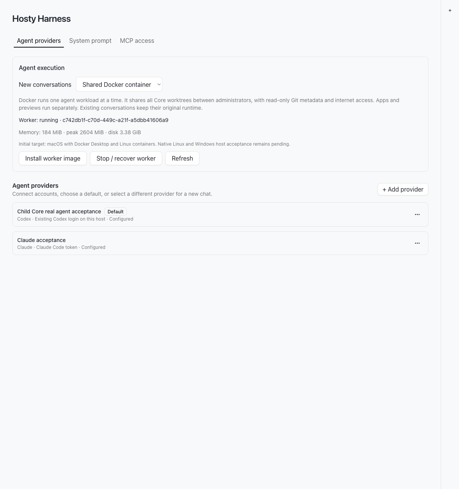
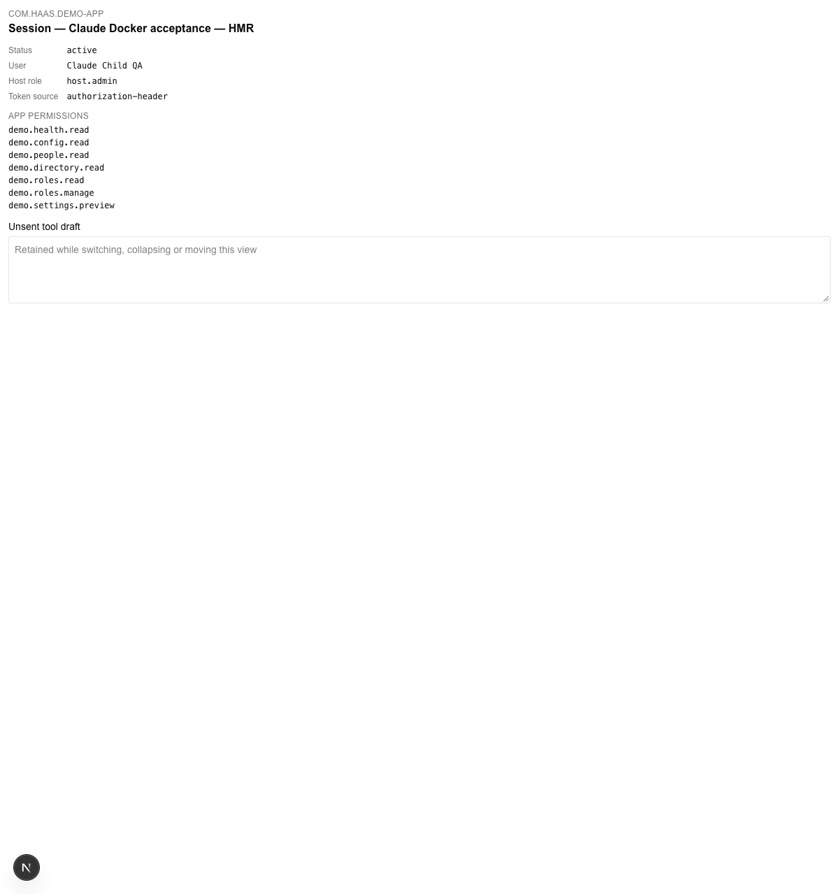

# Shared Docker Agent Acceptance — 2026-10-15

Baseline: docker-host `f45d5702e31a7274fb1faa04133b030115464625` plus the uncommitted shared-runtime
implementation. SHA-256 of sorted changed/new non-documentation path/content pairs:
`f84c10bfaa933ca86eadaf94b5c0f716c8dfcb5bb52795215a615f4e32011b3d`. This is a local acceptance archive; no commit, PR, registry push or production
upgrade was performed. It completes shared-runtime D1-D8 and Sandbox D5, not the wider Sandbox D9
Git/publication and host matrix or the Draft per-session containment plan.

## Versions And Boundary

Platform 0.134.0 → 0.135.0; Harness 0.52.0 → 0.53.0; Demo 0.17.0 → 0.17.1.
Codex CLI 0.160.0; Claude SDK 0.3.288 / Claude Code 2.1.288. The worker image is built locally from
pinned Node/.NET bases, runs Linux arm64 on macOS Docker Desktop, and is limited to 2 CPUs,
4 GiB memory/equal swap ceiling and 512 PIDs. Harness remains native. No Docker socket, host home,
Core data or coordinator credential is mounted into the worker. Source worktrees are deliberately
shared across administrators; common Git metadata is read-only. This is not session isolation or
network confinement. Native Linux and Windows hosts and the amd64 image remain unverified locally.

A separate temporary parent Core and two child Cores use normal setup/password login. The operator
explicitly authorized copying the selected Claude connection into this fixture and deleting it after
verification. The selected Codex login was imported through the supported managed authorization path.
The primary Core, Harness, provider connection and unrelated Docker applications were not changed.

## Real Provider Journeys

Both adapters prepared their own Core worktree during a Docker turn, changed Demo's Session heading,
passed all six Demo tests and its production build, and resumed the same native provider conversation
across worker generations. No test agent committed or published source. A simultaneous second send
returned `409 worker_busy` before dispatch; no second worker or implicit queue was created.

Each agent created and bootstrapped a trusted child Core through scoped MCP, ordinary launch consent
and app installation review. Demo's backend and frontend ran in separate app containers with their
own data/cache volumes. The browser showed the edited heading and the child's real administrator
identity. Held-open pages received source edits without navigation or app/container restart: observed
write-to-DOM intervals were approximately 1.35 seconds for Codex and 0.07 seconds for Claude. These
are individual local observations, not latency guarantees.

The Claude fixture initially placed its override recipe outside Git, so Core had no source root.
A reviewed reinstall using an untracked recipe beside the real app manifest fixed the test setup.
An attempted update using an unpublished local image was correctly refused by the registry resolver.
No source-path or image-review checks were weakened. The original app manifest remained unchanged.

Codex additionally installed Media Server 0.92.0 and a dedicated Transcode Engine 0.14.0 in its child
Core. Their image revisions matched `d75073e` and `4bf6f00`. The authenticated Media UI created a
read-only catalog and reported importing 31 files. Original media was mounted read-only into both
services; the optional output directory was separate and writable. Transcode restart and subsequent
health were exercised through Core. This pass checks the shared worker's app/dependency journey;
it does not repeat the earlier full-film codec/export acceptance. TMDb enrichment and torrent ingest
were not tested or supplied with production credentials.

## Recovery And Cleanup

A real Claude turn spawned a bounded detached writer inside its worker. SIGKILL terminated exactly
the fixture Harness Node process; the writer continued in Docker, proving that coordinator death
alone was insufficient. Restart loaded the same persisted generation, stopped/removed its container,
and retained recovery state until the owning administrator supplied fresh authorization. No uncertain
model message was automatically replayed. Explicit recovery released the Core lease and admission;
Claude resumed the same provider conversation and finished its child. Demo remained available across
coordinator loss and recovery. A separate Codex cancellation stopped another detached writer,
removed the worker and left its Core lease inactive. A session's stable workspace lease UUID remains
in its record for replay; its presence alone does not mean the lease is active.

Independent Docker inventory found no containers, volumes or networks labelled for either child or
the temporary parent. Recorded app volumes and networks were also checked by exact name. Child data
roots disappeared; worktree source survived Finish and was removed only later with the disposable
parent fixture. Core/Harness/preview ports closed. Both temporary provider connections and native/
Docker credential homes were deleted before the parent root was removed. The explicitly copied
Claude token therefore has no retained fixture store. Temporary image aliases and the QA browser
were removed; the release-matching worker development image remains cached locally.

The borrowed media inventory matched after child Finish: all 118 files (94,222,024,758 bytes),
154 entries, full SHA-256 contents, file modes, sizes, modification times and symlink targets were
unchanged. The caller-owned empty output folder survived Finish and was removed by fixture teardown.

## Measurements

| Observation | Result |
| --- | --- |
| Codex worker lifetime cgroup peak, including install/build/test | 2.37 GiB |
| Claude worker lifetime cgroup peak, including install/build/test | 2.54 GiB |
| Maximum sampled simultaneous worker + child app memory | 2,842.5 MiB |
| Maximum sampled Media API + web + dedicated Transcode memory | 442.3 MiB |
| Observed parent Core RSS maximum | 324.2 MiB |
| Observed first child Core RSS maximum | 213.2 MiB |
| Observed first native Harness Node RSS maximum | 119.3 MiB |
| Dedicated QA browser process-tree RSS maximum, four tabs | 1,195.9 MiB |
| Cached worker start in repeated transport smoke checks | approximately 0.18–1.54 s |
| Worker image rebuild without application-layer cache | 15.847 s; base images already local |
| Last observed aggregate worker disk accounting | approximately 3.48 GiB Codex / 3.38 GiB Claude |

579 samples were collected at approximately five-second intervals, with gaps while the monitor was
restarted between scenarios. Cgroup current values from each sample were summed for the simultaneous
container total; unrelated lifetime peaks were not added. Native/browser RSS includes shared pages
and is a separate observation, not a Docker VM allocation total. Native Harness coverage does not
include every transient coordinator generation. First registry/base-image download and provider
network first-token latency were not controlled benchmarks. Docker VM overhead and unrelated apps
are outside these totals. The 20 GiB disk policy is sampled and soft, not a filesystem quota.

## Fixes Found During Acceptance

- Successful empty HTTP 204 workspace-lease release is handled without JSON parsing failure.
- Abandonment terminates the actual worker before releasing provider state or approvals.
- Docker command completion waits for closed output streams; readiness validates the same local
  Linux daemon contract as launch.
- Demo image COPY permissions support Core's private checkout modes without changing host files.
- Child app capacity refusal returns structured HTTP 409 and settles start/restart to stopped/failed,
  allowing retry after capacity becomes available. Stopped containers still reserve their limits.

## Verification

- `dotnet build apps/core/src/Haas.Hosty.Core/Haas.Hosty.Core.csproj --artifacts-path <isolated-output>`:
  passed, four existing warnings. The fixture's new process identity and exact source project were
  verified after restart. A custom fixture port must be passed explicitly when relaunching it.
- Initial full Core suite: 3,338 passed, six repository-fixture path failures, four opt-in tests skipped.
  The isolated artifacts layout could not locate repository app manifests. Exposing the real `apps`
  directory to that test layout and rerunning both manifest suites passed 166/166; no product assertion
  was weakened. This initial full run is not reported as entirely green.
- Final affected Core suites (`CoreLifecycleServiceTests`, `LifecycleAuditHttpTests`,
  `CoreEnvironmentResourceTests`): 699 passed, four existing opt-in tests skipped. Earlier focused
  workspace/sandbox coverage: 79 passed. Tests include structured capacity refusal and retry.
- `npm run harness:test`: 70 files, 553 tests passed. `npm run harness:lint` and
  `npm run harness:build-web`: passed.
- Demo workspace tests: two files, six tests passed. `npm run demo-app:build`: passed.
- `node --import tsx scripts/check-harness-worker.mjs`: passed against the local release-matching
  image, including both CLI versions, actual Claude SDK initialization, read-only metadata,
  missing Docker socket, persisted-generation recovery and detached-writer removal.
- `node scripts/check-versions.mjs`, `node scripts/docs-index.mjs --check`, `git diff --check`: passed.
  Workflow YAML parsed locally. `actionlint` was unavailable; remote GitHub Actions, multiarch
  publication and registry install remain release checks, not claimed local results.

Raw evidence JSON, transcripts, logs, credentials and experimental patches are excluded from Git.
