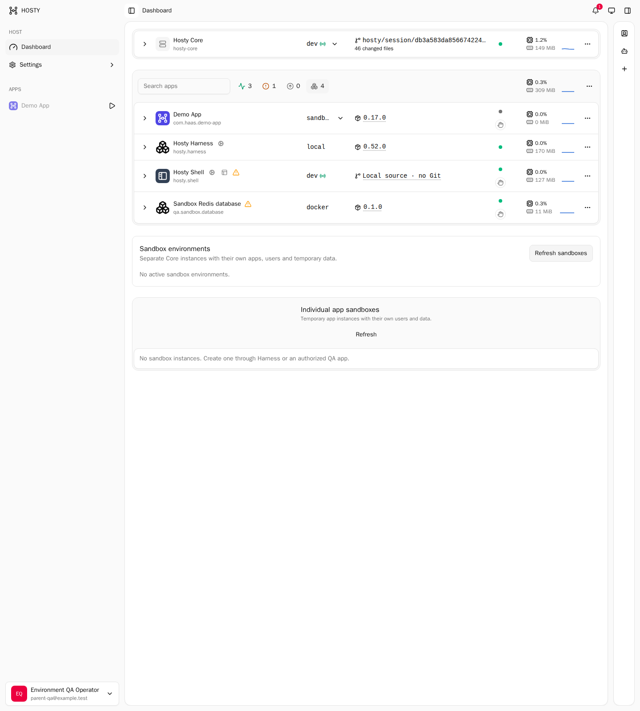

# Trusted child Core consent and dependency acceptance

Date: 2026-10-15. Baseline: `c5d37752356b3a2713a9a89435bb21ca060591c3`
(merged #594), with the uncommitted consent, dependency URL and login callback changes in the
registered `sandbox-workflow-permissions-20261015` worktree. This is a bounded acceptance
record for D13–D17 of the [sandbox plan](../features/app-sandbox-runtimes/plan.md), not a claim
that D5, D9 or optional remote preview are complete.

## Contract and fixture

The owner selected a trusted child Core with ordinary Core roles and APIs inside. Consent
controls the caller installation's ability to create/use that environment; it does not impose
a second parent policy on the child's administrator. Each child has independent data, accounts,
connections and application installations, with the existing root-wide descendant quotas.
The shared Docker daemon is intentionally trusted, not a hostile-code isolation boundary.

The macOS fixture used a separate data root, genuine password setup/login, source Core, candidate
Shell and Harness, a real Codex worker in a bounded container, and a separate Playwright browser.
Normal rendered consent and installation pages were used. The primary Core was not replaced.
The Docker engine exposed 15.63 GiB during this run; the bounded fixture used lower reservations
than the earlier two-app demonstration. All worker credentials and raw evidence remained outside
Git and were temporary fixture material.

## Observed results

| Case | Result |
| --- | --- |
| No consent | Delegated creation refused before data allocation |
| One run | Remember unchecked by default; exact request replay returns the same environment; another request needs review |
| Saved consent | Matching later creation proceeds autonomously; Shell displays effective access and saved policies |
| Technical lifecycle | Child stop/start/restart preserves identity and data without another consent review |
| Changed executable target | Fresh review required; replay of the original create request attaches the new grant without duplicating or resetting the child |
| Revocation | Delegated create/restart/setup/API refused; ordinary operator recovery and Stop/Finish remain available |
| Revocation boundary | Running child remains running; its independently created accounts retain ordinary child rights |
| One-run completion | Finish retires the one-run grant; saved grants remain until explicitly revoked |
| Independent database | Consumer cannot resolve its provider until a dedicated child installation exists, even while the parent's provider is live |
| Database lifecycle | Child writes/reads its own sentinel; provider stop fails the consumer; start and restart restore that same sentinel; parent sentinel remains unchanged |
| Service identity | Service token alone cannot call child-environment management |
| Ordinary member | Invitation acceptance and fresh password login succeed; environment administration and user management return 403 |
| Account disable | Existing member session becomes 401; a new login is refused |
| Connections | Child source-connection inventory is empty and Git identity is unset |
| Nested Core | Normal setup/login, empty app inventory, own administrator; third descendant refused by the root-wide limit; stop/start retains ID |
| Group Finish | Outer Finish removes the still-running nested environment as well as the outer one |

The database case exposed a real bug: Docker dependency URL rewriting handled only HTTP(S),
leaving a Redis URL pointed at the consumer's own loopback. The fix rewrites local hosts for
non-file absolute dependency URIs while preserving protocol, port, path and query. Regression
coverage includes Redis/Postgres and unchanged remote/file URLs. The real Redis scenario passed
after applying the fix to the test Core and child.

## Shared mounts and preservation

The operator-provided media folder was bound read-only through the existing shared library.
Docker inspection showed `RW=false`, and a real write attempt failed at the filesystem boundary.
A writable manifest slot still received read-only access when bound to a read-only library entry.
Library reuse worked. Removing a bound entry without force returned 409; forced removal changed
configuration, while the running mount remained until restart, as documented by the existing
mount lifecycle. Restart removed access, and a newly approved read-only binding restored it.

A separate fixture-owned directory tested explicitly writable access: actual Docker configuration
showed `RW=true` and a bounded write/read succeeded. It never mounted the user's media. Finish
preserved both external directories. Full comparison of the media folder found **118 regular
files with identical SHA-256, size and modification time, and 154 tree entries with unchanged
inventory, modes, links and modification times**.

Six captured macOS child environments, including the nested pair, were independently checked:
owned roots absent, processes gone, ports closed, and labeled containers/networks/volumes absent.
The two saved fixture policies were explicitly revoked. The UI then showed no active child Core
or offline app sandbox:

## Linux in Docker

A native-AOT Linux arm64 Core ran in a separate bounded Linux container against the same
explicitly authorized Docker daemon. It used a separate data root and real setup/password login.
Create replay, child setup, dedicated Redis installation through Core approval, a 384 MiB
application limit, nested creation and the root-wide count limit passed. Warm child readiness
was **0.358 seconds** in this cached fixture; this excludes image pulls, source builds and setup.

Finish was interrupted by killing only this disposable parent after the root-deletion checkpoint.
A replacement parent with a new process identity recovered using the **original Finish UUID**.
Both child roots/ports and their containers, networks and volumes were absent afterwards.
The bounded run took 15.83 seconds. This verifies Linux **inside Docker**, not a native Linux host
or Windows. Tests without a Docker socket also passed after removing an accidental live-daemon
dependency from the empty-inventory HTTP test fixture.

## Resource observations

878 samples covered the consent/dependency/role/mount run. Median interval was 5.16 seconds,
maximum 23.32 seconds; Docker collection adds latency to the monitor's three-second delay.
`docker stats` working set and cgroup charged memory are different measurements:

| Container | Maximum sampled working set, MiB | Maximum sampled charged memory, MiB | Observed cgroup lifetime peak, MiB |
| --- | ---: | ---: | ---: |
| Codex worker | 700.30 | 724.50 | 752.36 |
| Playwright browser | 228.60 | 238.50 | 275.38 |
| Dependency consumer | 117.40 | 124.42 | 133.45 |
| Child Redis | 12.11 | 20.73 | 25.43 |
| Writable fixture consumer | 30.65 | 36.25 | 40.42 |
| Parent fixture Redis | 18.72 | 26.80 | 31.87 |

The largest simultaneous macOS fixture-container sample was **989.30 MiB working set /
1026.49 MiB charged memory**. This is not the sum of lifetime peaks. No sampled fixture reported
OOM or OOM-kill events. The worker had a 1.5 GiB ceiling and the browser 768 MiB.

Native sampled RSS maxima: parent Core 304.30 MiB; Harness including its independent runner
221.20 MiB; child Core processes together 410.66 MiB; Shell including its runner 233.84 MiB;
Docker CLI helpers 96.61 MiB. Their largest simultaneous sampled total was 1092.47 MiB.
Independent runner/Shell collection was added during the run, so these are observed lower
bounds, not complete lifetime peaks or hard native-process quotas. Shared pages may overlap;
these figures must not be added to Docker VM host RSS as if they were independent memory.

The separate Linux runtime container reached 263.82 MiB charged memory. Linux test/build
containers are excluded from the macOS workload aggregate. The native-AOT build reached its
4 GiB cgroup ceiling without an OOM event; source-build cost is not app idle cost.

## Verification and limits

- Full Core suite: **3300 passed, 4 existing opt-in skips** using `dotnet test` with isolated artifacts.
- Focused macOS environment/consent/background/approval/Docker suite: **225 passed**.
- Linux CoreEnvironment/Sandbox/DockerRuntimeAdapter/GlobalMount/RuntimeMount suite: **261 passed**.
- macOS and Linux arm64 native-AOT publication: passed.
- SDK: **669 tests**, build passed.
- Harness: lint, **542 tests**, web build passed.
- Shell: lint, **268 component tests** plus native Node tests, build passed.
- Workspaces: lint, **17 tests**, build passed.
- Version consistency, documentation/index validation and whitespace checks passed.

The fresh-login/HMR fix has its own [acceptance record](2026-10-15-sandbox-login-hmr-acceptance.md).
Remaining offline daemon-loss/create/dispose verification belongs to D5. Full inherited matrix,
native host coverage and complete simultaneous setup/build memory coverage remain D9. Production
worker orchestration and optional remote ingress have not been implicitly implemented or approved
by these results. No raw evidence JSON, logs, credentials or experimental patches belong in this report.
