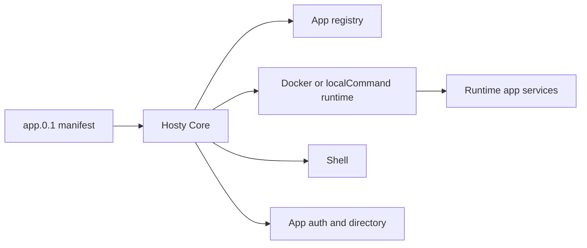

# Documentation

## Overview

Hosty is a local application orchestrator with a headless Core API, Core-managed Shell and Marketplace system apps, and user runtime apps. New local development and testing use runtime apps installed from `app.0.1` manifests.

The direction it is built toward — a modular platform for personal and shared environments,
assembled from independent applications — is recorded in [Hosty platform vision](vision.md).
Optional human and agent workflows compose the platform's capabilities; the
[Composable Human And Agent Work Draft](features/composable-agent-systems/plan.md) maps existing
blocks, missing contracts and their investigation order.

[Ideas](ideas.md) collects raw possibilities and questions that may expand or complement that
vision, before they are concrete enough for a Draft plan. It is a living collection outside the
feature status index.

## Documents

Every feature folder is listed below with its summary and, where it has a plan, the plan's status,
deliverable progress and last update. The list is generated from each document's frontmatter;
the format and the rules for writing documents are in the Documentation section of
[AGENTS.md](../AGENTS.md).

<!-- docs-index:begin -->

_Generated by `scripts/docs-index.mjs --fix` — do not edit this block by hand._

### Features

Plans: 13 In Progress · 1 Blocked · 46 Draft · 7 On Hold.

- [Accent Presets](features/accent-presets/plan.md) — A per-user brand color preset chosen like the light or dark theme and carried to embedded apps; parked while ink and lime stay fixed. · On Hold, 0/2, updated 2026-10-13
- [Access Tokens — Credentials For Clients Without A Browser](features/access-tokens/feature.md) — Device-flow access tokens that let clients without a browser engine sign in to Core, with Shell metadata management and compact trusted Core credential actions.
- [Advertised App Origins — Advertise A Host-Published Endpoint At A Usable Address](features/advertised-app-origins/plan.md) — Advertise endpoints already published beyond loopback at one host-wide address that other devices can use. · Draft, 0/8, updated 2026-07-30
- [Synthetic Agent App Evaluations](features/agent-app-evaluations/plan.md) — Use agents as bounded exploratory app testers whose findings are reproduced and triaged independently. · Draft, 0/3, updated 2026-10-13
- [Agent Background Sessions](features/agent-background-sessions/feature.md) — Assistant sessions that keep working after the tab closes and notify the operator when they wait for a person.
- [Agent MCP Directory](features/agent-mcp-directory/feature.md) — Core enforces installation-bound assistant MCP access and tool exclusions; Harness owns invocation preferences and independent skill selections.
- [Persistent Agent Participants](features/agent-participants/plan.md) — Persistent agent participants with explicit access, attribution and responsible humans, separate from profiles, providers and executions. · Draft, 0/4, updated 2026-10-26
- [Agent And Model Provider Interface](features/agent-provider-interface/plan.md) — Explore a shared app-facing interface for independently provided agents and models, including multi-model providers and structured results. · Draft, 0/6, updated 2026-10-26
- [Shared Agent Skills](features/agent-skills/feature.md) — A shared Core library of complete Git and app skill packages with manual updates, stable selections and current-file exports for native agents.
- [AI Agent Bridge](features/ai-agent-bridge/feature.md) — The umbrella model for Hosty's AI integration, covering component boundaries, execution profiles, token mechanics and the decision log.
- [Hosty Harness](features/ai-gateway/feature.md) — Hosty Harness, the optional administrator assistant app hosting operator chat sessions on a host-resident agent harness.
- [Hosty Harness Chat Components](features/ai-gateway-chat-ui/feature.md) — The chat components Harness uses for messages, code blocks, attachments, the composer and collapsible activity.
- [Hosty Harness Provider Connections](features/ai-gateway-providers/feature.md) — Named Claude and Codex agent connections that administrators manage in the Harness Providers settings.
- [App Activity Window](features/app-activity-window/feature.md) — Legacy activity-window compatibility and current continuous authority for privileged app operations and assistant conversations.
- [App Authoring In Hosty](features/app-authoring/plan.md) — Epic for prompt-driven app creation, live iteration, integration with installed apps and optional publication. · Draft, 0/8, updated 2026-10-26
- [Feature: App Cache Storage](features/app-cache-storage/feature.md) — A Core-managed per-app cache directory that persists across restarts and updates but is never backed up.
- [App Code Exchange](features/app-code-exchange/feature.md) — Authorization codes require target-app service identity and private S256 proof, with browser-origin and nonce-bound sign-in attempts. · [plan](features/app-code-exchange/plan.md): Blocked, 16/20, updated 2026-10-08
- [App Installation And Configuration Experience](features/app-configuration-experience/feature.md) — Default-only installation, shared configuration readiness and optional app-author guidance for manifest and app-owned settings.
- [Feature: App Data Backup Retention](features/app-data-backup-retention/feature.md) — Retention and cleanup of app data backups, which cover only each app's primary data directory. · [plan](features/app-data-backup-retention/plan.md): Draft, 0/2, updated 2026-10-05
- [Development Controls For Existing Apps](features/app-development-controls/feature.md) — Core-owned execution selection runs installed packages or registered workspace manifests on ordinary app data, with scoped access review and recoverable lifecycle operations. · [plan](features/app-development-controls/plan.md): In Progress, 8/10, updated 2026-10-24
- [App Embedding Restrictions — Only Operator-Designated Embedders May Frame An App](features/app-embedding-restrictions/plan.md) — Restrict app framing to operator-designated embedders while preserving the assistant browser runner. · On Hold, 0/7, updated 2026-10-10
- [App Feedback Inbox](features/app-feedback-inbox/plan.md) — Durable draft app observations, administrator triage and reviewed batch delivery with optional assistant grouping into development sessions. · Draft, 0/6, updated 2026-10-26
- [Runtime App Feeds](features/app-feeds/feature.md) — Apps publish named update sources in an app-owned feeds.json that Core validates and follows without a catalog or Marketplace.
- [App Installation SDK And Core Confirmation](features/app-installation-sdk/feature.md) — A shared install dialog for Marketplace and Shell, with final authorization on a separate Core-origin confirmation page.
- [App Lifecycle States — Intermediate `starting` And `stopping`](features/app-lifecycle-states/feature.md) — Intermediate starting and stopping runtime states, so every client sees a lifecycle action while it is in flight.
- [App-Owned MCP](features/app-mcp/feature.md) — Runtime apps expose domain actions through an MCP endpoint they own, and Core tells agent clients which apps have one.
- [App Permission Management](features/app-permission-management/feature.md) — Per-app permission reviews and a host-wide Security overview of Core permissions, provider roles and their installed-app holders.
- [Local App Creation From Harness](features/app-prototype-workspaces/feature.md) — Local Git app creation, child Core Docker preview, local acceptance, remote publication and versioned development guidance through Harness, MCP and CLI.
- [App-Provided Skill Packages](features/app-provided-skills/feature.md) — Apps supply multiple complete SKILL.md packages to Core through stable agent.skills declarations.
- [App Publication](features/app-publication/plan.md) — Repository provisioning, installable releases and feeds, and catalog promotion for apps built in Hosty. · Draft, 0/7, updated 2026-10-26
- [App Readiness — Readiness Is Health](features/app-readiness/feature.md) — Readiness is per-service health, probed by default and read by every consumer before it uses an endpoint.
- [Core Application Resource Policy](features/app-resource-policy/plan.md) — Operator-owned Core defaults and per-application resource limits, independent of app manifests and bounded by environment policy. · Draft, 0/7, updated 2026-10-21
- [Core Sandbox Instances](features/app-sandbox-runtimes/feature.md) — Independent app sandboxes and parent-managed child Core environments with separate data, shared Docker, lifecycle recovery and Harness and Shell controls. · [plan](features/app-sandbox-runtimes/plan.md): In Progress, 29/31, updated 2026-10-21
- [App Secrets Store](features/app-secrets-store/feature.md) — A Core-managed keychain for secrets an app obtains at runtime, stored outside backups, with clients in both SDKs. · [plan](features/app-secrets-store/plan.md): Draft, 0/5, updated 2026-09-06
- [App UI Surfaces](features/app-ui-surfaces/feature.md) — Apps declare where their pages belong, such as settings, panels or navigation, and Shell places them.
- [Assistant Action Summary](features/assistant-action-summary/plan.md) — A readable summary of the tools and MCP calls an agent used during a session. · Draft, 0/3, updated 2026-09-26
- [AHP Client Interface For Hosty Sessions](features/assistant-ahp/plan.md) — Evaluate AHP as a replaceable external client interface over Hosty's existing session implementation. · Draft, 0/5, updated 2026-09-29
- [Assistant App Context](features/assistant-app-context/feature.md) — Administrators attach up to 16 installed apps to an assistant session as shared context for Claude and Codex.
- [Assistant MCP Approval Rules](features/assistant-approval-rules/feature.md) — A shared per-tool MCP policy for Claude and Codex with Ask, Run unprompted and Disabled controls. · [plan](features/assistant-approval-rules/plan.md): Draft, 0/8, updated 2026-10-18
- [Assistant Attachments](features/assistant-attachments/feature.md) — Files attached in the assistant composer land in the session's working directory and are recorded in the transcript.
- [Shared Assistant Development Sessions](features/assistant-development-sessions/plan.md) — Umbrella for assistant sessions that own a conversation, its source workspaces, tests and pull requests. · Draft, 0/3, updated 2026-10-26
- [Assistant Entry Points](features/assistant-entry-points/feature.md) — The assistant docks as a Shell panel reachable from every page, and apps can hand it context without driving it. · [plan](features/assistant-entry-points/plan.md): In Progress, 4/6, updated 2026-09-27
- [Assistant Execution Authorization](features/assistant-execution-authorization/plan.md) — Deferred execution-scoped credentials for assistant and external-agent source operations, independently of the workspace viewer. · Draft, 0/3, updated 2026-10-20
- [External Agent Session Context](features/assistant-external-session-context/plan.md) — Let an authenticated local external agent read a Hosty session, work in its registered folders and save a report back. · Draft, 0/3, updated 2026-10-07
- [Assistant Pull Request Lifecycle](features/assistant-pr-lifecycle/feature.md) — GitHub pull request publication, review, merge and completion for assistant session workspaces.
- [Assistant Provider Permissions](features/assistant-provider-permissions/feature.md) — Apps request the assistant role with provides, and Core records administrator-confirmed roles.
- [Agent Host And Session Containment](features/assistant-runtime-containment/plan.md) — Remaining per-session execution isolation, scoped access and verified shutdown; the shared Docker worker is implemented and verified separately. · Draft, 0/10, updated 2026-10-20
- [Assistant Session Autonomy](features/assistant-session-autonomy/feature.md) — A per-chat Normal or Autonomous mode that controls whether native commands and file changes ask for approval.
- [Assistant Session Workspaces](features/assistant-session-workspaces/feature.md) — Logical workspaces group repository worktrees with explicit session membership, compatible Git operations and an authorized inspection API.
- [Shared Docker Agent Runtime](features/assistant-shared-docker-runtime/feature.md) — Harness runs declared API and Worker services over authenticated HTTP and SSE, with shared Core-owned source access and native model and reasoning-effort selection. · [plan](features/assistant-shared-docker-runtime/plan.md): In Progress, 10/12, updated 2026-10-21
- [Shared Assistant History And Provider Switching](features/assistant-shared-history/plan.md) — Durable session events and cross-provider context so one conversation can switch between Claude and Codex. · Draft, 0/6, updated 2026-10-26
- [Assistant Timeline And Tool Analysis](features/assistant-timeline-analysis/plan.md) — A session timeline for analysing how agents work and which MCP tools would help them. · Draft, 0/3, updated 2026-09-26
- [Audit Log — A Bounded, Append-Ordered Trail](features/audit-log/feature.md) — Core's bounded audit trail records security and lifecycle events, constrains exported metadata and searches retained history with explicit limits.
- [Auth And Gateway Model](features/auth-gateway/feature.md) — Core owns user authentication, app assignments, identity issuance and scoped directory access, while apps own their sessions.
- [Auth Provider Extensions](features/auth-provider-extensions/plan.md) — External identity providers, password reset and durable login throttling beyond local password login. · Draft, 0/7, updated 2026-10-10
- [Auth Session Lifecycle And Recovery](features/auth-session-lifecycle/feature.md) — The identity error contract, opaque app session grants, sliding lifetimes and session recovery through Core login.
- [Feature: Automatic Runtime App Ports](features/automatic-runtime-app-ports/feature.md) — Core reserves host ports at install, injects them into the environment and lets operators reassign or pin them. · [plan](features/automatic-runtime-app-ports/plan.md): Draft, 0/10, updated 2026-10-21
- [Cardputer Operator Shell](features/cardputer-shell/feature.md) — Native Cardputer ADV console with early app status, explicit refresh and bounded Core operations. · [plan](features/cardputer-shell/plan.md): In Progress, 7/12, updated 2026-10-23
- [CI Feedback Loop](features/ci-feedback-loop/feature.md) — Affected component CI, explicit local integration checks and publication of verified main revisions.
- [CLI Bootstrap](features/cli-bootstrap/feature.md) — The hosty CLI installs itself and Core, discovers the Core control API and manages runtime apps.
- [Feature: Cloudflare Ingress](features/cloudflare-ingress/feature.md) — An opt-in Cloudflare Tunnel provider that publishes app endpoints and derives their public origins.
- [Composable Human And Agent Work](features/composable-agent-systems/plan.md) — Map reusable capabilities for shared tasks, agent participants, decisions and artifact handoffs, with explicit workspace choices, existing owners and memory deferred. · Draft, 0/5, updated 2026-10-26
- [Container Capabilities And Devices](features/container-capabilities/feature.md) — A docker service can add named Linux capabilities and device nodes under /dev, opt-in per service and never as --privileged.
- [Continuous App Access](features/continuous-app-access/feature.md) — Silent maintenance of browser and native app sessions, with separately authorized and revocable background delegation.
- [Core API](features/core-api/feature.md) — Core's browser and control APIs and the serialization rules every endpoint must follow.
- [Core App Shell](features/core-app-shell/feature.md) — Shell is the Core-managed browser UI app that authenticates users and embeds app pages.
- [Core Confirmation Design](features/core-confirmation-design/feature.md) — Shared local typography, light and dark cards, accessible forms and outcomes for Core authentication and trusted operation confirmations.
- [Core Development Mode](features/core-dev-target/feature.md) — Run Core from source in Debug, restart into isolated build generations and switch back to the installed release. · [plan](features/core-dev-target/plan.md): In Progress, 0/3, updated 2026-10-23
- [Core Event Bus — Ephemeral Domain Events Over A Unified SSE Stream](features/core-event-bus/feature.md) — One authorized SSE stream carries ephemeral domain hints, notifications and opt-in resource measurements and workspace metadata hints.
- [Core Extension Model](features/core-extension-model/feature.md) — Current boundaries between runtime apps, confirmed provider roles, Core permissions and platform-owned operations.
- [Core Lifecycle Parallelism](features/core-lifecycle-parallelism/feature.md) — Core runs per-app lifecycle work concurrently and queries Docker in batches.
- [Core MCP](features/core-mcp/feature.md) — Core MCP exposes app state, logs and bounded audit search, with explicit grants for lifecycle actions and reviewed updates.
- [Core's Own Public Origin](features/core-public-origin/feature.md) — Core's public origin is a live setting, editable in Shell and publishable through the Cloudflare provider.
- [Core Read-Path Caching](features/core-read-path-caching/feature.md) — Core serves hot reads from in-memory caches guarded by on-disk file stamps.
- [Core Runtime Parameters — Two Launch Flags, Everything Else Lives Inside](features/core-runtime-parameters/feature.md) — Core launches with only a data root and a port, and everything else lives in the instance's settings store.
- [Core Service Unit — Surviving A Reboot](features/core-service-unit/plan.md) — Parked idea for an OS service unit that starts Core again after a host reboot. · On Hold, 0/1, updated 2026-09-01
- [Core Single Binary — One Executable For Server And Terminal](features/core-single-binary/plan.md) — Parked decision on whether the CLI and Core merge into one executable. · On Hold, 0/1, updated 2026-09-01
- [Core Source Inspection](features/core-source-inspection/feature.md) — The development-mode Core row shows branch and changed-file statistics through a read-only Core API.
- [A Single Core Review For App Updates](features/core-update-review/feature.md) — One Core-owned consent page for review-required app updates, with frozen change metadata and direct routine update actions.
- [Cross-App Auth — Identifying the Caller on App-to-App Control APIs](features/cross-app-auth/plan.md) — Providers learn which installed app is calling their control API by introspecting the caller's service token against Core. · Draft, 0/8, updated 2026-10-26
- [Cross-App Dependencies — Declared Providers, Injected URLs, And Reported State](features/cross-app-dependencies/feature.md) — Apps declare dependencies on other installed apps, Core injects their URLs and reports their state. · [plan](features/cross-app-dependencies/plan.md): Draft, 0/6, updated 2026-10-10
- [Cross-Port Session Capture — A Captured Core Cookie Must Not Carry Core Authority](features/cross-port-session-capture/plan.md) — Prevent captured Core browser cookies from authorizing requests replayed by an app on another port. · Draft, 0/10, updated 2026-10-06
- [Default Applications](features/default-applications/plan.md) — Proposed shared defaults for host UI and assistants, with personal overrides, explicit migration and no silent replacement of selected providers. · Draft, 0/5, updated 2026-10-26
- [Assistant MCP Delegation](features/delegated-token-exchange/feature.md) — Core grants individual assistants access to selected MCP targets through administrator-configured delegation.
- [Demo App](features/demo-app/feature.md) — The repository-local reference app used to validate lifecycle, identity, directory access and app roles.
- [Dependency-Ordered Startup](features/dependency-ordered-autostart/feature.md) — Required dependencies gate manual and automatic startup with a durable waiting state and event-driven recovery.
- [Design System](features/design-system/feature.md) — Shared web tokens, local fonts and scoped SDK chrome, with Shell, Harness, Marketplace and Telemetry adoption and an in-place credential grid. · [plan](features/design-system/plan.md): In Progress, 25/51, updated 2026-10-26
- [Documentation Workflow](features/documentation-workflow/feature.md) — Workflow documents carry YAML frontmatter and stable deliverable IDs, checked by one validator shared by every Hosty repository.
- [Documents App](features/documents-app/feature.md) — Read current application documentation, source-defined plans and workspace progress from Git, with version-aware links, attention and assistant drafts.
- [Feature: Domain Model](features/domain-model/feature.md) — The shared vocabulary for Core, Shell, the CLI and runtime apps.
- [Durable Agent Jobs And Continuation](features/durable-agent-jobs/plan.md) — Durable agent job execution, schedules, retry and resource budgets, notifications and recoverable decision waits using existing authority and resource APIs. · Draft, 0/6, updated 2026-10-26
- [Embedded App Chrome](features/embedded-app-chrome/feature.md) — Navigation visibility uses explicit SDK composition policy while legacy launch modes retain transport and old-client compatibility.
- [Embedded App Sign-In](features/embedded-app-sign-in/feature.md) — Embedded apps keep their own per-tab sign-in grant and sign in silently through Core without Shell handling their codes.
- [External Development Workspaces](features/external-development-workspaces/feature.md) — Local external agents use authorized Core-owned worktrees, separate plan progress, and read-only pull request tracking through Harness and Core. · [plan](features/external-development-workspaces/plan.md): Draft, 0/6, updated 2026-10-18
- [External Host-Path Mounts](features/external-mounts/feature.md) — Apps declare external mount slots and operators bind host folders to them, injected as HOSTY_MOUNT_{KEY} and never backed up or deleted.
- [Global (Shared) Host-Path Mounts](features/global-mounts/feature.md) — A host-level library of shared host folders that apps attach by reference.
- [Harness Context Usage](features/harness-context-usage/feature.md) — Current context-window usage for Claude and Codex conversations, with durable replay and a compact composer indicator.
- [Harness Development UI](features/harness-development-ui/feature.md) — Harness combines conversation navigation, multi-repository workspace details, sandbox previews and verified lifecycle actions.
- [Harness Session Retention](features/harness-session-retention/feature.md) — Harness expires reconciled chats, protects attached development sessions and recovers previously accepted cleanup without deleting shared source implicitly.
- [Harness Work Orchestration](features/harness-work-orchestration/plan.md) — Compose shared work capabilities in Harness with agent profiles, optional hierarchy, task coordination and one tasks, decisions and artifacts experience. · Draft, 0/6, updated 2026-10-26
- [Host Networking](features/host-networking/feature.md) — A docker service can run with network host to share the host network namespace, for peer-to-peer workloads the bridge NAT throttles.
- [Hosty App SDK](features/hosty-app-sdk/feature.md) — The shared app-side Host integration published as an npm package and a NuGet package. · [plan](features/hosty-app-sdk/plan.md): In Progress, 1/7, updated 2026-10-08
- [Hosty App Skill](features/hosty-app-skill/feature.md) — The repository ships hosty-app-skill, an agent skill for creating, wrapping, updating and validating Hosty runtime apps.
- [Hosty Delivery Readiness](features/hosty-delivery-readiness/plan.md) — Local demo priorities through November 5 for host-contained agents, workspace Docker sandboxes, app creation, Git review, optional feedback and gradual redesign. · Draft, 0/3, updated 2026-10-26
- [Hosty Harness Integration](features/hosty-harness-rename/feature.md) — Hosty Harness replaces the former AI Gateway as the administrator assistant and MCP facade app.
- [Hosty Harness Swift Client](features/hosty-harness-swift/plan.md) — A native Swift client for Hosty Harness sessions, approvals and changes, aimed at phone use. · Draft, 0/8, updated 2026-09-29
- [Hosty Initialization](features/hosty-initialization/feature.md) — Core-owned first-run initialization selects applications, persists automatic ports and opens ordinary administrator setup from CLI or Dashboard environments. · [plan](features/hosty-initialization/plan.md): In Progress, 9/11, updated 2026-10-21
- [Hosty MCP Connector](features/hosty-mcp-connector/feature.md) — hosty mcp, a stdio MCP server in the CLI that presents every app on one host as a single server.
- [Hosty Overlay](features/hosty-overlay/feature.md) — SDK-owned React overlay combines session and required-permission readiness, hides blocked content and preserves same-user state through recovery.
- [Internal Endpoint Exposure — Keep Machine-Only Routes Off The Published Origin](features/internal-endpoint-exposure/plan.md) — Keep machine-only internal routes off the published ingress origin. · Draft, 0/4, updated 2026-09-06
- [Local Browser Origins](features/local-browser-origins/feature.md) — Core derives local browser addresses under hosty.localhost without stored public origins or DNS. · [plan](features/local-browser-origins/plan.md): In Progress, 31/40, updated 2026-10-10
- [Local Development And Testing](features/local-development/feature.md) — The Core-managed local development and test loops for Core, Shell and runtime apps.
- [Local Password Login](features/local-password-login/feature.md) — Core-owned email and password setup, recovery, invitations and login.
- [Local OPUS Translation](features/local-translation/feature.md) — Independent OPUS-MT Big CPU translation app for English-to-Russian text and protected Markdown, with pinned native dependencies and verified model caching.
- [Manifest-Level App Assets](features/manifest-level-app-assets/feature.md) — An app's icon, screenshots and markdown description live in its own repository and Core serves them for installed apps. · [plan](features/manifest-level-app-assets/plan.md): Draft, 0/3, updated 2026-10-05
- [Manifest Projection Backfill](features/manifest-projection-backfill/feature.md) — A Core upgrade re-projects installed app records from their manifests without operator action.
- [MCP Facade — One Remote Endpoint For The Whole Fleet](features/mcp-facade/feature.md) — A Harness MCP endpoint that exposes Core and every enabled app's tools through one remote entry. · [plan](features/mcp-facade/plan.md): On Hold, 0/6, updated 2026-10-10
- [MCP OAuth — Automated Issuance For Scoped Tokens](features/mcp-oauth/feature.md) — Core acts as an OAuth 2.1 authorization server so MCP clients obtain and rotate scoped tokens themselves.
- [Mixed Development Runtimes](features/mixed-development-runtimes/feature.md) — Development profiles can combine Docker and local-command services and run editable source inside Docker. · [plan](features/mixed-development-runtimes/plan.md): In Progress, 10/13, updated 2026-09-17
- [Notifications](features/notifications/feature.md) — A Core-owned per-user notification inbox with app and Core producers and live delivery to any client. · [plan](features/notifications/plan.md): Draft, 0/7, updated 2026-10-26
- [OAuth Core Control Scopes](features/oauth-core-control-scopes/feature.md) — OAuth consent can grant Core MCP lifecycle and update scopes in addition to read.
- [Object Links](features/object-links/plan.md) — Typed app-owned object links with Core target resolution and SDK host placement, leaving shared-object viewers and defaults as separately approved extensions. · Draft, 0/5, updated 2026-10-20
- [Feature: Observability (telemetry collection, storage, and UI)](features/observability/feature.md) — OpenTelemetry from apps flows to a collector, an SQLite-backed telemetry backend and the telemetry UI app. · [plan](features/observability/plan.md): In Progress, 7/12, updated 2026-10-22
- [Plan Provider Interface](features/plan-provider-interface/plan.md) — Early ideas for an optional plan-provider interface across Markdown specification-driven plans, task trackers and checklists, with possible MCP tools. · Draft, 0/4, updated 2026-10-26
- [Plan Tracking](features/plan-tracking/feature.md) — Core source-document access, target freshness and workspace projections for Documents and other authorized readers.
- [Private App Sources](features/private-app-sources/feature.md) — Core reads private repository manifests and sources through explicitly selected personal provider connections.
- [Private Distribution Access](features/private-distribution-access/plan.md) — Authenticate private feeds, release assets and container registries independently of source access. · Draft, 0/4, updated 2026-09-28
- [Provider Consumption And Speech Recognition](features/provider-consumption/feature.md) — Apps discover and call confirmed speech, translation and assistant providers with short-lived Core credentials. · [plan](features/provider-consumption/plan.md): In Progress, 1/4, updated 2026-10-10
- [Feature: Public Origins](features/public-origins/feature.md) — An endpoint's public origin is a durable property of the endpoint that exists before the app first starts.
- [Raw L4 Port Publishing](features/raw-ports/feature.md) — A docker service port can opt into publishing on all interfaces over TCP and UDP with expose and transport.
- [Removable System Apps — Distribution Catalog and One Lifecycle](features/removable-system-apps/feature.md) — First-party apps are ordinary runtime apps selected from a distribution catalog during initialization and removable like any other. · [plan](features/removable-system-apps/plan.md): Draft, 0/4, updated 2026-10-24
- [Replaceable UI Clients — The `ui-client` Role And Primary Selection](features/replaceable-ui-clients/plan.md) — Proposed replaceable browser UIs using confirmed roles and shared defaults, preserving app authorization and Core-owned recovery when the selected UI is unavailable. · Draft, 0/7, updated 2026-10-24
- [Repository And Release Model](features/repository-release-model/feature.md) — The repository layout, release artifacts and versioning rules for every component.
- [Runtime App Manifest](features/runtime-app-manifest/feature.md) — The app.0.1 manifest contract for installing and running runtime apps.
- [Marketplace System App](features/runtime-app-marketplace/feature.md) — The optional Marketplace app that owns catalog discovery and requests Core-confirmed installations. · [plan](features/runtime-app-marketplace/plan.md): Draft, 0/6, updated 2026-09-26
- [Runtime App Update](features/runtime-app-update/feature.md) — Reviewed update plans and their apply behavior, including permission changes and routine updates. · [plan](features/runtime-app-update/plan.md): Draft, 0/5, updated 2026-10-05
- [Runtime Artifact Model](features/runtime-artifact-model/feature.md) — Runtime profiles pair a command recipe with an execution type and deliver immutable prebuilt folders. · [plan](features/runtime-artifact-model/plan.md): Draft, 0/6, updated 2026-09-26
- [Unified runtime resource usage](features/runtime-resource-usage/feature.md) — One Core resource sampler for containers, local process trees and Core itself, shared by Dashboard and Telemetry.
- [Runtime Source Workflows](features/runtime-source-workflows/feature.md) — Source checkouts, local overrides and runtime switching for installed apps, with Git inspection. · [plan](features/runtime-source-workflows/plan.md): On Hold, 0/6, updated 2026-10-18
- [Scoped Access Tokens — Audience-Bound Credentials For External Clients](features/scoped-access-tokens/feature.md) — Access tokens can be bound to one audience and a set of scopes, validated against live state on every call.
- [SDK Panel System](features/sdk-panel-system/feature.md) — Shared SDK panels compose app-owned tools beside documents in Shell and standalone, with verified peers and pinned presentation targets.
- [SDK Style Isolation](features/sdk-style-isolation/plan.md) — Draft ownership and compatibility design for isolating SDK chrome styles from app content while preserving authentication and retained UI contracts. · Draft, 0/6, updated 2026-10-26
- [SDK UI Composition](features/sdk-ui-composition/feature.md) — Explicit navigation and tool policy, manifest navigation, and retained tool instances shared by Shell, desktop hosts and standalone apps.
- [Settings Experience](features/settings-experience/feature.md) — Shell unifies personal, host and application settings; Core confirms protected changes while Harness owns invocation preferences and skill selections.
- [Shared Work Artifacts And Handoffs](features/shared-artifacts/plan.md) — Minimal described and versioned work artifacts with authorized save, discovery and reads, durable references and explicit agent handoffs. · Draft, 0/4, updated 2026-10-26
- [Shared Decisions And Human Response](features/shared-decisions/plan.md) — Persistent addressed decision requests, authorized resolution and durable continuation handoff beyond an individual live session. · Draft, 0/4, updated 2026-10-26
- [Shared Tasks And Executor Bindings](features/shared-tasks/plan.md) — Shared observable tasks, assignments, child relationships and resource bindings with replaceable executors and app-owned workflow state. · Draft, 0/5, updated 2026-10-26
- [Shell Access And System Apps](features/shell-access-and-system-apps/feature.md) — Assignments apply equally to system and ordinary apps, and management views are administrator-only.
- [Shell Navigation](features/shell-navigation/feature.md) — Shell routes, role-specific home, sidebar app launchers and phone navigation.
- [Shell operation feedback](features/shell-operation-feedback/feature.md) — Shell separates confirmations, transient operation results and persistent diagnostics.
- [Resizable Shell Panel](features/shell-panel-resize/feature.md) — Shell-owned ReUI document and panel containers with persistent resizing, responsive drawers and retained SDK app frames.
- [Source Providers](features/source-providers/feature.md) — Core owns a typed source-provider registry with built-in GitHub, owner-scoped connections and Shell account management.
- [Swift Shell](features/swift-shell/feature.md) — A native SwiftUI client for iOS, iPadOS and macOS that manages a host's installed apps.
- [Telemetry Over MCP](features/telemetry-mcp/feature.md) — Stored logs, traces and resource metrics exposed as an MCP interface behind a scoped credential.
- [Tool Activity](features/tool-activity/feature.md) — Per-user tool activity flows from app servers through Core to Tools, including unopened panels, presence expiry and restart recovery.
- [Translation Providers](features/translation-provider/feature.md) — Core translation discovery and scoped invocation, SDK clients, and two static Harness variants for translating text and Markdown plans.
- [Isolated User Agent Sessions](features/user-agent-sessions/plan.md) — Deferred non-admin agent conversations with verified execution isolation and MCP calls limited to the acting user's current rights. · On Hold, 0/6, updated 2026-10-10
- [User Management](features/user-management/feature.md) — Administrators invite, disable, delete and assign app access to Host users from the Shell User Management view.
- [User Profile And Provider Connections](features/user-profile-connections/feature.md) — Shell manages personal GitHub accounts and Git identity through Core-owned connections and narrow app permissions.
- [Workspace Event Observation](features/workspace-event-observation/feature.md) — Core observes workspace changes through filesystem and mutation events, while Harness consumes authorized SSE updates.
- [Workspace Lifecycle Controls](features/workspace-lifecycle-controls/feature.md) — Core coordinates workspace pause, verified completion, conservative deletion and separately confirmed physical removal of unwanted unfinished work.
- [Core Source And Workspace Activation](features/workspace-live-activation/feature.md) — Select named app workspaces or installed package runtimes with scoped access review, retained package choices and recoverable Core-owned transitions.
- [Multiple Sessions In A Shared Workspace](features/workspace-sessions/feature.md) — Explicitly shared workspaces support concurrent private sessions, scoped source access, attributable activity and independent conversation lifetimes.
- [Workspaces App Retirement](features/workspaces-app/feature.md) — Retirement of the standalone Workspaces app; Core workspace inspection and Harness agent sandbox workflows remain available.

<!-- docs-index:end -->
